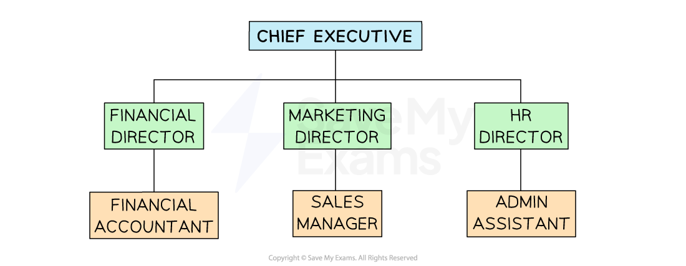
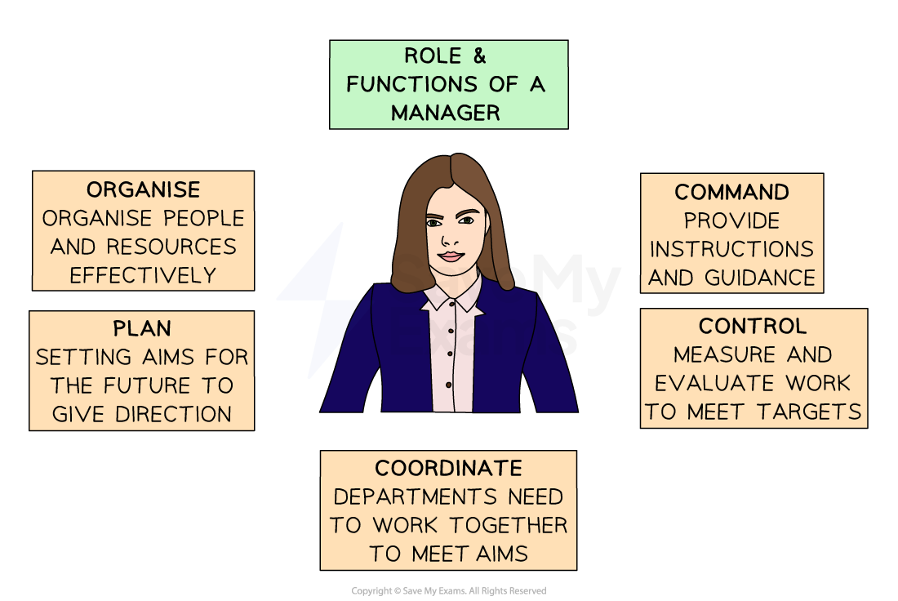

# The Role of Management

## Roles, Responsibilities and Organisational Relationships

> **Spec point** — `spcpt_5QX75jFSCt6VqrWb`

## Roles, responsibilities and organisational relationships

- The **organisational structure** of a business determines the roles, responsibilities and relationships in an organisation

  - Individuals at the top of the structure usually have more authority
  - Middle managers will have relationships with senior managers, other middle managers, and their subordinates
  - These hierarchies determine the formal routes through which **communication** often flows in a business

#### Possible business roles

*Many larger firms are arranged into functional departments such as Finance and marketing, which are led by directors who carry the final responsibility for the work of everyone in the department*

#### Managers

- **Managers** have** many responsibilities **in the business and help it to **operate effectively on a day-to-day basis**
- Types of managers include ***directors***, ***line managers*** and ***supervisors***

#### Roles and responsibilities of a manager

| **Job roles** | **Responsibilities** |
|---|---|
| **Owner/director** | - Establish the business’ **overall goals** - Set** long-term plans** and targets for the business |
| **Line manager** | - Work to **achieve the short and long-term targets** set by the owners or directors - May be **responsible for a function** within the business, e.g. marketing or finance - Use employees and other resources in the best possible ways |
| **Supervisors/team leaders** | - Help managers achieve their targets by **reporting any problems and passing on instructions** - Take** simple decisions,** such as allocating jobs among different employees |

## Role and Functions of Management

> **Spec point** — `spcpt_qqb2pVqPpfYbJHq8` · "• Functions of management, e.g. planning, organising, coordinating, commanding and controlling
• Importance of delegation; trust versus control"

## Role and functions of management

- The responsibilities of **managers are similar, **no matter the organisation in which they work

  - In **schools**
  
    - **Headteachers** organise the school's overall curriculum and staffing
    - **Heads of Department **manage teaching staff and subject course planning
    - **Pastoral Managers** focus on pupil behaviour and reward systems
    - **Site Managers** oversee the safety and maintenance of buildings and equipment

#### Manager roles

*Managers roles commonly include planning, organising, commanding and controlling*

**1. Planning**

- Setting targets or aims for the organisation or department to achieve which provide a clear sense of **purpose and direction**
- Managers also **plan and budget for resources required** to achieve targets

  - The number of people required
  - Finance and ***capital resources*** needed

**2. Organising**

- Once targets have been set, **managers should then organise the resources **including

  - Allocate tasks and delegate responsibility to employees
  - **Make changes** to ways of working to improve efficiency

**3. Commanding**

- Managers need to **guide, lead and supervise employees** in the tasks they do

  - Make sure staff meet deadlines and achieve individual or team targets
  - Provide feedback and direct staff to tasks

**4. Controlling**

- **Evaluate the performance** of employees and teams
- Investigate reasons for missed targets and implement changes
- Manage **budgets** and report to senior leaders
- Ensure effective **coordination between** **departments to** achieve the organisation’s aims

**5. Coordinating**

- **Encourage** groups of workers to communicate with each other and work towards the same goal
- Ensure all of the required **resources are available** to ensure objectives are met

## Delegation

> **Spec point** — `spcpt_2MvY8V6QhvwZDh8r`

## Delegation

- Delegation is a process where responsibility for specific **tasks is given to *****subordinates*** by managers

  - Delegation usually involves **transferring** **authority** from manager to subordinate
  - E.g. the Human Resources Director of a large company** delegates authority** for recruitment and training to the Recruitment and Training Manager

#### The advantages of delegation

| **Advantages for managers** | **Advantages for workers** |
|---|---|
| - Allows managers to **concentrate on important tasks**    - Managers do not have the time to do complete every task themselves | - Delegation allows workers to **feel empowered in decision making**    - This can **motivate **as staff are trusted to perform a job well |
| - Helps managers to **measure the performance of their staff** as they can judge how well subordinates carry out these tasks | - Provides **a form of training** as workers learn on the job thus increasing job opportunities to progress within the organisation |
| - Can help to **reduce errors** if managers delegate    - Workers may be skilled in certain areas and have sufficient time to complete the task to a higher standard | - Makes employees **work more interesting and rewarding**    - This could reduce absenteeism and labour turnover |

- Some managers are reluctant to delegate as they** lose some control over decision-making**

  - Managers may need support to be able to balance trust and control to delegate appropriate tasks
  - ***Autocratic*** leaders may not be willing to give authority to others
  - Some managers may feel **threatened **by highly skilled subordinates seeking promotion
