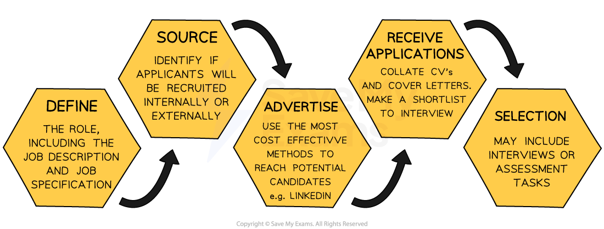

# Choosing the Right Employee

## The Employee Recruitment Process

> **Spec point** — `spcpt_vYV5SGDSttqyvRtt`

## The employee recruitment process

- The **recruitment and selection process** details the **steps a business takes when bringing new employees into a business**
- A manager or HR employee is usually nominated to **manage the application process**

  - This person (possibly together with others) will draw up a **shortlist **of candidates from the applications received
  - The shortlist is a list of candidates who are** invited to interview** or asked to complete an assessment tas

#### Stages in the recruitment process

*The recruitment process starts by defining the role the business wants applicants to apply for*

### Step 1: Defining the role

- Businesses should determine exactly what is required and part of that is developing a job description and a person/job specification

  - **A job specification** (sometimes known as a **person specification**) outlines the qualifications, skills, experience, and personal qualities required **from a candidate** for a specific job e.g. problem solver, good communicator, able to code in Java etc.
  - **A job description **outlines the duties, responsibilities, and requirements of a particular job

#### Comparing a person specification with a job description

| **Job Specification ** | **Job Description** |
|---|---|
| - Details the essential and desirable characteristics of the **person** suitable for the job including    - Qualifications   - Experience   - Skills such as the ability to drive or IT capabilities   - Personal characteristics and attributes | - Details the features of the **job** including    - Duties   - Hours and location of the job   - Managerial or supervisory responsibilities   - Pay and conditions |

### Step 2: Identifying the source of required employees

- **Internal recruitment** involves a business promoting or ***redeploying*** workers that already work for them

  - Internal recruitment can be beneficial as it encourages employee development, builds morale and can save time and money on training
- **External recruitment **involves bringing in new workers from outside of the business

  - External recruitment can bring fresh ideas, experiences and perspectives to the organization

### Step 3: Advertising the role

- Roles may be **advertised internally **or** externally**

  - If the business is seeking an **internal candidate** business newsletters, staff noticeboards or internal email can be used to display job advertisements
  
    - ***Line managers*** may be asked to **recommend suitable candidates **following ***appraisals***
  - **External candidates** can be targeted with advertisements in newspapers, industry magazines, specialist recruitment websites, agencies and government-run agencies
  
    - **Existing employees** may be asked to **nominate people they know** for roles - sometimes they receive a reward of their nominee is successfully recruited
    - ***Headhunting*** can be used to fill high level roles
    - Businesses with a strong social media presence can use these platforms to advertise cost effectively e.g. Facebook, LinkedIn, TikTok
    - **Specialist recruitment portals** may be used to advertise
    
      - These tend to be expensive but target specific groups of potential applicants
      - E.g. The Times Educational Supplement is one of the main publications in the UK used to recruit teaching staff

### Step 4: Receiving applications

- The business may **accept applications from candidates** via ***Curriculum Vitae*** (CV) and **covering letter** or **application form**

- A **curriculum vitae** should be well laid out and clear and usually contains the following details:

  - Name and contact details
  - Qualifications and work experience
  - Positions of responsibility
  - Interests
  - The names and addresses of referees
- The accompanying** letter of application** should outline

  - Why the applicant wants the job
  - Why they would be suitable for the advertised role
- **Application forms** are often preferred in place of a CV

  - They usually ask for the **same information as the CV**
  - Sometimes **further information** that is specific to the job is requested
  - Applications from a selection of candidates can be **easily compared**
  - Many application forms are now **completed online**

#### Comparing application methods

| **Application form** | **Curriculum vitae (CV)** | **Covering letter** |
|---|---|---|
| - A **standardised **form **designed by the recruiter** to collect the same details from each candidate - Responses are collected in a **consistent format**and comparison is straightforward - A large volume of candidates can be **narrowed down** for interview | - A **professional document** **compiled by the applicant** - Details **career experience**, key **skills**and **strengths** - Includes **qualifications**and character/professional **referees** - Provides **contact details** for the recruiter to get in touch with the applicant | - A letter that **accompanies the candidate's application** form or CV - Gives **reasons for submitting** an application - Draws attention to the **applicant's particular suitability** for the role - Allows recruiters to **sift applications **without having to compare detailed application forms/CVs |

## The Employee Selection Process

> **Spec point** — `spcpt_MMpFz9NSQTPQGDnr`

## The employee selection process

### Step 5: Selection

- Once candidates have **submitted their applications** and the business has ***shortlisted*** suitable candidates, a variety of methods can be used to **select the right worker** for the role

#### Interviews

- Interviews are commonly used to meet with candidates

  - They usually include a face to face, telephone or online **discussion between a manager and the candidate **about their **suitability** for the role
  - It is important to prepare a **set of relevant questions** to ask all candidates and to ensure that the interview is conducted in a fair and consistent manner
  - Interview questions may focus on
  
    - **Skills and experiences** that are relevant to the job
    - **Successes and failures** - and how these were overcome
    - Personal** interests and experiences**

#### Selection tests

- Candidates may be asked to **undergo a test **to demonstrate their skills and suitability for the job
- **Candidates may be asked to complete **tests individually or within groups to assess how they may work as part of a team
- The different types of tests may include:

  - **Skills **tests (e.g. numeracy)** **show the ability of candidates to carry out certain tasks
  - **Aptitude** tests show the candidate’s potential to improve or increase their skills
  - **Intelligence** tests are used to assess the candidate’s ability to work at a desired level
  - **Personality** tests are used to identify desired characteristics or traits such as the ability to work effectively in a team

## Recommending Which Applicant to Employ

> **Spec point** — `spcpt_hWHPq34ZSqGcYgWk` · • Recommend and justify who to employ in given circumstances

## Recommending which applicant to employ

- The final decision of which applicant to employ depends on several factors
- Even when a suitable candidate is identified the business will need to think about **whether it can finalise their appointment **

  - Can the business fulfil the applicant's **pay and conditions demands**?
  - Can appropriate** fringe benefits **be offered?
  - Are attractive **development opportunities **available to the applicant?

#### Factors used to select the best applicant

| **Factor** | **Explanation** |
|---|---|
| **Experience** | - Which applicant has the most relevant work experience? - How might broader experiences help an applicant succeed in a specific role? |
| **Qualifications** | - Are formal qualifications **essential **for filling the post?    - E.g. A teacher may require a degree in their specialist subject, whilst a retail store manager's experience is likely to be more relevant than formal qualifications |
| **Internal or external candidate** | - How important is it that the **applicant already has a good understanding** of how the business operates? - Time may be saved on induction training and ***productivity*** may reach expected levels sooner than with an external candidate - How important is it that the new worker has **experience and skills gained from outside **the business? - New ideas, insights into competitor activities and different ways of working could contribute towards a businesses competitive advantage |
| **Gut feeling** | - Will the worker 'fit' in with the business's culture and values? |

> **Case Study**
> - A small children's bookshop business has received two applications for its advertised **sales assistant **role
> - The shop owner is keen to select a **knowledgeable** candidate who is capable of delivering **good customer service**, **communicating effectively** with its (often young) customers and being willing to **support administrative tasks** such as banking cash
> - Which of these two applicants would likely be appointed?
> 
> 
> 
> #### Applicant analysis
> 
> - Amira scored better in the assessment tests. She was nearly 20% better in communication
> - Amira has had two weeks experience of working with kids, which will suit this role nicely
> - Amira also has a first aid qualification, which is a useful skill when working with kids
> - Overall, Amira is a better fit for the role advertised
