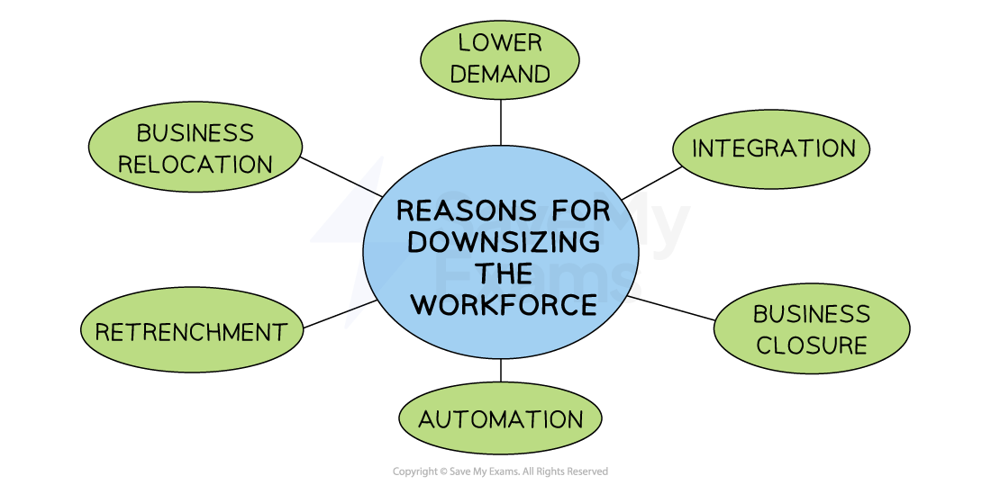

# Downsizing the Workforce

## Dismissal & Redundancy

> **Spec point** — `spcpt_fm933cBYvvnNjr3r` · "• Difference between dismissal and redundancy with examples
• Understand situations in which downsizing the workforce might be necessary, e.g. automation or reduced demand for products
• Recommend and justify which employees to make redundant in given circumstances"

## Dismissal and redundancy

- **Dismissal** (firing or sacking) is the **termination of employment by an employer** against the will of the employee

  - Employees are usually terminated due to their **misconduct **(e.g. violating company policy) or **poor performance**
  - The employer may choose to dismiss them immediately (without notice or compensation) or provide a notice period which they can work out
  - In some countries, an employee can take the business to court if they feel they were unfairly dismissed
- **Redundancy **is where a job role is no longer needed by a business and a worker is dismissed, usually with compensation

  - The legal process for selecting workers for redundancy must be very clear and fair

#### The factors used to determine who is made redundant

| **Worker productivity** | **Lateness or absence data** | **Length of time employed** | **Workers with essential skills** |
|---|---|---|---|
| - Productive workers are most likely to remain employed | - Reliable workers are less likely to be made redundant | - Long-standing employees are usually more expensive to replace | - Skilled workers could be transferred to other roles |

- Some workers are **happy** to be made redundant

  - This may be because they have another job they can go to, they want to retire early or they want to start their own business
  - Some businesses offer a good redundancy 'pay out' which is attractive to workers

## Downsizing the Workforce

> **Spec point** — `spcpt_mCb9PNwj6T9PTPbd`

## Downsizing the workforce

- **Workforce planning** is the process of determining the human resource needs for the foreseeable future, in terms of the **number and skills of employees required**

  - When expanding, a business often requires more employees
  - However, on some occasions they need to **downsize** the workforce (**reduce the number of employees)**

#### Reasons for downsizing

*Reducing business size can be caused by a range of factors including business relocation, falling demand and automation through the introduction of technology*

1. **Lower demand**

  - Is likely to reduce the volume of output a business needs to produce
  - Fewer workers are required to produce a reduced level of output
2. **Integration with other businesses **

  - Through ***mergers*** or ***takeovers*** could mean that some workers' roles are duplicated
3. **Business closure**

  - Will mean that only a few workers will be required to legally ***dissolve*** the organisation
4. **Automation**

  - involves more machinery being used in the business
  - Workers' jobs are replaced, with remaining workers focused on operating machinery
5. ***Retrenchment***

  - Is likely to mean that fewer resources of all types are required, including employees
6. **Business relocation **

  - may allow a business to reorganise its operations, requiring fewer employees
