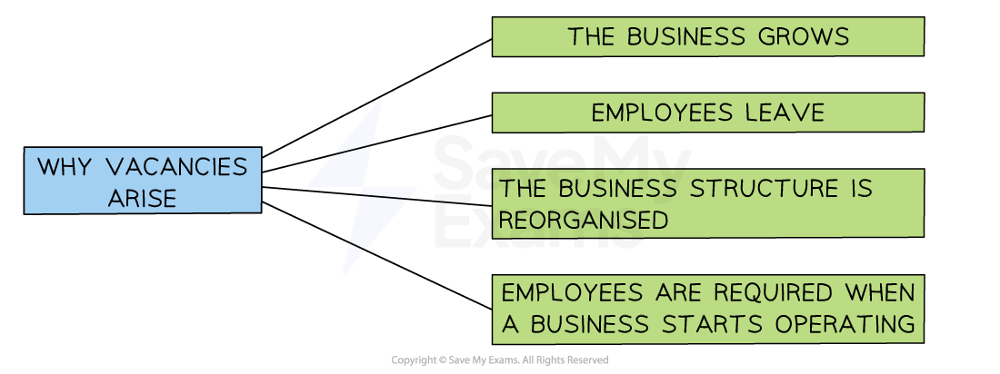

# Recruitment Methods

## An Introduction to Recruitment and Selection

> **Spec point** — `spcpt_gkqh9YBX42Z8X4DB` · • Recruitment and selection methods • Main stages in recruitment and selection of employees

## An introduction to recruitment and selection

- **Recruitment **is the process of **attracting and identifying potential job candidates** who are suitable for a particular role

  - Recruitment activities include **job advertising, job fairs, social media outreach and referrals** from current employees
  - The goal of recruitment is to **create a pool of qualified candidates** who can be considered for the role
- **Selection **is the process of **choosing the best candidate** from applications received

  - The goal of selection is to hire the **most suitable candidate** for the job
- A business will need to recruit and select a new employee(s) **when a vacancy arises** within the business

#### Reasons why vacancies arise

*Vacancies can arise for reasons including business growth, employees leaving and reorganisation*

- **During periods of business growth** more employees are needed as the business expands its operations
- When an employee **leaves their job** and needs replacing
- Businesses often reorganise their ***organisational structure*** which may result in the need for additional staff
- A **new business start-up** needs to recruit workers for the first time
- Businesses can choose to use a **recruitment agency** to carry out the recruitment and selection process on their behalf

  - New employees may be found **quickly** from its pool of available talent
  - Management **time **can be saved
  - Recruitment agencies usually charge a **finding fee** for their specialist services

> **Exam Hint**
> Make sure you know the difference between a job description and a person specification. You will be expected to know specific types of recruitment  documentation for the exam

## Internal and External Recruitment

> **Spec point** — `spcpt_qgpBDsPwvtcYwTB5` · Difference between internal recruitment and external recruitment

## Internal and external recruitment

- **Internal recruitment** involves **promoting or redeploying** employees that **already work for the business**
- **External recruitment** involves appointing an employee from **outside of the business**

#### Evaluating internal and external recruitment

| **Advantages of internal** | **Disadvantages of internal** |
|---|---|
| - The member of staff is already **familiar** with the business culture and working practices - The business is **aware of the employee's strengths and weaknesses** - There is no need for induction training - Expensive advertising is not needed - Employees can be ready to **start their new role immediately** | - When an employee moves to a new role their old job needs to be filled - There may be **resentment amongst employees** who are overlooked - **No new ideas or experience** come into the business which could limit creativity and innovation |
| **Advantages of external** | **Disadvantages of external** |
| - A **large number of applicants** may be attracted - **New recruits are usually highly motivated** and keen to impress - New ideas and experience are brought into the business | - New employees may need support from colleagues and induction training, which slows down productivity initially - **Advertising** for external staff **can be expensive** and take a long time - A candidate who performs well at interview may be unsuitable for the job when they start work |

> **Exam Hint**
> Be prepared to analyse why a business might recruit a senior manager externally rather than from internal applicants. One of the main reasons is to bring in outside expertise or skillset that does not exist in the business
