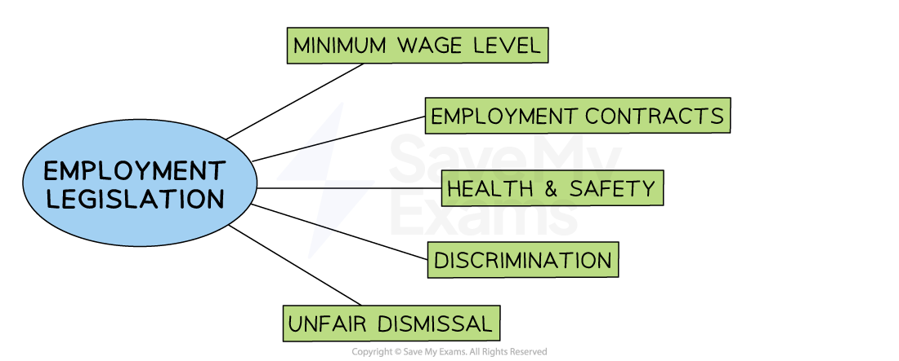
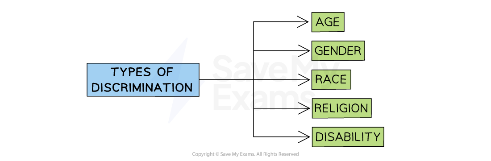

# The Impact of Legislation on Employment

## Legal Controls & Their Impact on Business

> **Spec point** — `spcpt_Mg6qxNVdYCB4sbm9`

## The impact of legal controls on business

- Legislation refers to **laws and regulations **passed by governments that require businesses to conduct their behaviour in a particular manner
- Many countries have **passed laws **that determine the required behaviour of employers towards their workers

#### Legal controls over business

*Employment legislation helps to reduce worker exploitation and unfair dismissal from the workplace*

## Legal Minimum Wage

> **Spec point** — `spcpt_5XWk757XHhzDrbSW` · • Legal controls over employment contracts, unfair dismissal, discrimination, health and safety, legal minimum wage

## Legal minimum wage

- A **national minimum wage (NMW) **is a **legally imposed wage level** that employers must pay their workers

  - It is set **above** the market rate of pay
  - In some countries, the minimum wage **varies by age**
  - A minimum wage makes it illegal for an employer to pay an hourly rate below the minimum wage set

#### Impact of a legal minimum wage on employers and employees

| **Employers** | **Employees** |
|---|---|
| - **I**mplementation and periodic increases of a minimum wage increase ***variable costs ***as all workers must be paid the minimum legal limit - Employers may **invest more in training unskilled workers** as they are being paid a higher wage - Skilled workers who are receiving slightly more than the NMW may **demand higher pay **to maintain their ***wage differential*** | - Low-paid workers' earnings are increased and their** living standards** are likely to improve as a result - **Reduces exploitation of workers, **as without a minimum wage powerful businesses can legally pay their workers very poorly - Acts as an** incentive to enter the workforce** due to the attractiveness of higher pay |

- Businesses in some countries are free to** pay their workers very low wages **leading to much **lower business costs**
- Businesses are often questioned about this decision as it compromises** *****business ethics***

## Employment Contracts

> **Spec point** — `spcpt_bsDcSG8PzfG9SfN4`

## Employment contracts

- An employment contract is a **legal agreement between the employer and employee,** which sets out the terms and conditions of employment

  - It is often a **legal requirement** for employers to provide a new employee with a contract of employment
- The **contract of employment **will usually include

  - The name of employee and employer
  - Employment start date
  - Working hours
  - Remuneration
  - Holiday entitlement
  - Duties and responsibilities of the role
  - Place of work
  - Notice period

- The main types of contract **include full-time, part-time, job share **and ***zero hours contracts***

  - Often, a business will have a mixture of employees with a **range of different employment contracts**

- A contract of employment **reduces misunderstandings** around issues such as working hours, pay, and holidays

  - Both employers and employees know what is expected of them
- The contract provides some **security of employment to the employee**

  - E.g., If an employer ignores any terms of the contract, such as paying the worker less than the agreed amount, then the worker could take legal action against the employer
- If the **employee does not meet the conditions of the contract,** then legal dismissal is allowed

  - E.g., this could occur if the worker refuses to work the agreed amount of set hours in the contract of employment

## Health and Safety

> **Spec point** — `spcpt_43dHCzYSdjtXNBpg`

## Health and Safety

- Health and safety legislation requires businesses to operate in a way that protects the **physical and mental wellbeing** of its employees, contractors and customers
- Health and safety legislation covers areas including

  - The provision of **adequate breaks and rest periods**
  - Temperature and noise levels
  - The provision of safety equipment
  - Hygienic, safe and sanitary conditions
  - **Preventing stress**
- Implementation of procedures and equipment required to maintain healthy working conditions are likely to **incur financial and time costs, such as**

  - Staff **training** and supervision
  - Changes to **working hours** and rest provisions
  - Arrangement of manuals, signage and safety **documentation**
  - Purchase and maintenance of safety **equipment**
  - Drawing up and implementing a **code of practice**
- Serious health and safety breaches can lead to **fines** or** investigations by the Health and Safety Executive** and, in some cases,** prison sentences**

## Discrimination

> **Spec point** — `spcpt_nb6TZc2zytmFKKNY`

## Discrimination

- **Discrimination** at work occurs when the employer treats employees with protected characteristics such as gender or race less favourably than one without these characteristics

  - In many countries, **discrimination **based on these characteristics is** illegal**

#### The main forms of discrimination

*Laws are in place to protect workers from discrimination based on gender, age, race, disability and religion*

- Employees who are victims of discrimination in the workplace can take **legal action against the employer**

  - ***Trade unions*** often support employees with legal claims against employers and **provide legal advice and support **
- Businesses can **miss out on recruiting the best applicant **if recruitment policies are discriminatory
- **Reputational damage** may result if a business is found to have discriminated against employees

## Unfair Dismissal

> **Spec point** — `spcpt_bm9Ct3m5M5TDmtDs`

## Unfair dismissal

- **Dismissal **takes place when an employer **ends an employee’s contract of employment with the business**
- **Dismissal can be fair **for a number of reasons

  - The job no longer exists, which means the employee is made **redundant**
  - An employee cannot do the job properly, e.g., they may **lack the right skills**
  - Long-term** illness**
  - Gross **misconduct,** such as theft or violence at work
  - For other “substantial” reasons, such as the employee has been sent to prison
- **Unfair dismissal **is when an employee of a business has their **employment terminated without a valid reason **or against **government legislation**

  - Reasons for unfair dismissal include** discrimination** or avoidance of paying for **redundancies**
- In cases where there is unfair dismissal, the worker may take his/her **complaint** to a court called an ***industrial tribunal*** to decide whether there is a case to answer

  - If the independent tribunal finds that the worker was **wrongfully dismissed, **then the worker receives **compensation** and their job is offered back to them
