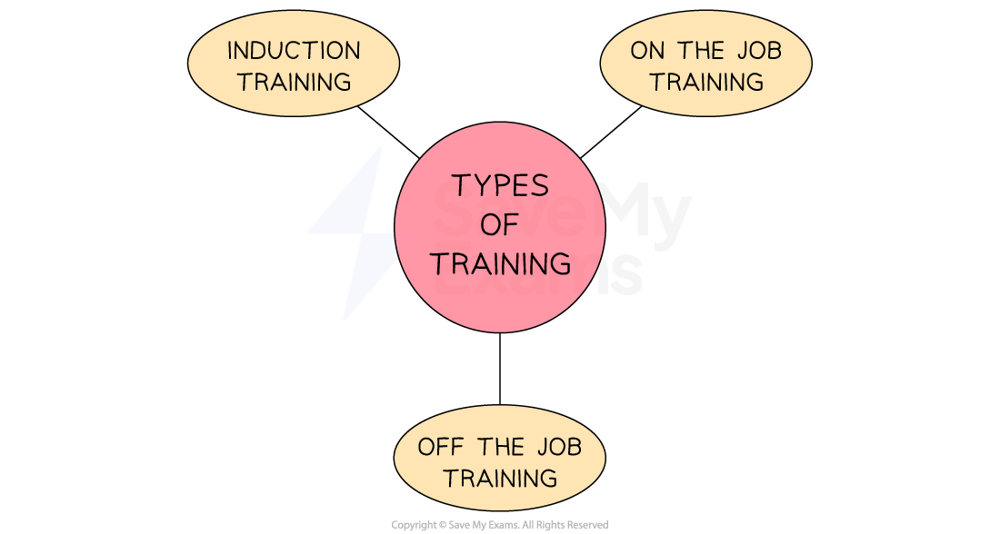

# Types of Training

## The Importance of Training to a Business

> **Spec point** — `spcpt_6djSzS9WkHf4VXcT` · "• Importance of training to a business and to employees
• Benefits and limitations of induction training, on-the-job training and off-the-job training"

## The importance of training to a business

- **Training **is the process of increasing the knowledge and skills of the workforce to enable them to perform their jobs effectively
- Businesses need to make sure that **new and existing staff are trained and developed appropriately**

  - Training is the teaching of **new skills **E.g., learning a new process or  how to use new equipment
  - Development is the **improvement** of **existing skills **E.g., a refresher course for an existing piece of software used

- A **well-trained workforce is important **for several reasons

  - Well-trained staff are likely to be more **productive**
  - Staff may feel **valued** if a business invests in training and development
  - Staff are more likely to be **flexible** and **resilient** in the face of change
  - Training decreases errors or waste in the production process
  - Improves the opportunities for internal promotion

## Types of Training

> **Spec point** — `spcpt_Wq38vZD7pP9TVfH3`

## Types of training

- There are three main types of training that a business uses

*Three common types of training that businesses put their new employees through*

### 1. Induction training

- Induction training is given to **new employees **when they start working for a business

  - It introduces them to the organisation, its culture, policies, procedures and their job roles and responsibilities
  
    - E.g. when new employee joins Marks & Spencer they receive induction training that covers customer service, product knowledge, store policies, and safety procedures

#### Evaluating induction training

| **Advantages** | **Disadvantages** |
|---|---|
| - Helps new employees to **understand their job roles** and responsibilities - Improves employee confidence and motivation - **Reduces the time** taken for new employees to become **productive** | - Can be time-consuming and **expensive to organise** - May not cover all aspects of the job role - May not be effective in all cases, **leading to employee dissatisfaction** and higher turnover rates |

### 2. On-the-job training

- A type of training that takes place **while employees are working** in their job roles

  - It allows employees to **learn new skills and knowledge** from colleagues while performing their job duties
  - For example, a sous chef at The Ivy Restaurant in York receives **on-the-job training **from the Head Chef to learn how to prepare new dishes, **use equipment** or improve cooking techniques

#### Evaluating on-the-job training

| **Advantages** | **Disadvantages** |
|---|---|
| - Employees learn new skills and knowledge while performing their job duties - **Training is tailored** to the employee's specific job role and responsibilities - Training is often **more practical and relevant** to the employee's job duties - **Can be cost-effective** as it takes place during working hours | - Employees may make mistakes while learning or trainers could pass on bad habits which may **impact productivity and quality** - Can be disruptive to the workplace as it **requires the trainer to devote time** to training the employee - May not be effective in all cases, leading to **employee dissatisfaction** and higher turnover rates |

### 3. Off-the-job training

- A type of training that takes place **outside of the workplace**

  - It can be in the form of workshops, seminars, conferences or online courses
  
    - For example, teachers attend exam board training days at which they learn how to deliver the syllabus and help their students to prepare for exams

#### Evaluating off-the-job training

| **Advantages** | **Disadvantages** |
|---|---|
| - Employees learn new skills and knowledge outside of the workplace, which can **bring fresh ideas and perspectives** to the workplace - **Training can be tailored** to the employee's specific needs and interests - Training can be **used as a reward** or incentive for high-performing employees - **Can be cost-effective** if training is provided online or through webinars | - Can be expensive to organise, especially if** travel and accommodation** are required - Employees may** miss work** while attending training, which can impact productivity - The training **may not be directly applicable** to the employee's job role or the needs of the firm |

> **Exam Hint**
> Different types of training are required for different job roles. You may need to evaluate a particular type of training or recommend one to a business. Think about the nature of the role and whether on- or off-the-job training would be the most appropriate.
> 
> E.g., On-the-job training may be suitable for a hotel porter who has many hands-on aspects to the role and needs to learn quickly. In comparison, employees that need training in a new software may need training sessions from an expert so show step by step how to use it in their role
