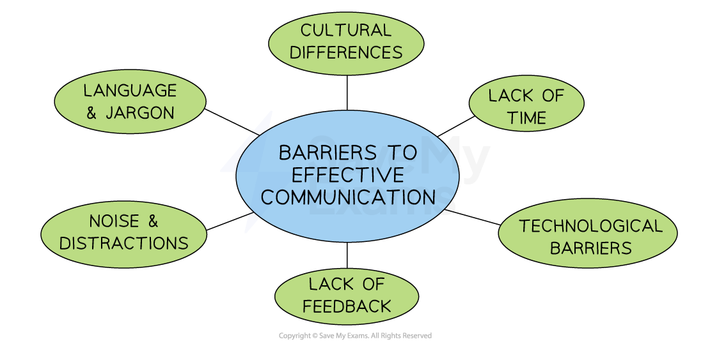

# Communication Barriers

## Barriers to Effective Communication

> **Spec point** — `spcpt_FSP2hcctXP22mgpx` · • How communication barriers arise and problems of ineffective communication; how communication barriers can be reduced or removed

## Barriers to effective communication

- Barriers to communication **hinder the flow of information,** leading to potential misunderstandings, conflicts and inefficiency

#### The barriers to communication

### Barriers to communication and how to overcome them

1. **Language and jargon**

  - The use of **technical terminology** or **industry-specific jargon can be misunderstood**
  - Industry- or business-specific** *****acronyms*** can confuse new staff
  - Staff in businesses that operate across international borders may speak different languages
  - **Reducing the barrier:**
  
    - Use of jargon or terms which are too technical should be minimised
    - An **agreed language** for key communications is implemented
2. **Noise and distractions**

  - **Loud machinery** or a **crowded workspace** can interfere with effective communication
  - **Distractions,** including phone notifications and email alerts, which can divert attention
  - **Reducing the barrier:**
  
    - Choose **communication methods** that are **relevant** **to the workplace**
    - **Limit distractions** such as pop up messages and unnecessary emails
3. **Lack of feedback**

  - The **absence of feedback** can affect understanding and lead to **misunderstandings**
  - Messages may require **urgent clarification or correction** to avoid mistakes being made
  - **Reducing the barrier:**
  
    - Where appropriate, **select methods that allow for feedback**
    - Encourage an **open culture** where employees are confident to ask questions
4. **Cultural differences**

  - Cultural ***norms***** **and **expectations** can affect communication style
  - **Reducing the barrier:**
  
    - Build **a culture of teamwork and respect **amongst employees
    - Include **cultural awareness** in training and development programmes
5. **Lack of time**

  - **Busy work schedules **and **competing priorities** can limit the time available for communication
  - **Reducing the barrier:**
  
    - Schedule meetings in shared calendars
    - Amend workloads to ensure effective communication can take place
6. **Technological barriers**

  - **Technical issues** such as poor internet connections, malfunctioning equipment or unfamiliarity with platforms can slow communication
  - **Reducing the barrier:**
  
    - Invest in good quality ICT systems and conduct regular updates and maintenance to avoid slow or poor quality connections
