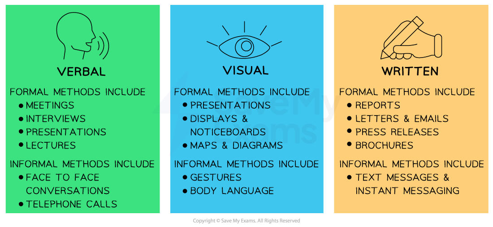

# Types of Communication Methods

## The Importance of Effective Communication

> **Spec point** — `spcpt_tznvKSnzc7KQZdgW` · "• Effective communication and its importance to business
• Benefits and limitations of different communication methods including those based on information technology (IT)
• Recommend and justify which communication method to use in given circumstances"

## The importance of effective communication

- **Communication **is the successful transfer of messages between sender(s) and receiver(s)
- **Internal communication** is the exchange of message(s) between two or more members of the same organisation

  - E.g. Telephone call between a sales manager and a finance team member
- **External communication** is the exchange of message(s) between an organisation and external entities such as customers, suppliers or investors

  - E.g. Sending an online order form to a supplier
- **One-way communication** transmits a message which does not require any feedback

  - E.g. Sign in a supermarket stating 'wet floor' to customers and staff
- **Two-way communication** occurs when the receiver gives a response to the message received

  - E.g. Email between two members staff discussing the success of a new promotional campaign
- **Formal communication** is channeled **through the businesses organisational structure** and is likely to be recorded in some way

  - E.g Minutes of an ***appraisal meeting***
- **Informal communication** is any communication that takes place **outside of the official channels **and is unlikely to be formally recorded

  - E.g. a short lunchtime conversation about workload with a colleague

#### The process of communication

*A sender passes the information to the receiver using a medium of communication such as email*

- Effective communication ensures that clear messages are sent, received, understood and acted upon in the way intended
- **Effective communication should be**

  - Clear and unambiguous
  - Appropriate to the context and to the sender
  - Sent to the correct receiver in an accessible format
  - Timely and contain only the required amount of detail

### The benefits of effective communication

- Helps managers and employees to **minimise mistakes**
- Supports everyone involved in a business to **understand their role** and know **what is expected **of them
- Ensures that the businesses **values and objectives are clear**
- Provides customers with the **information** they need to **understand goods and services**
- Minimises business costs
- Helps businesses to effectively exploit new opportunities
- **Managers **should make sure that communication is **organised** and **controlled** to ensure that a suitable level of communication exists **between key stakeholders**

  - A 2021 survey of US workers found that more than one-third reported email overload that might lead them to resign from their jobs

## Methods of Communication

> **Spec point** — `spcpt_5vCfcjddZwzrnBPX`

## Methods of communication

- Businesses have a **range of ways** in which internal and external communication can take place
- In some circumstances, **the choice of communication methods may be more limited**

  - For example, the need for a written legal contract of employment for a new employee or a notice of termination of employment

#### The main communication methods

*The main forms of communication used by businesses*

- The effectiveness of each method **depends on the business context**, the nature of the communication and the **personal preferences** of both the sender and receiver of information

#### Evaluating communication methods

| **Method** | **Strengths** | **Weaknesses** |
|---|---|---|
| **Verbal** | - **Video and phone calls **allow people in different locations to connect - **Face to face** verbal communication includes facial expressions, body language and tone of voice which can enhance understanding - Allows for **real-time** communication and the quick exchange of information and resolution of queries and disputes | - May not always be possible due to **geographical** distances or **time constraints** - Requires** listening skills ** - Unreliable internet connections or **audio/video problems** can hinder effective verbal communication |
| **Visual** | - **Videos, charts, photographs and visual displays** can simplify complex communications    - E.g., A manager showing sales figures using a pie chart in a meeting | - **Feedback may be limited** so follow-up may be required to check understanding    - E.g., a training video on fire safety in the workplace may be followed by an assessment task to check employees understand risks - **Some diagrams or chart**s may need a verbal or written explanation to support them |
| **Written ** | - Written communication provide a **record** that can be referred back to in the future - Instant messaging (WhatsApp, Slack) enables **fast and real-time communication** making it ideal for brief exchanges or urgent matters | - Without facial expressions and tone of voice, written messages can be **misinterpreted** or lack context - Requires **literacy** and/or **technical** **skills** |

## Recommending a Method of Communication

> **Spec point** — `spcpt_bRcFyhmZ7qTw69CH`

## Recommending a method of communication

- Businesses are likely to develop their communication methods and style over time

  - **Smaller business** may only be able to afford to communicate with customers through posters, leaflets and social media
  - **Larger businesses **are likely to have greater budgets which allow for the use of television and billboard promotional campaigns

### Factors which impact the communication method used

| **Factor** | **Explanation** | **Example** |
|---|---|---|
| Cost | - How important is it to **keep costs down**? - Is communication **vital regardless of cost**? | - Customers need to be informed about a serious safety problem with a children's toy    - An **announcement in national newspapers** would reach many affected people quickly   - An **announcement via** **social media channels** would be low-cost |
| Speed | - Does the message need to **transmitted quickly?** | - A manager from a foreign division of a company must be told about a cancelled sales meeting before he catches his flight from the US to China    - A **telephone call **would be quick and direct   - An **internal email** may not read in time |
| **Receiver** | - **How many/what type of person **needs to receive the message? | - All 300 staff in a factory need to be told about a change in working hours    - An** internal email **would be an effective way to inform all staff   - An **announcement on a staff noticeboard** may be missed/ignored by some workers |
| **Leadership Style** | - **Democratic leaders** are likely to encourage two-way communication whilst ***autocratic leaders***would prefer one-way communication | - A business is making arrangements for a staff social event    - A democratic leader may hold a **meeting** with the workplace social committee   - An autocratic leader may **send written invitations** to staff |
| **Message details** | - Is the message **technical **or **detailed**? - Does it contain** images **or** data**? | - A manager needs the sales team to review the monthly revenue figures before the next meeting    - Sending the sales report via **email **or placing it in** **a** shared online folder** allows colleagues to access/interact with the report before the meeting |
| **Need for a written record/formality** | - Is a **record of the communication needed** for future reference? - Is the communication related to a **formal matter?** | - A customer wishes to place an order    - An **order form** is a permanent written record that can be placed on file and provide a financial record   - A** telephone call **may not record all important details about the order |
| **Feedback** | - Does the receiver **need immediate feedback?** | - Two colleagues are concerned a customer has not paid for the goods they have and are leaving the store    - A quick **verbal discussion** can establish situational facts quickly so that appropriate action can be taken   - A** text message** may not be received in time |

> **Exam Hint**
> Communication methods in the workplace have changed rapidly due to advancements in technology. For example many organisations use social media to communicate. The speed of feedback from customers using these platforms can be both a positive and negative factor. Any errors are quickly posted across the internet, which can harm the business brand
