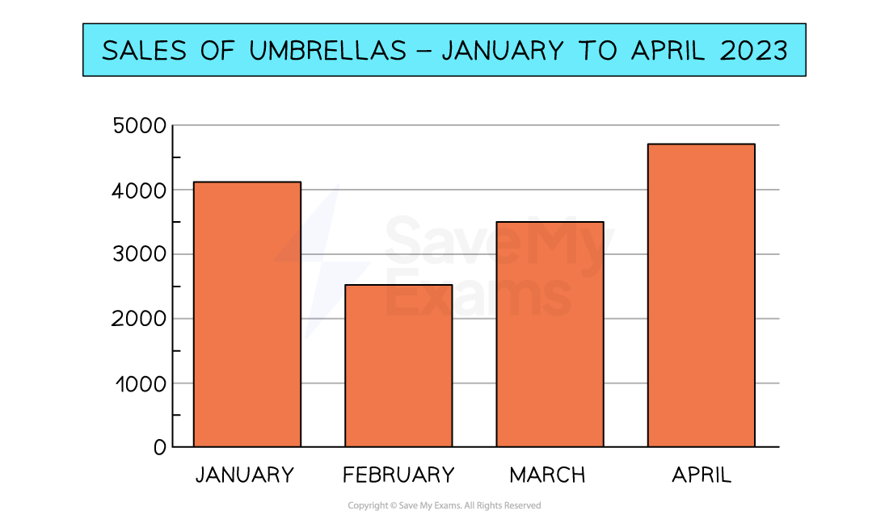
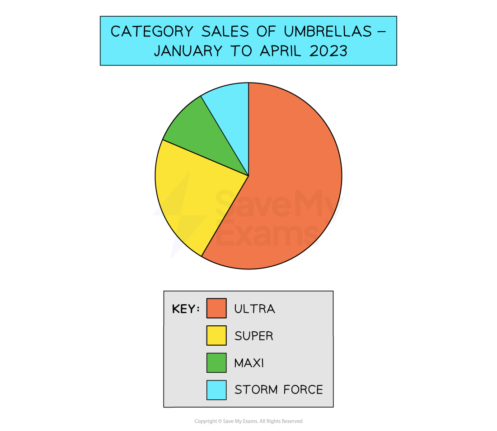

# Presenting and Using Market Research Data

## Presenting Market Research Data

> **Spec point** — `spcpt_pbPfGBXZ82M8PFdv` · • Analyse market research data shown in the form of graphs, charts and diagrams; draw simple conclusions from such data

## Presenting market research data

- Once market research data has been gathered, it need to be converted into a form which is **easy to understand** and capable of being used to **support business decision-making**
- Common methods of presenting data include:

  - Tally charts
  - Bar charts
  - Pie graphs
  - Scatter graphs
- Information presented in **graphs and charts** is often **easy to understand **because it is presented **visually**
- The **type of data that has been collected **and** what it is to be used for** will affect the form of presentation which will be used

  - ***Quantitative data*** tends to be relatively easy to present in a chart or graph
  - ***Qualitative data*** may be better presented in a report

### 1. Tally charts

- **A table **or** tally chart, **is a simple method used to **record data in its original form**

  - It is particularly useful for recording **frequency **of an event **as it is happening**
  
    - E.g., It may be used to record the number of customers entering a retail store
  - Each time a particular event happens, a small vertical line is drawn
  
    - **Groups of five** occurrences are recorded with a **diagonal line** **through four vertical lines **
    - These groups of five can be easily** totaled to identify frequency**
- In many cases, tally chart data is **converted into a chart or graph** to make it more **visually appealing**

> **Worked Example**
> Susie asks her friends to select their favorite type of pet
> 
> | Dog | Cat | Dog | Dog | Dog |
> |---|---|---|---|---|
> | Rabbit | Dog | Rabbit | Cat | Cat |
> | Cat | Dog | Dog | Rabbit | Dog |
> | Cat | Cat | Dog | Dog | Dog |
> 
> Represent the data in a frequency table. You can use a tally chart to help
> 
> **Step 1**: **Draw a table with a tally and frequency column with types of pet as row headers**
> 
> | **Type of Pet** | **Tally** | **Frequency** |
> |---|---|---|
> | Dog |   |   |
> | Cat |   |   |
> | Rabbit |   |   |
> 
> **Step 2: Tally the data**
> 
> | **Type of Pet** | **Tally** | **Frequency** |
> |---|---|---|
> | Dog |  |   |
> | Cat |  |   |
> | Rabbit |  |   |
> 
> **Step 3: Total the tally data and add to the frequency column**
> 
> | **Type of Pet** | **Tally** | **Frequency** |
> |---|---|---|
> | Dog |  | 11 |
> | Cat |  | 6 |
> | Rabbit |  | 3 |

### 2. Bar charts

- This bar graph provides a clear picture of umbrella sales between January and April and allows a manager** to compare sales** month by month

### 3. Pie charts

- This pie chart breaks down all umbrella sales into those **achieved by different models**
- It **shows **that more than half of sales were 'Ultra' umbrellas

*Pie chart showing the sales of umbrellas over four months*

### 4. Scatter graphs

- Scatter graphs allow **relationships between two** ***variables*** to be identified
- The scatter graph on the right shows that there is a **positive** ***correlation ***between the temperature and sales of barbecues

  - As the temperature increases, sales of barbecues increase
- A ***line of best fit*** would allow a business to ***extrapolate*** the known data to identify likely sales of barbecues at other temperatures

*A scatter graph showing the correlation between the temperature and the sale of umbrellas*

## Analysing Market Research Data

> **Spec point** — `spcpt_9fs3jrFxwYd3KpTM`

## Analysing market research data

- **Quantitative** data is **statistical numeric data** that can be used to support decision making

  - Quantitative data needs to be **accurate** and **interpreted correctly** if it is to be useful
  - It may be collected from **primary** or **secondary** sources
  - **Sources **of quantitative data** **include
  
    - Financial reports
    - Survey findings
    - Marketing or sales data
    - Statistical research from the government or research organisations
- **Qualitative** research data often **requires considerable skill and insight** to be interpreted appropriately

  - It involves comparing and drawing conclusions from **opinions, insights, feelings and preferences**
  - It is **mainly collected from primary sources** such as focus groups, detailed surveys/interviews and test marketing
- Both forms of data **can help business managers forecast sales**,** **identify **trends **and **make decisions** about product development, promotional planning, pricing tactics and other important ***marketing mix*** elements

> **Exam Hint**
> You are often required to interpret quantitative data in exam questions, so ensure that you practice these skills and understand how data can be used to inform decision-making. Make sure that you also consider relevant qualitative factors, **especially where a decision is not straight-forward. **Some powerful qualitative factors can include the wishes of the business leader, the impact on stakeholders, and whether the business has aims that are not purely financial.
