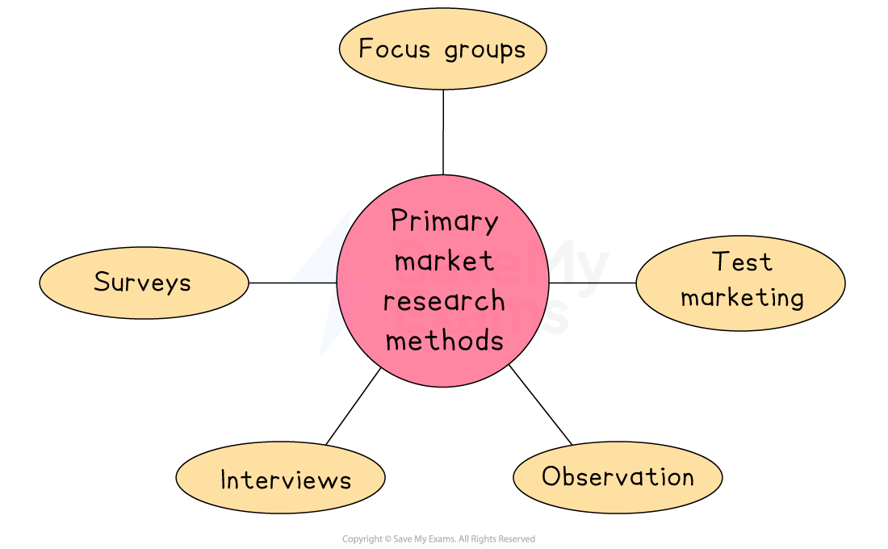

# Primary Market Research

## Primary Research

> **Spec point** — `spcpt_BxvRWvb9gq2yhF3S` · "• Methods of primary research, e.g. postal questionnaire, online survey, interviews, focus groups
• The need for sampling"

## Primary market research

- **Primary market research** is the process of** gathering information** **directly from consumers** in the target market

  - This process gathers **information that **does not already exist and is specific to the needs of the business collecting it
- **Surveys, interviews **and** focus groups **are common primary market research methods

  - Many of these methods make use of ***questionnaires*** to **organise research questions and responses**

#### Primary market research methods

*Methods of primary market research*

1. **Surveys**

  - Surveys are the most widely used tool to gather primary research
  - Surveys may be **face-to-face**,** online**, carried out by **telephone **or by** post**
  - A series of questions are posed to a defined number of people **(respondents)**
  - A wide range of respondents can be reached using **online survey tools** such as Survey Monkey
2. **Observation**

  - A market researcher **studies consumer behaviour** during their interaction with a business
  - E.g. Shoppers may be accompanied as they shop in a store or consumer traffic is measured at a particular location and time
  - Common focuses for observation include
  
    - The impact of **packaging **on the products consumers select
    - The impact that the **placement of a product** in a store may have on consumer choice
3. **Interviews**

  - A **more formal meeting than a survey** between a researcher and a customer
  - Questions may be **similar to those in a survey** but the interviewee may be asked **follow-up questions** to gather **detailed information** as well as cues such as **body language**
4. **Test marketing**

  - Free samples are provided for a limited period to the target market to **gauge their response to the product**
  - Recipients of samples are asked to **review products** and provide **detailed feedback** to allow **changes** to be made **before the product is formally launched**
5. **Focus groups**

  - Free-range discussions led by a marketing specialist collect** detailed feedback** on all aspects of the ***marketing mix*** from the target market
  - Usually limited to a **small group** of 12-15 people who **may meet more than once**
  - Group members are usually **rewarded for attendance**

> **Exam Hint**
> A business will often use **more than one method **of primary research in order to build up a reliable understanding of the market. The data can then be **analysed** and used to **make data-led judgements** such as how much to charge for a new product and where to sell it

#### Evaluating the use of primary market research

| **Advantages** | **Disadvantages** |
|---|---|
| - Information gathering is **focused on the needs of the business **and will not be available to its rivals - Some primary research methods allow  **in-depth information** to be gathered from respondents, such as reasons for certain behaviours or choices - Primary market research is **up-to-date and **can be used to **ask specific questions** and so will be more relevant to business decisions | - The ***sample size***** may be too small** and unrepresentative of target customers, leading to unreliable results - ***Bias*** may mean that researchers guide respondents to **answer questions in a particular way**    - A business** may need to hire a specialist market research agency **to help making the process **expensive and time-consuming** |

### Primary market research is becoming cheaper

- Traditionally, primary research has been **relatively difficult and expensive** for businesses to gather
- The **rise of social media platforms** such as Facebook, Twitter, Instagram and TikTok provides businesses with incredible primary research opportunities

  - The **speed of communication** between businesses and customers can be almost instantaneous
  
    - Online surveys or polls allow large numbers of responses to be received in a short period of time
  - The **cost of gathering this information **can be very low
  
    - Online polls take a few minutes to set up and software automatically gathers and analyses results
- **Online businesses** can collect primary market research via electronic means

  - Customers are also able to **feedback quickly** on products or to express innovative ideas about how they want the products to be changed
  
    - Feedback may help a business to develop *extension strategies* in a **product's life cycle**

## The Purpose of Sampling

> **Spec point** — `spcpt_nMkVxxhBPQhb4W9V`

## The purpose of sampling

- Primary market research is conducted with a small representative **sample** of the market as a whole

  - It  would be both too **expensive** and **time-consuming** to collect data from the whole market
  - Market researchers use carefully designed sampling methods from which accurate **conclusions can be drawn **about likely customer preferences and behaviour
  - In general,** the larger the sample size, the more likely it is that results of market research activities will reflect the market as a whole**

### Explaining the different sampling methods

#### 1. Quota sampling

- **Specific proportions of each group of the population** are selected to participate in research

  - E.g., a focus group for a **car manufacturer** may include a sample of 25% respondents between the ages of 18-24, 50% between the ages of 25-45 and 25% aged 46+

| **Advantages** | **Disadvantages** |
|---|---|
| - Suitable for research where there is a **time limit **to conduct the study - Relatively easy and **low cost** | - Not random so there is **some risk of bias** - Need to **understand the population** to be able to apply results to the market as a whole |

#### 2. Random sampling

- This method makes sure that **every member of the population has an equal chance** of being selected

  - E.g., a survey of **gym members **may be sent to a random selection of clients in its membership database

| **Advantages** | **Disadvantages** |
|---|---|
| - **Simple** to design and interpret - As anyone in the population can be asked to participate, **bias should be avoided** | - As anyone may be selected, the sample **may not be representative of the market **as a whole - A **complete and accurate list of all consumers** in the target market would eliminate bias, but is **unlikely to be available** |

#### 3. Convenience sampling

- This method uses those who are **willing to volunteer and are easiest to access** in the study

  - E.g., a **cafe **owner may ask regular customers to fill out a written survey during a quiet period regarding their experiences of the menu and customer service

| **Advantages** | **Disadvantages** |
|---|---|
| - Respondents taking part in research are readily available - Large amounts of information can be gathered quickly | - The sample is **likely to be biased if those known to the researcher are chosen** - The sample is **unlikely to be representative** of the market as a whole |

### Which sampling method should be used?

- The **choice of sampling method** will depend upon a wide range of factors, including

  - **Time **available
  - **Knowledge** of the target population
  - **Skills** of the researcher(s)***  ***

- Where **little time is available **to carry out market research a **quota sample** may be the most appropriate sampling method as it is usually very quick and straightforward to organise
- Where a business has a **good knowledge of the target population** a **random sample** is likely to provide a set of research data that lacks bias and can be interpreted with insight
- Where researchers **lack experience or expertise** in market research a **convenience sample** is likely to provide a useful set of data that can be easily interpreted

> **Exam Hint**
> A **research population** refers to the group of people in whom the business has an interest when conducting market research, not the population of the entire country.
