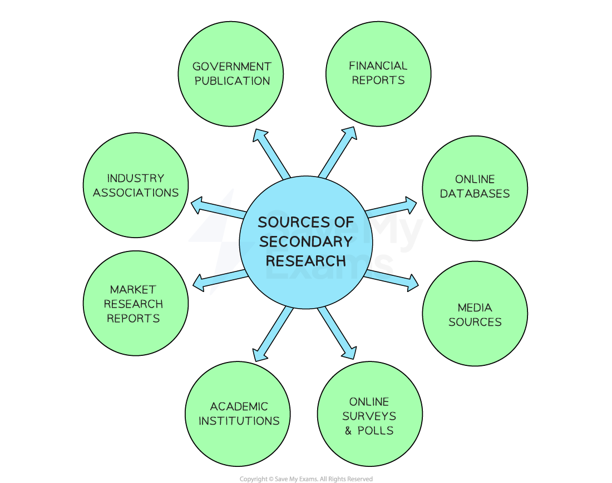

# Secondary Market Research

## Secondary Market Research

> **Spec point** — `spcpt_5qz8H8n4zbsthfKm` · "• Methods of secondary research, e.g. online, accessing government sources, paying for commercial market research reports
• Factors influencing the accuracy of market research data"

## Secondary market research

- **Secondary research **involves the collection, compilation, and analysis of data that **already exists**
- Businesses must weigh up the **reliability** of secondary market research and aspects such as **cost, relevance and availability** of data when making a decision on which secondary data to use

#### Sources of secondary market research

*Businesses can consult a wide range of secondary sources to gather market research data*

- **Government Publications**: National governments and ***trading blocs*** such as the EU publish reports and statistics on topics such as the economy, demographics, industry trends and consumer behaviour
- **Academic Institutions**: Universities and research institutions conduct studies and publish research papers which provide valuable insights and data on specific industries, consumer behaviour and market trends

  - E.g., *Stanford University* is a globally significant research centre for engineering and medicine
- **Industry Associations**: Trade associations and industry-specific organisations provide detailed information about specific sectors, including market size, growth rates and industry ***benchmarks***

  - E.g., The *International Organisation of Motor Vehicle Manufacturers* conducts and collates research on production and sales statistics
- **Specialist Market Research Reports**: Companies specialising in market research produce and sell in-depth reports on various industries, markets and consumer trends

  - E.g., *Mintel* is one of the leading private companies supplying market research information
- **Financial Reports**: Public limited companies are required to publish ***annual reports*** which can provide valuable information about a company's performance, market position and future plans
- **Online Databases**: There are various online databases and research platforms that provide access to a wide range of secondary market research

  - E.g. *Statista* and *Euromonitor International* make a large volume of data on international commerce available
- **Media Sources**: Newspapers, magazines and online publications often contain articles, opinion pieces and investigative reports that can offer insights into market trends, consumer behaviour and industry developments

  - E.g. The *Financial Times* and the *Wall Street Journal*

#### Evaluating the use of secondary market research

| **Advantages** | **Disadvantages** |
|---|---|
| - Information is **already available **and so may be** quicker to collect** than primary research, thereby saving time - Information is often free (e.g. government websites and internet sources such as Statista) and cheaper** to collect, **leading to **lower costs **compared to primary research - Suitable for a **small business** that lacks a large marketing budget and/or expertise | - Information has been collected for other purposes and so may be **difficult to analyse**, may** lack relevance **or may** not be** **factually correct,** e.g., Wikipedia - Can be **expensive** to purchase market specific secondary data from specialist companies, e.g., MINTEL reports - **Information may be out-of-date**, especially in dynamic markets |

## The Accuracy of Market Research Data

> **Spec point** — `spcpt_qt8FQBn24znh6Stb`

## The accuracy of market research data

- The **reliability and accuracy of market research depend upon a large number of factors, **including

  - How **questions are phrased **in** questionnaires **or other tools used to conduct surveys
  
    - Questions should be written in such a way that they do not elicit a particular response
  - How **carefully the sample is selected**
  
    - Including its **size**,** types of respondent** chosen and how closely these reflect the intended ***target market***
  - **Who conducts the research **including their **experience**, research **skills** and **source** (primary or secondary?)
  - Potential for ***Bias*** when conducting research or analysing results
  
    - The research and its analysis should be as objective as possible
  - **When and where **the research is conducted
  
    - Customer tastes, fashions, economic conditions and technology change, giving data a relatively short period of usefulness
    - Customers in different geographic areas can have very different opinions

> **Exam Hint**
> When answering questions about market research, it is tempting to write down everything you know about the topic. Try to focus more on weighing up the advantages and disadvantages of market research tools and methods, justifying which method(s) might be more appropriate, and explaining why **in context.**
