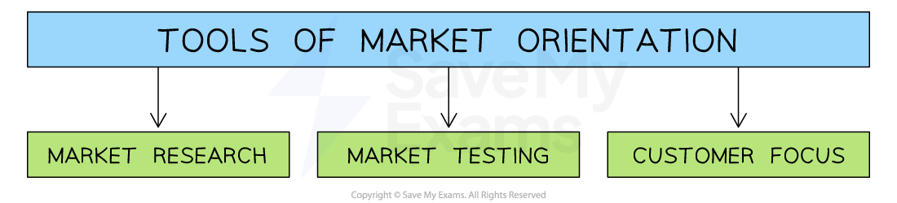

# The Role of Market Research

## The Role of Market Research

> **Spec point** — `spcpt_Pz7HYNkxqHVfTwtg` · "• Market-orientated businesses (uses of market research information to a business)
• Primary research and secondary research (benefits and limitations of each)"

## What is market research?

- **Market research** **is the objective collection, compilation **and **analysis of information about a market**
- Effective market research will help the business to

  - **Reduce risk** when launching new products or entering new markets
  - Identify and understand the **future needs and wants of customers**
  - Understand **consumer behaviour **
  - Identify how much consumers are **prepared to pay**
  - Identify potential **gaps** **in the market** (market niches) which can be exploited to increase sales
  - **Identify competitors** and gauge their potential strengths and weaknesses
- With effective market research businesses are well-placed to **make informed decisions** about the **most effective way** to use their valuable resources and **develop a suitable** ***marketing mix***
- **On-going market research** helps businesses to update their **marketing *****strategy*** in line with customers' changing needs and preferences

## Market Orientation

> **Spec point** — `spcpt_KqBMHJZtjzhVKP2t`

## Market orientation

- **Market orientation** is an approach to marketing that focuses on the **needs of consumers **and uses this information to design products that meet customer needs

  - **Consumers** are **at the centre of marketing decisions**
  - **Products **which **respond to consumer needs are developed **
  - Market-orientated businesses are usually more** adaptable** to to changing customer needs
  
    - For example, universities often develop new courses based on the feedback they receive from students and the changing requirements of employers
- Market orientation should lead to a business benefitting from increased demand, increased profits, and **a valued brand image** as its products are more desirable than those of rivals

#### Tools of market orientation

*Market orientation combines market research and market testing with a customer focus*

- **Market testing** is the process of assessing customer reaction to a product or service before it is launched

  - It **determines whether there is a potential market **for the product or service
  - **Features** that are likely to be most appealing to consumers
  - For example, a healthcare business may conduct a ***focus group*** for a new brand of toothpaste
- Customer focus means **putting your customers' needs first**

  - Customer-focused businesses focus on **enhancing customer satisfaction **and building strong customer relationships
