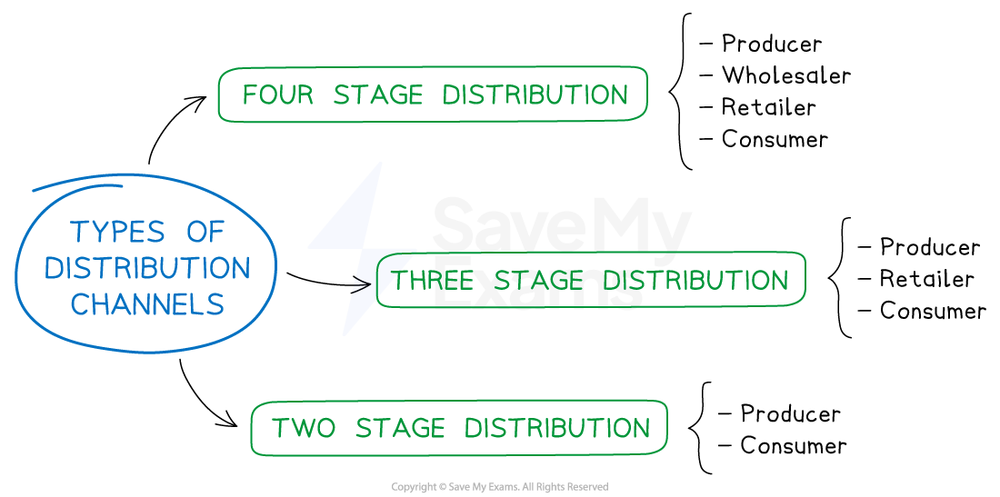

# Place: Types of Distribution Channels

## The Role of Place in the Marketing Mix

> **Spec point** — `spcpt_7hybJDkzkjSZQ6P5` · "• Advantages and disadvantages of different channels, e.g. use of wholesalers, retailers or direct to consumers
• Recommend and justify an appropriate distribution channel in given circumstances"

## The role of place in the marketing mix

- **Place** in the marketing mix refers to **where customers purchase** a businesses products and the ***distribution channels*** used to move the product from producer to consumer
- In a competitive environment, location and distribution decisions can give a company a ***competitive advantage***

  - Businesses could locate themselves in areas with** high foot traffic** to achieve high sales volumes
  - They may use **innovative online channels** to reach customers who prefer to shop online
- **Changing consumer needs can impact the way businesses distribute their products**

  - **E-commerce** makes it easier for consumers to **shop online** and have products delivered to their doorstep
  
    - Many businesses have therefore invested in their online presence, offering **convenience and fast delivery **to meet customer needs

### Types of distribution channels

- Distribution channels refer to the ***intermediaries*** through which products** move** **from the business to the end customer **

*There are three different types of distribution channels businesses can use to move products from the manufacturer to the end consumer*

#### Four stage distribution

- Producer → Wholesaler → Retailer → Consumer
- This channel is commonly **used by smaller retail business** that lack space or sufficient cash flow to hold large amounts of stock
- **Advantage:** Small shops can buy little and often from the wholesaler, so they don’t need big, costly storage space
- **Disadvantage:** Two extra *markups* (wholesaler and  retailer) push the selling price up for customers

  - **E.g., The Coca-Cola Company** produces soft drinks, which are sold in bulk to a **wholesaler**
  
    - The wholesaler sells smaller quantities to a convenience store
    - The convenience store  then sells individual soft drinks to the customer

#### Three stage distribution

- Producer → Retailer → Consumer
- This channel is often used for **products with high demand** or where the cost of distribution is high
- This method is also common **where customers require support or advice** in selecting the product
- **Advantage:** Retail staff can give advice and after-sales help, which suits complex goods like laptops
- **Disadvantage:** Stock sits in the retailer’s warehouse or shop, tying up cash until each item is sold

  - E.g., **Toshiba** produces laptops and sells them directly to retailers such as Walmart or Currys
  
    - Currys employs knowledgeable sales staff who sell them to end customers

#### Two stage distribution

- Producer → Consumer
- This channel is commonly used for **products that are sold online** or through direct sales channels
- **Advantage:** No middlemen mean lower costs, so the firm can offer keener online prices or keep more profit **Disadvantage:** The producer must handle delivery, returns and customer service itself, which can be expensive and time-consuming

  - E.g., **GermanWings** sells its service (airline passenger tickets) directly to the end customer on their website

### The rise of e-commerce

- Distribution channels have been impacted by social trends such as the **growth of e-commerce **and the **shift from product-based businesses to service-based businesses**
- Businesses have adjusted their distribution strategies to better **meet the needs** of customers and **stay competitive**
- **Online distribution** has become increasingly popular due to the convenience and accessibility it offers to consumers
- **Drop-shipping **allows businesses to sell products without holding stock

  - When products are ordered they are **shipped directly** from the producer to the customer
  - This reduces the cost and complexity of distribution, making it **easier for businesses** to sell online

#### Examples of e-commerce

- Amazon is known as a** third-party logistics provider** (3PLs)
- They provide small businesses with the **infrastructure and a well-known online marketplace,** which allows them to **reach a wider audience**
- This allows even the smallest of businesses to increase sales without having to invest in their own warehouses

## Recommending an Appropriate Distribution Channel

> **Spec point** — `spcpt_TBr5SQzgcgqd3rHV`

## Recommending an appropriate distribution channel

- The **choice of distribution channel chosen by a business** depends on a variety of factors
- The following questions are worth considering when **establishing** a distribution channel

  - Do consumers want to speak to a salesperson?
  - Will customers want to handle the product before they make a purchase?
  - Would they prefer to purchase it conveniently online?
  - Does the product require special handling, such as protective packaging or quick delivery?

*Getting the distribution channel right will increase sales revenue and profit*

### Factors affecting the choice of channel

#### 1. Type of product

- If sold to producers of other goods, distribution is likely to be direct or via a specialist wholesaler

  - E.g., **JCB** sells excavators directly to construction companies
  - Specialist wholesalers such as France's **Bricoman** sell consumable building supplies such as nuts, bolts and cement to builders

#### 2. Frequency of purchase

- If the product is bought on a daily basis, retail stores provide convenience for consumers

  - E.g., **Milka** chocolate is sold in most EU-based supermarkets

#### 3. The price of the product

- If the products is an expensive luxury good, it would be best sold through a few specialist high-end outlets

  - E.g. **Rolex** watches are sold in high-end jewellery stores

#### 4. The durability of the product

- Perishable product like fruit and vegetables are distributed through retailers, sometimes via wholesalers, to be sold quickly

#### 5. Proximity of customers

- If customers are located over the world, e-commerce is likely to be a suitable distribution channel

#### 6. Competitors distribution channels

- Products need to be sold where competitors are selling so that a business can compete effectively

  - E.g., **Nestlé** cereals are sold alongside **Kelloggs** cereals in a wide range of retail outlets

#### 7. Technical specifications

- If technical information needs to be passed to the customer, direct selling or a retailer is usually preferred

  - E.g., **Apple Store** staff provide focused advice to customers purchasing its range of phones, computers and entertainment devices
