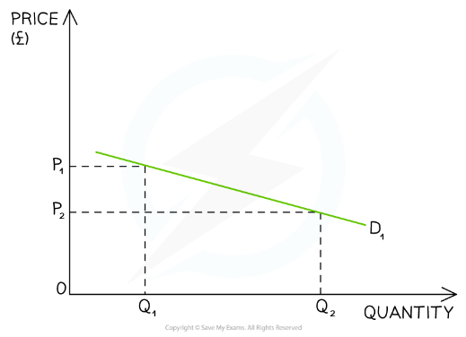
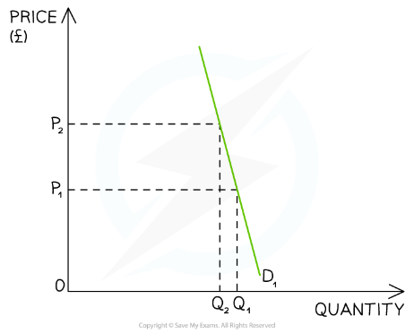
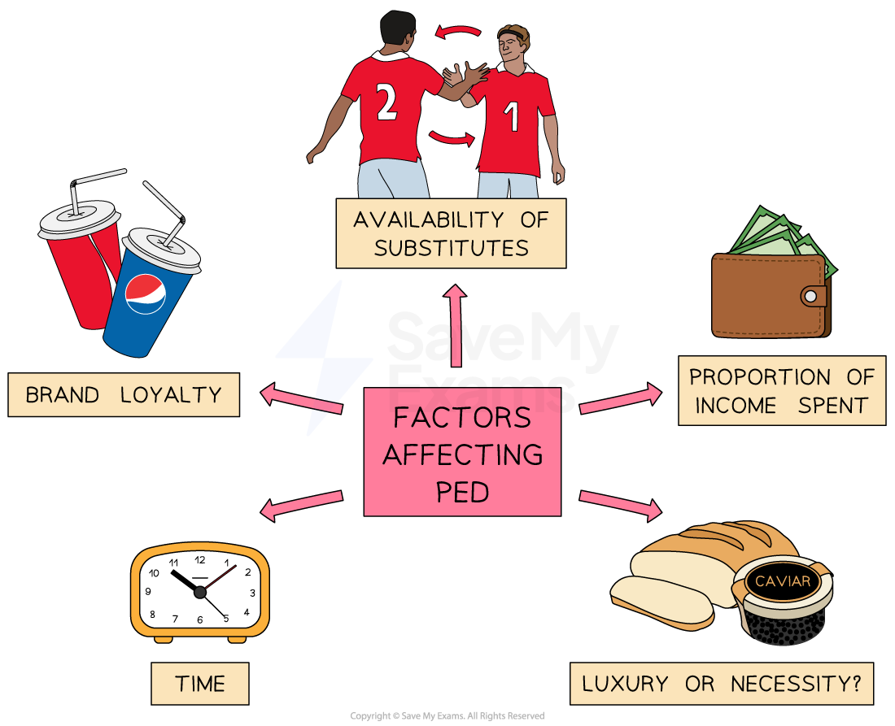

# Price: The Significance of Price Elasticity of Demand

## An Introduction to Price Elasticity of Demand

> **Spec point** — `spcpt_Wmc96HtbpStzxDNV` · "• Recommend and justify an appropriate pricing method in given circumstances
• Understand the significance of price elasticity: difference between price elastic demand and price inelastic demand; importance of the
concept in pricing decisions (knowledge of the formula and calculations of PED will not be assessed)"

## An introduction to price elasticity of demand

- ***Price elasticity of demand*** (PED) measures **how responsive demand for a product is to a change in price**

  - In most cases **an increase in price leads to a fall in demand for a product**
  - Similarly **a fall in price leads to an increase in demand for a product**
- Price elasticity of demand answers the question of **how much **demand changes.

  - **Price elastic demand** is where the volume of a product's sales changes by a greater percentage than the change in price
  
    - E.g., A 10% increase in price leads to a 20% decrease in the volume of sales
  - **Price inelastic demand** is where the volume of a product's sales changes by a smaller percentage than the change in price
  
    - E.g., A 10% increase in price leads to a 5% decrease in the volume of sales

### Interpretation of PED

- PED will always be negative due to the** inverse relationship** between price and quantity

  - If the price goes up, the quantity demanded goes down
  - If the price goes down, the quantity demanded goes up

- The numerical value of PED indicates the **responsiveness** of a change in quantity demanded to a change in price

#### Interpretation of PED values

| **Numerical value ** | **Explanation** | **Examples** |
|---|---|---|
| **Value less than -1**  **ELASTIC** | - **Demand **is **more responsive to a change in price** - **The %∆ in QD is more than proportional to the %∆ in P** - An increase in selling price reduces the total amount of revenue generated from sales - A reduction in selling price increases the total amount of revenue generated from sales | - **Luxury products **such as cars, smart watches, foreign holidays, cinema visits, jewellery, and branded goods |
| **Value between**  **0 and - 1**  **INELASTIC** | - **Demand** is** less responsive to a change in price** - **The %∆ in QD is more than proportional to the %∆ in P** - An increase in selling price increases the total amount of revenue generated from sales - A reduction in selling price reduces the total amount of revenue generated from sales | - **Necessities** such as bread, milk, eggs, and potatoes; fuel; rent; toothpaste, etc. - **Addictive products** such as cigarettes and sugary foods |

## The Significance of Price Elasticity of Demand

> **Spec point** — `spcpt_ycHR2g8ykNDsCm4F`

## The significance of price elasticity of demand

- If businesses can **determine the price elasticity of demand** for their products, they can adjust their **pricing strategy** to **maximise their revenue**
- If the demand for their products is relatively **price inelastic (PED < -1),** raising the price will lead to an **increase in total revenue. **However, lowering the price will lead to a **fall in total revenue**

  - ***Price skimming strategies*** are best employed for products that are price inelastic in demand
- If demand for their products is relatively **price elastic (PED > -1),** raising the price will lead to a **fall in total revenue. **However, lowering the price will lead to a **rise in total revenue**

  - ***Competitive pricing strategies*** are best employed for products that are price inelastic in demand

### The relationship between PED and total revenue

#### Price elastic demand

*A shallow demand curve indicates an elastic product or service*

- An **increase in price **will lead to a** decrease in revenue**
- A **decrease in price **will lead to an** increase in revenue**

#### Price inelastic demand

- An **increase in price **will lead to an** increase in revenue**
- A **decrease in price **will lead to a **decrease in revenue**

## Factors Influencing the Price Elasticity of Demand

> **Spec point** — `spcpt_npdx5yYjTNyXvRmr`

## Factors influencing the price elasticity of demand

- Several factors can influence how responsive the customer demand is for a product

*The factors which determine if a product is more price elastic or price inelastic in demand*

### 1. Brand loyalty

- The aim of advertising and marketing expenditure by a business is to shift the demand curve to the right **and make the demand more price inelastic**

  - E.g., Coke consumers tend to remain brand loyal to Coke and are unlikely to buy Pepsi even though their taste and selling price are very similar

### 2. Availability of substitutes

- Demand for goods that have **fewer substitutes **is likely to be **price inelastic**

  - E.g., Petrol has fewer substitutes and is more price inelastic whereas chocolate bars have more substitutes and are more price elastic

### 3. The proportion of income taken up by the product

- The **smaller the proportion of income **we spend on a product the **more price inelastic** the demand will be

  - E.g., A small amount of income is spent on salt and so demand for salt is **more price inelastic** whereas buying a new car takes up a **bigger proportion** of consumer income and so demand is **more price elastic**

### 4. Luxury or necessity

- **Necessities **are required as part of consumers' daily needs and are therefore **more price inelastic** in demand

  - E.g. Bread, milk, petrol, gas and electricity might be considered to be necessities
- **Luxuries** are not essential and are therefore **more price elastic** in demand

  - E.g. Smoked salmon, Nike Air Jordans, and foreign holidays might be considered to be luxuries

### 5. The time period

- The **longer the time period** under consideration, the more price elastic the demand for a good or service is likely to be (consumers have more time to search for substitutes)
- The **shorter the time period** under consideration, the more price inelastic the demand for a good or service is likely to be

  - For example, if the price of petrol increases, making driving more expensive, there is little that consumers can do in the short term but pay the price required to keep their vehicle running
  - Over time they may switch to alternatives such as public transport or bicycles so demand for petrol could be more price elastic in the long-term
