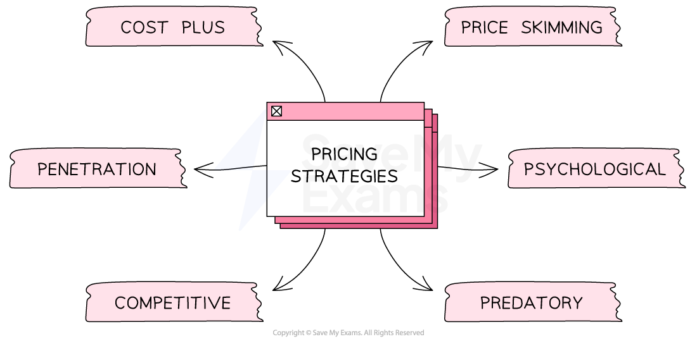

# Price: Types of Pricing Methods

## Types of Pricing Strategies

> **Spec point** — `spcpt_vmYyqB44F3DKDq5q` · • Pricing methods (benefits and limitations of different methods), e.g. cost plus, competitive, penetration, skimming, and promotional

## Types of pricing strategies

- Choosing the right **pricing strategy **is essential for a business to be profitable, competitive, and successful in the long run
- By understanding their customers, competitors and costs, businesses can set prices that **maximise sales revenue** and **profits**
- Pricing can play a significant role in the ***market positioning***** **of the brand and help a firm to **compete with rivals**

#### The main pricing strategies

*Different types of pricing strategies*

### 1. Cost plus pricing

- The business calculates the **cost of production** and then adds a markup to determine the final price
- The markup covers the cost of production **plus the business's desired *****profit margin***
- This pricing strategy is simple and is commonly **used by manufacturers** that produce standardised goods, e.g., washing machines

| **Advantages** | **Disadvantages** |
|---|---|
| - A **simple **and **quick** method of calculating a price for a product - It ensures that a **profit** is made on each item sold | - It does not consider the **needs of the market ** - The **pricing approach of competitors** is ignored |

### 2. Price skimming

- The business sets a **high price** for a new product or service when it is **first introduced to the market**
- The business will then gradually lower the price to **ensure sales continue**

| **Advantages** | **Disadvantages** |
|---|---|
| - This is effective when an *established brand* is introducing a new product and there is a high demand for it, e.g successive models of **Apple's Macbook Air** - The high price helps the business recover its **development and marketing costs** quickly | - Only effective when used by strong brands with an established and loyal customer base - Loyal customers may become **tired of paying high prices **for new product versions and look to see what competitors offer |

### 3. Penetration pricing

- The business sets a** low price for a new product or service** when it is first introduced
- This is effective when a business wants to quickly **capture market share** and attract price-sensitive customers, e.g., many new perfumes launch using penetration pricing
- Once they have enough customers, the business will start to **raise the price**

| **Advantages** | **Disadvantages** |
|---|---|
| - Customers are **attracted to buy** the product at a low price, leading to high sales volume and market share - **Competitors unable to match or beat the low price** are forced out the market, leading to less competition | - Customers may perceive that the product is of **low quality **if the product is sold at a low price - Selling at a low price limits the **amount of profit **made |

### 4. Predatory pricing

- The business **sets prices so low** that it drives its competitors out of the market
- This strategy is illegal in many countries as it is considered **anti-competitive** and harms customers by reducing choice in the market

| **Advantages** | **Disadvantages** |
|---|---|
| - This method allows a business to gain a **dominant position** in the market - It acts as a ***barrier to entry*** for firms considering selling in the market | - Use of this strategy may have a negative impact on a businesses's **reputation** - It is an **expensive strategy** for which a business needs sufficient finance to fund |

### 5. Competitive pricing

- The business sets its prices **based on its competitors' prices**

| **Advantages** | **Disadvantages** |
|---|---|
| - This is effective when a business is in a highly competitive market and wants to **maintain its market share** | - The business must continually monitor its competitors' prices and adjust its prices accordingly to remain competitive |

### 6. Promotional pricing

- This pricing strategy takes into account the **customer's emotions, and compulsive behaviours in responding to price promotions**
- E.g., a business may have a **Bogof offer** - buy one, get one free
- Generates higher volumes of sales for many products, but lowers the profit per item

### 7. Premium pricing

- The business sets a **high price** for its product, which gives customers an impression of **high quality** and luxury
- This is effective for **designer brands** such as *Chanel* and *Ritz Carlton Hotels*
- Premium pricing should not be confused with **price skimming**, where a high price is set for a short period at a product's launch

| **Advantages** | **Disadvantages** |
|---|---|
| - The high price helps the business differentiate its products from competitors - It emphasises  **exclusivity **and improves the **value of a brand** - Premium priced goods often **attract attention** from celebrities and the media, which reduces the need for promotional activity | - Large numbers of more **price-conscious customers are ignored,** which limits sales revenue - Premium products require high quality raw materials and components so **variable production costs are usually high** |

## Recommending an Appropriate Pricing Strategy

> **Spec point** — `spcpt_4GrqMXc4wDbxfjqs`

## Recommending an appropriate pricing strategy

- A business needs to **make informed decisions **about its pricing and increase its chances of success
- It should carefully consider a range of factors when deciding on an appropriate pricing strategy

### Factors to consider

#### 1. Number of USPs or the amount of differentiation

- Products with many USPs and **high differentiation can command higher prices**

  - E.g Dyson vacuum cleaners have unique features which allow the company to charge a **premium price**

#### 2. Technology

- The use of **online platforms and development of new markets** has created new pricing strategies

  - E.g. **Candy Crush Saga** uses a ***freemium strategy*** where the initial game is free of charge after which users
  have to pay for additional features
  - Charging for these features generates a very high
  ***profit margin***

#### 3. Level of competition

- In highly competitive markets businesses may need to **set their prices low** to remain competitive

  - E.g. The budget airline industry is **highly competitive** and airlines keep their prices low so as to increase demand
- In less competitive markets, businesses may be abl**e to set higher prices**

#### 4. Strength of the brand

- A strong brand with a** loyal customer base** can command higher prices

  - E.g. Nike's strong brand allows it to **charge premium prices** for its athletic shoes and apparel

#### 5. Stage in the product life cycle

- In the ***introduction*** stage, prices may be set lower to attract customers and build market share
- In the ***growth*** stage, prices can increase as demand for the product increases
- In the ***maturity*** stage, prices may need to be lowered again

#### 6. Costs and the need to make a profit

- Prices must cover the **cost of production and provide a reasonable profit margin**

  - E.g. A restaurant needs to consider the cost of ingredients, labour, rent, and other expenses when setting menu prices

### The strategy requires monitoring

- Retailers may need to** adjust their pricing strategie**s to remain competitive in an online marketplace where customers can easily compare prices e.g **[www.comparethemarket.com](http://www.comparethemarket.com)**** **
- Pricing has changed to reflect the rise of price comparison through the use of** price matching policies**

  - Retailers now offer to **match the prices** of their competitors in order to prevent customers from switching to a competitor with a lower price

> **Exam Hint**
> Exam questions frequently ask you to be able to justify the most appropriate pricing strategy for a product or service. When studying the case study provided, consider the points above and then make a recommendation.
> 
> For example, in launching a new product with a strong brand identity, it may be appropriate to initially use a price skimming strategy in order to recover research and development costs and then gradually lower prices over time as the market becomes more saturated.
