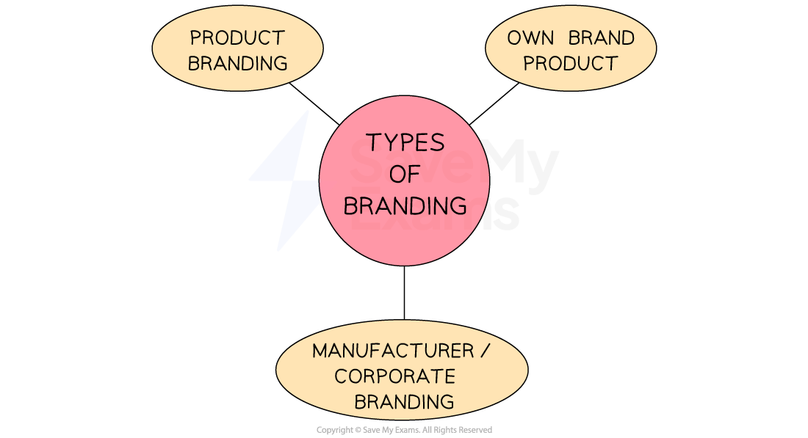

# Product: Products and Brand Image

## Introduction to the Marketing Mix

> **Spec point** — `spcpt_ZvpwnCtDQXV8Q9j4` · "• The limitations and benefits of developing new products
• Brand image; impact on sales and customer loyalty
• The role of packaging"

## Introduction to the marketing mix

- The **marketing mix **provides a framework for businesses to create and implement** successful marketing strategies**

  - Sometimes known as the '**Four P's',** it represents the key elements of a marketing strategy: **product, price, place, and promotion**
  - These four components work together to satisfy the **needs and wants of a target market **while achieving the company's objectives
- By understanding and manipulating the marketing mix, businesses can **differentiate **themselves from competitors, maximise **marketing impact **and achieve **long-term success**

#### The four P's of the marketing mix

*Businesses combine the 4 P's of the marketing mix in appropriate and unique ways to maximise their chances of success*

### 1. Product

- The product design mix refers to the** combination of elements **that make up a product's design

  - These elements include ***function***, ***aesthetics*** and cost
- Balancing the elements of function, aesthetics and cost helps to ensure a product's design is both **functional and attractive **while also being **cost-effective** for both the manufacturer and the consumer

  - Many manufacturers aim to **balance all three elements**
  
    - E.g., *Fentimans* ginger beer is relatively affordable and is packaged in eye catching bottles and the product itself is very good quality
  - Other manufacturers may** focus on one aspect** more than the others
  
    - E.g., Asda's own brand of ginger beer is produced at the lowest possible cost and sold to consumers at a very low price
  - Businesses must take care to balance **customers' quality expectations** with these elements
  
    - The target market may value quality less than price and will not be prepared to pay a high price for goods, even if they are of the highest quality
- Most companies are ***market-orientated*** when developing new products

  - They spend a lot of money researching consumers’ buying habits and their likes and dislikes
  - They then design and package a product, which this research suggests people will want to buy

## New Product Development

> **Spec point** — `spcpt_Qhj2txCMs5cSqpzH`

## New product development

- One way to stay ahead of the competition is by **developing new products** and** innovating existing ones**
- The **process of new product development** involves a number of important stages

1. **Generate ideas**

  - New product concepts are discussed and brainstormed using customer suggestions, ideas from competitors’ products, employees’ ideas and information collected through market and technical research
2. **Select the best idea**

  - Ideas are weighed up with some dropped and others chosen for further research
  - This decision relates closely to costs and likely ***demand***
  - Research includes looking into forecast sales, size of market share, and cost-benefit analysis for each product idea
3. **Develop a *****prototype***

  - This allows the operations department to see how the product can be manufactured, any problems or difficulties arising from its production and how to fix them
  - Computer simulations are often used to produce 3D prototypes on screen
4. **Test launch**

  - The developed product is sold to on a small scale to a limited market to see how well it sells before its full launch
  - Changes may be needed prior to an expensive, large scale launch
  - Digital products like apps and software run beta versions, which is a method of test-launching
5. **Full launch of the product**

  - The finalised version of the product is launched to the entire target market

#### Evaluating new product development

| **Costs** | **Benefits** |
|---|---|
| - Market research collection and analysis regarding the new product is** time-consuming** | - **Sell more products and services to existing customers**    - Making the most of existing relationships is cheaper than finding new customers |
| - **Investment in Research and Development **and design can be very expensive | - Developing new products **spreads *****fixed costs***** **like premises or salaries across a wider range of products |
| - The** costs of producing trial products,** including the costs of wasted materials, can be significant, especially if innovative materials or components are used | - Diversifying the products it offers means a business is less reliant on certain customers or markets |
| - **Low sales** if the target market is wrong or if market or technical research leads to the development of an inappropriate product or service for the market | - Can create a ***unique selling point*** by developing a new innovative product for the first time in the market    - This USP can be used to charge a high price for the product as well as be used in advertising |
| - **Damage to the brand **if the new product fails to meet customer needs | - **Charge higher prices **for new products    - Pricing strategies such as ***price skimming*** can be used for innovative new products |

## The Importance of Brand Image

> **Spec point** — `spcpt_BxBF7PbFPz46Gjjz`

## The importance of brand image

- Developing a **strong brand** involves **creating a unique and identifiable** name, design, symbol or other feature that ***differentiates***** a product or service **or company from its competitors

  - This can help a business to ***add value*** as customers are often **willing to pay higher prices **for brands they recognise and trust
- Branding is a **strategic tool** that helps businesses **create awareness**, **develop strong customer relationships**, **generate loyalty **and sets them apart from competitors

#### The three main types of branding

*Building a brand using one of these three methods, or all of them, will help a business to develop a strong and loyal customer base*

- **Manufacturer or corporate branding**

  - Manufacturer or corporate branding refers to the use of a company name or logo to **promote all the products or services offered by the company**
  
    - This type of branding is used by companies like Nestlé, Nike, and Apple
- **Product branding**

  - Product branding refers to the use of a **unique name, design, or symbol** to promote a **specific product**
  
    - E.g. KitKat, Coca-Cola, and McDonald's Big Mac

- **Own brand product **

  - Own brand or private label branding refers to the use of a retailer's name to promote a specific product or service and is often used by supermarkets
  
    - E.g., ASDA chocolate, Tesco's Finest range, and Sainsbury's Basics range

### How are brands built?

- Brands can be built using various methods, including

  - Developing ***unique selling points***
  - Advertising
  - Sponsorship
  - Social media presence and activity
  - Emotional branding

#### Examples of the ways that brands have been built

| **Method** | **Explanation** | **Example** |
|---|---|---|
| **Unique selling points (USPs)** | - USPs are the features that make a product or service **stand out **from its competitors - Brands can build their reputation by **emphasising these unique qualities** in their marketing efforts | - *Apple* is known for its innovative and **sleek design and use of quality materials**, which sets its products apart from its competitors - The company has built its brand around this USP and is recognised worldwide for its **premium design** |
| **Advertising** | - Brands can **create compelling ads** that resonate with their target audience, raise brand awareness, and communicate their value proposition - With the** right advertising strategy**, brands create a strong emotional connection with their audience and inspire brand loyalty | - *Coca-Cola* has successfully built its brand through advertising - Iconic ads over the years have become synonymous with the brand - E.g. The **"Share a Coke"** campaign  encouraged people to buy *Coca-Cola* bottles with their friends' names on them and was a massive success |
| **Sponsorship** | - Partnering with events, organisations, or individuals can **help brands gain exposure and build their reputation** by aligning themselves with positive associations or values | - *Nike* has **sponsored many high-profile athletes** and sports events, such as the Olympics and the World Cup - The business has built a reputation for being a brand that **champions excellence and inspires people** to be their best |
| **Social media** | - With the right social media strategy, brands can build a loyal following and **create a community around their brand** | - *Glossier* has a strong presence on platforms like Instagram and it engages with its audience and shares user-generated content - *Glossier*'s social media strategy has helped the brand **build a loyal following** |
| **Emotional branding** | - A strategy where companies **build strong emotional connections** with their customers by appealing to their values, beliefs, and emotions | - Brands like *Patagonia* and *TOMS* have built their entire brand identities around their commitments to environmental and social causes, which** resonates with customers** who prioritise these values |

### The benefits of branding to a business

#### 1. Business differentiation

- Branding **differentiates **a business from its competitors

  - This** supports marketing and advertising** efforts to build memorable promotional materials and campaigns

#### 2. Reduces price elasticity of demand

- Customers are **less sensitive to price changes** of products with strong and appealing branding

  - Customers who are **loyal to a brand** are more likely to continue purchasing the product even if the price increases

#### 3. Ability to charge premium prices

- Customers may be **willing to pay more** for a product that is associated with a **well-established brand**

  - They often perceive products with strong branding to be of higher quality and therefore worth the extra cost

#### 4. Establishes recognition and identity

- Strong branding helps to build trust and credibility

  - This can create an emotional connection with customers, which helps **generate repeat purchases**

## The Role of Packaging

> **Spec point** — `spcpt_2SDFpCWfmQxcQF6F`

## The role of packaging

- **Packaging **is the physical container or wrapping for a product. It is also used for promotion and selling appeal
- Packaging is normally **designed to**

  - **Present **products in the most practical yet attractive way
  - **Communicate** the quality of the product
  - **Catch the customer's eye** when they shop
  - Provide** key information to customers**
  - **Establish the business brand image**
- To stand out from the competition and establish a long-lasting relationship with consumers, brands are investing more money than ever before in **creative and environmentally friendly packaging designs**

  - This is becoming increasingly important for businesses as they place a **greater emphasis on sustainability** and their ***CSR*** policies

> **Exam Hint**
> Brands are considered ***intangible assets*** on a company's balance sheet. A strong brand adds to the overall value of these intangible assets, which may be an important part of a company's **net worth **and** make it more attractive to investors.**
