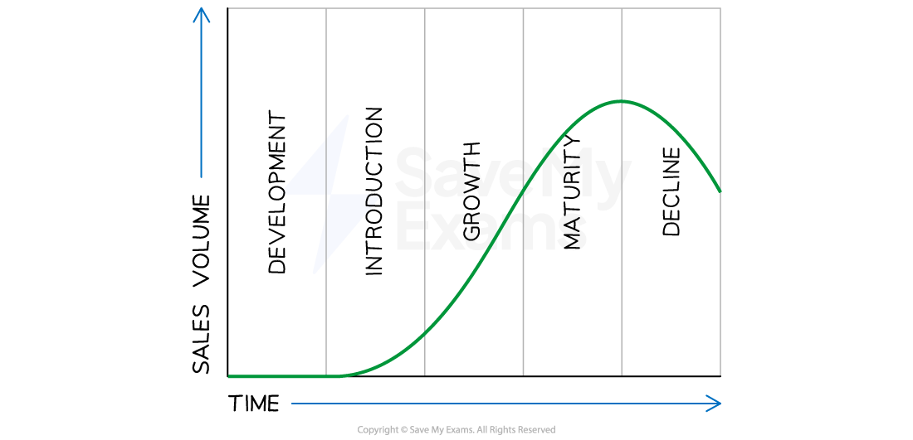

# Product: The Product Life Cycle

## The Product Life Cycle

> **Spec point** — `spcpt_hbw7HSD3wHkFjbHB` · "• The product life cycle: main stages and extension strategies; draw and interpret a product life cycle diagram
• How stages of the product life cycle can influence marketing decisions, e.g. promotion and pricing decisions"

## The product life cycle

- The product life cycle describes the **different stages a product goes through** from its conception to its eventual decline in sales
- There are typically **five stages in the product life cycle:** development, introduction, growth, maturity, and decline

#### The product life cycle diagram

*The five stages a product goes through over its life span - from initial development to eventual decline *

- The implications for ***cash flow*** and **marketing** vary at each stage of the product life cycle
- Companies should **tailor their marketing strategies** and manage their ***cash flow*** to ensure long-term profitability and success

#### The impact of the product life cycle on cash flow and marketing strategy

| **Stage** | **Explanation** | **Implication** |
|---|---|---|
| **Development** | - The focus is on designing and developing the product - The business **usually incurs high costs** for research and development, market research, and product testing | - **Cash flow is usually negative** during this stage, as the company is investing heavily in the product without generating any revenue - **The marketing strategy** during this stage is focused on creating awareness and generating interest in the product |
| **Introduction** | - The stage begins when the product is launched - Characterised by **slow sales growth** as the product is still new and unknown to most consumers | - **Cash flow is usually negative** as the business usually incurs high costs for promotion, advertising and distribution - **Marketing efforts are focused on** creating awareness and generating interest in the product |
| **Growth** | - The product enters this stage when sales begin to increase rapidly - The business focus shifts to **building *****market share*** and **increasing production** to meet this growing demand | - **Cash flow usually turns positive **during this stage as sales revenue increases and costs are spread out over a larger volume of production - **The marketing strategy **is to ***differentiate***** **the product from its competitors and build brand loyalty |
| **Maturity** | - Characterised by high sales but **slowing sales growth** - ***Market saturation*** is likely | - **Cash flow is usually positive** during this stage as sales revenue continues to come in and costs are reduced through ***economies of scale*** and efficient production processes - **The marketing strategy** aims to maintain market share and increase profitability by cutting costs and finding new markets |
| **Decline** | - Starts when sales begin to decline as the product **becomes obsolete** or is replaced by newer products - The business focus shifts to managing the product's decline and reducing costs | - **Cash flow usually turns negative** as sales revenue declines and costs associated with the product's decline increase - **The marketing strategy** may involve discontinuing the product, reducing prices to clear stock, or finding new uses for the product |

## Extension Strategies

> **Spec point** — `spcpt_zHxgJs4yphcV89Ch`

## Extension strategies

- Extension strategies refer to the techniques used by businesses to **extend the life of a product beyond its natural life cycle**
- These strategies are **designed to boost sales **and maintain profitability for a product that has** **reached the** late maturity or decline stage** of its life cycle
- There are two types of extension strategies which are often **implemented at the same time**

  - Product-related extension strategies
  -

### Product-related extension strategies

- **These are strategies that changing or modify the product to make it more appealing to customers **
- This could involve improving or adding features, increasing capacity or redesigning its appearance

  - **Product improvements **e.g. Samsung releases new versions of its Galaxy Smartphone every year with upgraded features and improvements to the previous model
  - **Line extensions,** e.g. Coca-Cola introduced Diet Coke and Coke Zero as line extensions of its original Coca-Col
  - **Repositioning** e.g. when IBM's personal computer division started losing market share to other brands, it repositioned its products as high-end business machines and focused on the enterprise market

### Promotion-related extension strategies

- These strategies aim to change the promotional activity related to the product
- This could involve:

  - **Changes to advertising **e.g Kellogg's continues to recreate adverts for its Corn Flakes cereal, which has been around since 1906
  - **Price promotions,** e.g. Cyber Monday occurs on the first Monday after Thanksgiving in the USA and electronic firms discount prices significantly in order to boost sales of their products
  - **Sales promotions, **e.g. many coffee shops offer a **loyalty programme** where customers can earn a free drink for every six consumed
