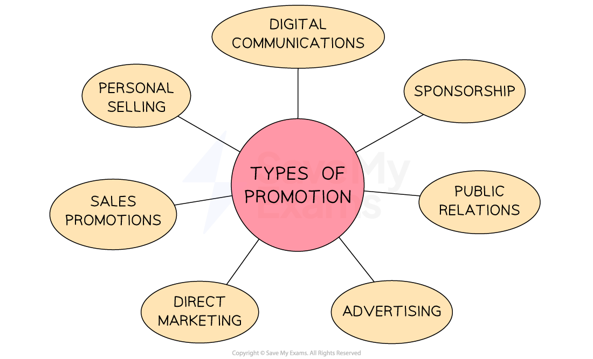

# Promotion

## The Aims of Promotion

> **Spec point** — `spcpt_KRfwMfJRcXGmTXCG` · "• The aims of promotion
• Different forms of promotion and how they influence sales, e.g. advertising, sales promotion
• The need for cost-effectiveness in spending the marketing budget on promotion"

## The aims of promotion

- Promotion plays a crucial role in **generating customer awareness**, interest and desire for a product

  - It communicates a businesses** *****value proposition*** to potential customers and helps to differentiate the product or business from competitors

*Promotion aims to support sales of new and existing products, inform customers and improve brand and business image*

## Types of Promotion

> **Spec point** — `spcpt_9fBSbMM6fgR4k7rr`

## Types of promotion

- **Above-the-line promotion** refers to **advertising**  aimed at reaching a wide audience through traditional mass media channels

  - Advertising may use media such as **television, radio, newspapers, magazines** and** outdoor sites** such as billboards
- **Below-the-line promotion **includes marketing communications over which **a business has direct control **and which d**o not make use of mass media**

  - These channels include direct marketing, sales promotions, personal selling and public relations (PR)
- Businesses have a **wide choice of promotional tools and techniques**

  - They must select the **most appropriate methods** for their product, target audience and budget

*Businesses may choose to use several of these methods to promote their products*

### Explaining the different promotional methods

#### 1. Advertising

- Promotion through **paid channels** such as television, radio, print media, online advertising and outdoor advertising

| **Advantage** | **Disadvantage** |
|---|---|
| - Can reach large audiences and increase brand awareness - Can **create a specific brand image** or message, e.g. the advertising campaign run by Compare the Market (Meerkat) | - is often **difficult to measure** - Many customers **tune out or ignore** advertising |

#### 2. Direct marketing

- Communicating directly with customers through email, text message, social media or post

| **Advantage** | **Disadvantage** |
|---|---|
| - **Targets specific audiences** and allows personalisation of the message to individual customers - Businesses can **track results** (for example, online advert clicks) and adjust their strategy accordingly | - Can be **intrusive** as customers may perceive it as spam - Can also be costly, especially if businesses need to **purchase customer databases** |

#### 3. Sales promotions

- Temporary incentives or discounts such as free samples, **buy one get one free (bogof)**, discount coupons, loyalty cards,] and rebates (customers have to mail in to receive money back)

| **Advantage** | **Disadvantage** |
|---|---|
| - Can quickly boost sales or customer engagement through **impulse purchases** - Can help to** clear out stock** or promote a new product - Can be** targeted **at specific groups of customers | - Heavy discounting **reduces revenue** significantly - Attract **deal-seeking customers** who may not be loyal to the brand - May reduce sales of full-priced products |

#### 4. Personal selling

- A salesperson interacts with potential **customers one-on-one** either in person or through digital channels

| **Advantage** | **Disadvantage** |
|---|---|
| - **Builds relationships** with customers and helps to understand their specific needs - Can provide **personalised advice and guidance** to customers | - **Hiring and training sales staff **increases costs - **Difficult to scale** the approach to larger audiences |

#### 5. Sponsorship

- Agreement where a business provides **financial or other support **to an event, team, or organisation in exchange for marketing exposure
- Can take many forms, such as **logo placement or naming rights** (For example, Arsenal's Emirates Stadium)

| **Advantage** | **Disadvantage** |
|---|---|
| - **Builds brand awareness** and credibility - **Creates emotional connections** with the  target audience - May support specific business objectives such as entering new markets or **reaching new customers** | - Sponsoring high-profile events or properties can be **expensive** - May not directly drive sales - **Negative publicity** is a risk    - E.g. In 2022 Kanye West was dropped by sponsor Adidas when he made a series of offensive statements |

#### 6. Public relations (PR)

- Building relationships with the public and manage business reputation
- Include **media relations, product launches, crisis management and community outreach**

| **Advantage** | **Disadvantage** |
|---|---|
| - Can enhance a business's **reputation **and **credibility**    - For example, a **brilliant PR strategy** helped **KFC** to communicate with customers in 2018 when supply chain issues causes UK and Ireland KFC outlets to run out of chicken - **Cost-effective **when compared with advertising or personal selling | - Can be **time-consuming** - **Difficult to measure** the direct impact of PR activities on profits |

#### 7. Digital communications

- Promotions or communication delivered electronically, such as social media, search engine optimisation (SEO) or **social media apps such as Instagram **and** Twitter**
- Can be used for building brand awareness, generating leads or driving sales

| **Advantage** | **Disadvantage** |
|---|---|
| - Can be highly targeted to **specific customer segments** - Can provide **real-time engagement and feedback** from customers | - Easily ignored or filtered out by customers - May require **significant investment in technology** or data infrastructure - May **not be effective for reaching older** or less tech-savvy customer segments |

## Spending the Marketing Budget Effectively

> **Spec point** — `spcpt_zYKR2d2S6sZDsjkN`

## Spending the marketing budget effectively

- A **marketing budget** is the plan for marketing spending over a specific time period

  - A budget helps the business to determine **how much can be spent** on advertising, sales promotions and other promotional activity
  - It allows the effectiveness of the marketing department to be assessed
- The **size of the marketing budget** can be calculated in several ways

  - Using **market and competitor averages**
  
    - E.g., using a proportion of sales revenues
  - Using the **businesses marketing objectives**
  
    - E.g., How much needs to be spent to increase market share by 5%
  - **Using figures from the the previous** **year** and adjusted for known changes in the marketing activities this year
  
    - E.g. the budget may have increased this year due to the development of a new product
- A small budget** limits the media a business can use for** **advertising** or the **techniques it can use**

  - Smaller businesses often find it difficult to use promotion to compete with larger businesses
  - Online promotional activity may be the most cost-effective way to reach large or targeted audiences
- A business will need to **compare the cost of promotional activity with increases in sales** it generates

  - **Over time** businesses will determine the **most effective methods** for their specific circumstances

> **Exam Hint**
> Make sure you can select suitable promotional strategies for particular products and explain why they are suitable. Remember that advertising does not necessarily increase sales and profits. More subtle promotional efforts can achieve outstanding results too.
> 
> Advertising may increase sales, but if prices have been reduced and advertising expenditure increased, then profits may not increase.
