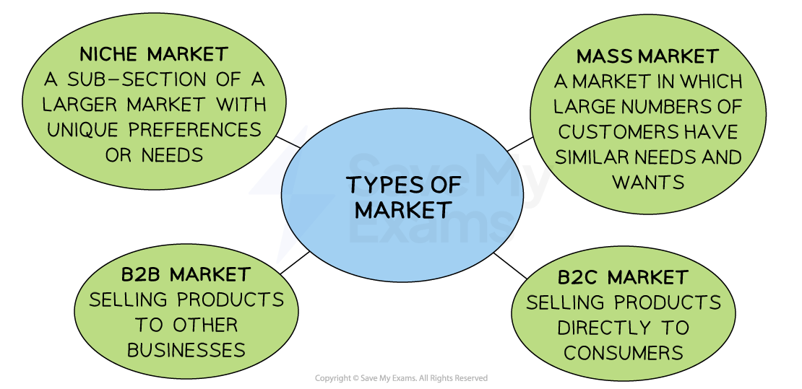

# Developing Appropriate Marketing Strategies

## Marketing Strategy

> **Spec point** — `spcpt_NdNNRrn4GPXy2jP7` · "• Importance of different elements of the marketing mix in influencing consumer decisions in given circumstances
• Recommend and justify an appropriate marketing strategy in given circumstances"

## Marketing strategy

- **A marketing strategy** is a plan that combines the four elements of the marketing mix to **achieve specific marketing objectives**

*Marketing strategies will be very different when selling in a B2B market as compared with a niche market*

- **Marketing strategies** vary depending on the** type of market** being targeted

  - Mass markets, ***niche markets***, business-to-business (B2B) and business-to-consumer (B2C) markets are likely to require different approaches

### A comparison of marketing strategies in different markets

#### Mass markets

- Mass markets are markets in which large numbers of customers have** similar needs and wants,** e.g., retail clothing
- Strategies** focus on building brand awareness** and appealing to a broad audience

  - Advertising campaigns are usually designed to **reach as many people as possible** and use mass media such as TV, radio, and print ads
  - The messages are often simple and the goal is to create a strong brand identity that resonates with a** large segment** of the population

#### Niche markets

- **Niche markets are a sub-section of a larger market with unique preferences or needs **e.g organic food stores, luxury car dealerships
- Strategies focus on **targeting a specific segment** of the population and building relationships with them

  - Advertising campaigns are usually very targeted and may use social media to reach potential customers
  - The messages are often more detailed and **often include technical information** that is relevant to the specific needs of the target market

#### B2B markets

- Selling products** to other businesses, **e.g. manufacturers selling parts to other manufacturers
- The emphasis is on **building relationships with other businesses** and demonstrating how **your product can help** them be more successful

  - Advertising campaigns may include case studies that demonstrate the value of your product or service
  - The messages are often **more technical **and may focus on features and benefits that are relevant to other businesses

#### B2C markets

- Selling products** directly to consumers **or via wholesalers or retailers
- The emphasis is on **building brand loyalty** and creating a **positive customer experience**

  - Advertising campaigns may include social media ads or influencer marketing campaigns that appeal to the emotions of consumers
  - The messages are often more **emotional** and may focus on the** lifestyle benefits** of using the product or service

## Importance of the Marketing Mix in Influencing Consumer Decisions

> **Spec point** — `spcpt_yhghh5CSftmvfVzf`

## Importance of the marketing mix in influencing consumer decisions

- The **marketing mix** has a significant impact on consumer decisions

  - Businesses need to thoroughly consider each element when developing a suitable marketing strategy so that it is **attractive** to the intended target market
  - A change in one element can have a significant impact on the others
  
    - E.g., An increase in price may require a redesign of packaging to encourage customers to consider a product to be of higher quality
  - The **marketing mix should change** as a product moves through different stages of its ***product life cycle***
  
    - E.g., Newly-launched products may be sold at a low price initially until sales start to grow; at this point, the price may be increased to improve ***profit margins***

- If the marketing strategy **fails to combine the elements of the marketing mix appropriately,** the marketing objectives are unlikely to be achieved

### The influence of the marketing mix on consumer decisions

#### 1. Product

- The product/service is the **heart of the marketing mix** and determines all other elements

  - Price, the target audience, distribution methods and promotional activity stem from the product
- If the product changes, then all other elements of the mix will likely **need to change**

  - E.g., the launch a **premium version of a product** may require an increase the price and redesigned promotional activity to reflect the new product's value
- **Questions to consider**

  - Is the product brand new, or is it an existing product?
  - What type of product is desired by the target market?
  - What changes need to be made to the product to make it more desirable?

#### 2. Price

- The price of a product is closely linked to its **perceived brand value**

  - If a product is priced too high, it may be perceived as too expensive by the target audience, leading to lower sales
  - If a product is priced too low, it may be **perceived as low quality,** leading to lower sales
- Increasing the price may require changes to the promotion strategy, which are aimed at convincing consumers of the products **value**
- **Questions to consider**

  - What price do key rivals charge?
  - What price is the ***target market*** willing and able
  willing to pay?
  - What impact might promotional pricing have on demand?

#### 3. Promotion

- The **promotion strategy can affect the price and distribution channels**

  - E.g. If a business decides upon promotional activity that emphasises luxury, it may need to increase the price to reflect the product's value
- **Questions to consider**

  - What is the promotional ***budget***?
  - How does the target market respond to different methods of promotion?
  - What methods do rivals use to promote their products?

#### 4. Place

- **Distribution and sales channels affect the price and promotion strategy**

  - E.g. if a business decides to use exclusive distribution channels, it may need to increase the price to reflect the exclusivity of the product
- **Questions to consider**

  - What channels of distribution are most appropriate for the product?
  - Where does the target market expect to be able to buy products?
  - What channels of distribution do rivals use?

## Recommending an Appropriate Marketing Strategy

> **Spec point** — `spcpt_tKC9TYVZs2kdf7wd`

## Recommending an appropriate marketing strategy

- Each business combines the different elements of the marketing mix in **unique ways** for each product or range they sell
- Elements to consider when formulating an appropriate marketing strategy include:
- **Marketing budget for the project**

  - E.g. Which advertising media or promotional tactics are affordable?
  
    - Large budgets will allow a business to use mass media such as TV advertising, whilst smaller budgets may afford only minimal promotional activity using social media
- **Marketing objective to be achieved**

  - E.g. Is the plan to increase market share or launch a new product range?
  
    - Increasing market share may require an emphasis on low prices, whilst price skimming may be important when launching a new product range
- **The intended target market for the product**

  - E.g. Is the product to be aimed at families or single-person households?
  
    - Products aimed at families may be sold in large multipacks, whilst single-person households may be targeted with smaller quantities of standard products
- **Is it a balanced marketing mix?**

  - Do the elements of the mix effectively complement each other?
  
    - Luxury products are likely to require a premium price, whilst products sold in supermarkets may be sold in bright packaging to stand out from other brands

### Consider the nature of each product

- Each product is **unique **and a **different marketing mix will be needed**

  - For a **music streaming service** such as Spotify, the place element is not as important as the other elements, as consumers can access the service from anywhere
  - For the increasing number of **vinyl stores,** location in popular high-street locations is vital to success and location is a key element of their marketing mix

- Many **service-based businesses,** such as **Save My Exams** or recruitment companies like **The International Educator, **have set up as remote companies with employees working from home and **services delivered exclusively online**

  - This reduces business costs and gives a competitive advantage over competitors who continue to **incur office expenses**
  - Facilities can be hired for company get togethers or **essential business meetings**

> **Exam Hint**
> The context of the business provides information on the best way forward for each element of the marketing mix. Your case study data will usually set the context and have an appropriate response in mind. When reading case study data, think about the 4Ps and identify what seems to be
> 
> - Any issues with the current marketing strategy
> - Changes the firm could make to improve its sales revenue and profits
