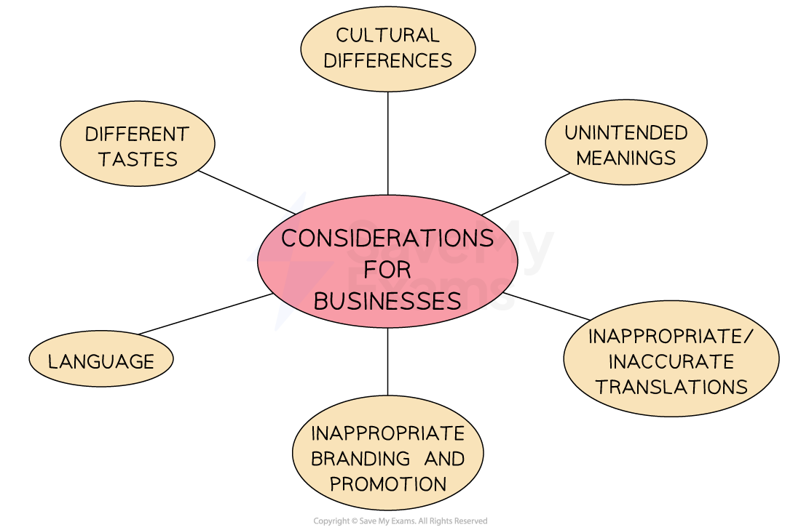

# Entering Foreign Markets

## The Potential of New Markets

> **Spec point** — `spcpt_cBZWhCgbD98Rjdpy` · "• Growth potential of new markets in other countries
• Problems of entering foreign markets, e.g. cultural differences and lack of knowledge"

## The potential of new markets

- Entering new international markets has proved **attractive to many businesses**

  - The** internet** makes it easier than ever to enter international markets
  - **Financial systems** are much more joined up, making it much easier for money to flow between countries
  - This is a natural part of growth once a successful business has saturated their market share for a particular product

*Entering and operating successfully in international markets can generate higher levels of profit*

### The benefits of entering international markets

#### 1. Economies of scale

- Operating on a larger scale can reduce unit costs
- Potential for higher profit margins
- Flexibility to reduce prices to gain market share

#### 2. Brand recognition

- Higher visibility of branding (e.g. product/brand names, packaging)
- Particularly relevant to the ethnocentric approach
- Improves brand loyalty/repeat sales

#### 3. Spreading risk

- Less exposure to market change in one country
- May avoid localised economic downturns

#### 4. Increased volume of customers

- Potential to earn high level of sales revenue
- Access distribution economies of scale

#### 5. Extends the product life cycle

- Avoids saturation/decline in domestic market
- May reduce the need for spending on research and development

## Problems of Entering Foreign Markets

> **Spec point** — `spcpt_hWq7zTjgkH36Jq9G`

## Problems of entering foreign markets

### 1. Lack of knowledge of the market

- The business may lack** of knowledge of customer needs or tastes**so they may produce wrong style of product or not cater to the market's needs

  - E.g., Tesco struggled to compete with local supermarkets in China and suffered from distribution issues

### 2. Higher transport costs

- There may be **less reliable or more expensive distribution channels **
- Moving products around the world requires reliable but complex logistics systems

  - Developments in large-scale containerisation as well as long-distance freight transport by rail is improving global distribution

### 3. Established competition

- Problems of **established competitors **in the market may make it harder to establish market share

  - High brand loyalty may exist to local brands and it can take time for customers to build trust towards a foreign brand

### 4. Trade barriers

- **Protectionism **is** **when a government seeks to **protect domestic industries from foreign competition**

  - Governments may impose** *****tariffs*** or ***quotas*** on imports from businesses in other countries
  
    - E.g., Cricket bats imported into the UK from Australian manufacturers such as *Bradbury* and *Kraken* have a tariff applied to them, which may help to increase **demand** for UK-produced brands such as *Kippax *and* Fearnley*

### 5. Exchange rate changes

- The exchange rate is the **value of one currency expressed in terms of another**
- Exchange rates are an important economic influence for businesses that  ***import*** ** **raw materials and components and for businesses that ***export ***their product
- The value of a currency can ***appreciate*** or ***depreciate ***over time

  - Businesses are particularly at risk from **fluctuating **exchange rates as they make planning and forecasting difficult

### 6. Cultural and social factors

- Global businesses must consider various **cultural and social factors** to effectively market their products and services in different countries and regions

*Cultural and social factors to consider in global markets*

- **Cultural differences**

  - Businesses must respect and adapt to the customs, values, and traditions of different cultures to avoid offending potential customers or alienating markets
- **Unintended meanings**

  - Words, symbols, or images used in one country might carry completely different or even offensive meanings in another, risking misinterpretation of marketing messages
- **Inappropriate or inaccurate translations**

  - Poorly translated content can distort the intended message, confuse customers, or even damage the brand’s reputation. Accurate, context-sensitive translations are vital
- **Inappropriate branding and promotion**

  - Promotional strategies or brand names that work in one market may be considered offensive or ineffective in another due to social norms or laws
- **Language**

  - Even within the same language, regional dialects or expressions may differ. Businesses must use appropriate, clear, and locally understood language in their communications
- **Different tastes**

  - Product flavours, features, or aesthetics that are popular in one country may not appeal to consumers in another. Businesses must conduct research to adapt to local preferences

> **Exam Hint**
> Always consider the context of the business provided in case study. For example, Toyota’s target market is diverse in terms of consumer preferences, regional and local market conditions. The company’s marketing mix is tailored to respond to these variations
> 
> - In high-income countries such as Singapore it markets the exclusive Lexus range heavily
> - In lower-income countries such as Vietnam it charges competitive prices for rugged vehicles with few extras or special features
