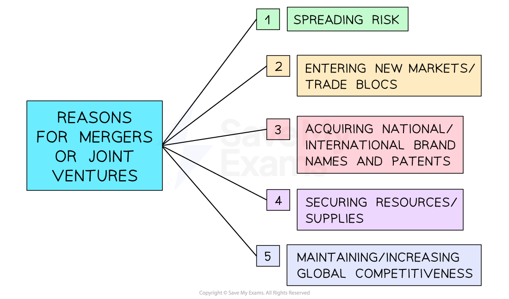

# Joint Ventures and Licensing

## Overcoming Problems of Entering Foreign Markets

> **Spec point** — `spcpt_TvHq3rWg2m825nFV` · • Benefits and limitations of methods to overcome such problems, e.g. joint ventures, licensing

## Overcoming problems of entering foreign markets

- Two common strategies used by businesses to try and overcome the problems of entering new markets are global mergers and joint ventures

  - A** global merger **is an agreement between two businesses from two different countries to join together
  - **A joint venture **occurs when two businesses join together to share their knowledge, resources and skills to form a separate business entity
  
    - E.g., The mobile network EE is a joint venture formed by the French mobile network, Orange and the German mobile network, T-Mobile
- These strategies may be more cost effective than ***exporting***, ***licensing*** and ***franchising***

*Key reasons for global mergers and joint ventures *

### Reasons for mergers or joint ventures

#### 1. Spreading Risk

- Operating in more than one market helps to **reduce reliance** on one geographical market

#### 2. Entering new markets

- Entering a market or ***trade bloc*** using a merger/joint venture is a quicker method than using ***organic growth***

  - In emerging economies, many governments insist that foreign businesses can only **operate as a joint venture** as this can benefit domestic businesses
  - Forming a joint venture with a local company allows the joining business to **gain knowledge and business of the local markets **

#### 3. Acquiring national/international brand names/patents

- A **patent** is the legal right given by the government to an individual or business to make, use or sell an invention and exclude others from doing so
- **The process of developing intellectual property can be a long and expensive process**

  - Using a merger/acquisition is a method businesses can use to get access to ***intellectual property*** or a business with a strong reputation

#### 4. Securing supplies

- A joint venture with a supplier can ensure that **scarce resources** used in manufacture are more likely to be available

#### 5. Increasing global competitiveness

- Mergers and joint ventures can give businesses access to **new technologies, expertise, and economies of scale**, helping them operate more efficiently
- Partnering with local or international firms can improve **innovation and product quality**, enabling the business to compete more effectively on a global scale

#### 6. Evaluating mergers and joint ventures

| **Benefits** | **Drawbacks** |
|---|---|
| - ***Economies of scale*** gained from costs being spread over larger output can lead to increased profit margins - **Diversifying risk **due to having products in several markets so if there is a fall in sales of certain products, the business can still generate revenue from other products - **Opportunity to enter new markets **which otherwise may be closed to the business | - The** initial costs **of merging can be significantly high, with no guarantee a business will gain a return on their investment - ***Diseconomies of scale*** can occur due to communication issues and a lack of control as the business expands - A ***culture clash*** between the two businesses can affect the quality of the business, leading to poor sales |
