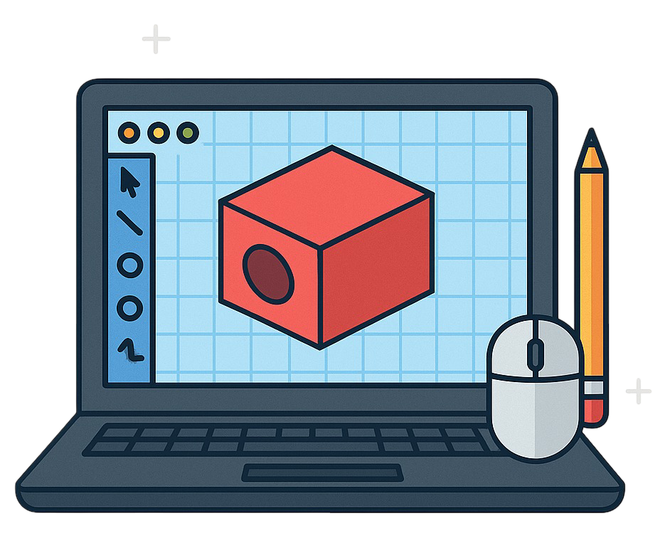

# The Impact of Technology on Production

## Technology & Production

> **Spec point** — `spcpt_f4ckMqnf4WDwF2kC` · How technology has changed and is changing production methods, e.g. using computers in design and manufacturing

## Technology and production

- New technology is** revolutionising flexibility** in design and production
- Two examples of this are

  - The use of ***computer aided design (CAD)***
  - The use of 3D Printers

### 1. Increased use of computer aided design

- The use of computers in design has transformed production by making it **faster, more flexible, and more precise**, helping businesses bring better products to market more efficiently

*Computer aided design improves efficiency and accuracy*

#### Key benefits of using computers in design

- **Improved accuracy**

  - CAD reduces human error in measurements and design
- **Faster design process**

  - Designers can create, modify, and test product designs more quickly
- **Easy modifications**

  - Designs can be adjusted or duplicated with minimal effort
- **3D modelling and visualisation**

  - Allows realistic previews of the final product, helping businesses test ideas before physical production
- **Better collaboration**

  - CAD files can be shared digitally across teams, even globally

#### Impact on production

- Leads to **faster product development**
- Makes *customisation* of products easier
- Improves **communication between design and manufacturing teams**, especially when paired with CAM (Computer-Aided Manufacturing)

### 2. Increased use of 3D printers for production

- Digital designs are uploaded and the printer produces the product **with minimal labour costs**
- Digital printers have been used to print car engines, houses, food and more

#### The impact of 3D printing on production

| **Impact** | **Explanation** |
|---|---|
| **Cost** | - Traditional manufacturing processes **require expensive tooling** and machinery    - This is a significant upfront cost for small businesses - 3D printing reduces the cost of manufacturing as there is **no need for expensive tooling** |
| **Productivity** | - With traditional manufacturing, there are often **long *****lead times*** for tooling and set-up    - This can delay production - 3D printing allows** quick production **with minimal lead times    - New **products are brought to market faster**   - Changing customer tastes can be catered to |
| **Quality** | - Traditional manufacturing may find it **difficult to produce complex or intricate** designs - 3D printing allows for precise and accurate** production of complex shapes and designs**, resulting in higher quality products |
| **Flexibility** | - Traditional manufacturing makes **customisation **to meet specific needs of customers difficult - 3D printing allows for small production runs, which reduces the costs of a specific **job production** |
