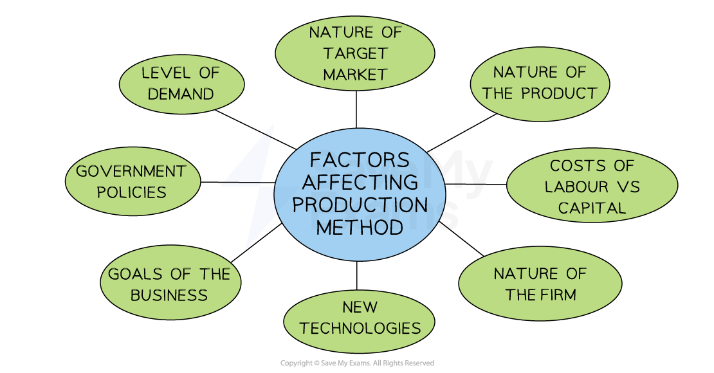

# The Main Production Methods

## Different Types of Production Processes

> **Spec point** — `spcpt_wnBqVjgxBxVjfprx` · "• Features, benefits and limitations of job, batch  and flow production
• Recommend and justify an appropriate production method for a given situation"

## Methods of production

- Businesses can **organise their production** processes in a variety of ways
- The method of production used by a business will depend upon a number of factors

  - The **level of output **required to be produced
  - The **nature** of the product
  - Whether the product is **standardised or customised**
  - The level of ***automation*** used in production

*The main methods of production*

### Explaining the methods of production

#### 1. Job Production

- Manufacturers produce **one product at a time** as ordered by the customer
- Advantages:

  - **High quality **product
  - Motivated and **highly skilled workers**
  - Customised products can be produced
- Disadvantages:

  - Production is **slow**
  - **Labour costs** are high

#### 2. Flow production

- **Continuous manufacturing** of standardised products, usually on a production line
- Advantages:

  - Low unit costs due to ***economies of scale***
  - Rapid production
  - Usually highly automated (***capital intensive***)
- Disadvantages:

  - Customisation is **difficult**
  - Capital equipment can be **expensive to purchase**

#### 3. Batch production

- Groups of the same product are produced as a batch, e.g., 1000 Blueberry muffins
- Advantages:

  - Workers can **specialise**
  - Production can take place as the previous 'batch' starts running out
- Disadvantages:

  - **Requires careful coordination** to avoid shortages
  - Money is** tied up in stock**
  - Completed products need to be stored

## Recommending an Appropriate Production Method

> **Spec point** — `spcpt_twJWG4fBWhQ2b3kY`

## Recommending an appropriate method of production

- **Small scale businesses often use job or batch production** as they lack the resources for flow production
- **Large scale businesses **are more likely to **use flow production** to meet high demand for their products
- Several **factors may influence a businesses decision** as to which type of production methods is used

#### Factors affecting the choice of production method

*A business may change production methods as it grows over time*

### Explanation of factors

1. **The level of demand**

- High demand may justify investment in flow production

2. **The nature of the target market**

- Price-sensitive markets may require high volume, standardised products
- High quality customised products require job production

3. **The nature of the product**

- It may only be possible to produce certain products using one method, e.g. sports stadiums require job production

4. **The comparative costs of labour and capital**

- Large firms minimise labour costs by investing in automation
- Cheap labour allows for labour-intensive production methods, which generates the use of job or batch production

5. **The nature of the firm itself**

- Small firms lack funds to invest in flow production

6. **New technologies**

- As technologies become cheaper, smaller firms can afford equipment previously inaccessible to them and increase their level of flow production

7. **The goals of the business**

- Firms seeking to maximise market growth and profitability may invest in flow production
- Small firms may use job production methods to create unique selling points e.g. ‘hand-made’

8. **Government policies**

- The government may stimulate economic growth by offering subsidies and tax breaks for investment in technology

> **Exam Hint**
> Carefully consider the needs of the customers to whom a business sells when recommending a suitable method of production. Where the selling price is a key driver of consumer demand, flow production (where ***unit costs*** are minimised) is likely to be very suitable. Where demand is driven by quality or where customisation is required, job or batch production is likely to be a better choice.
