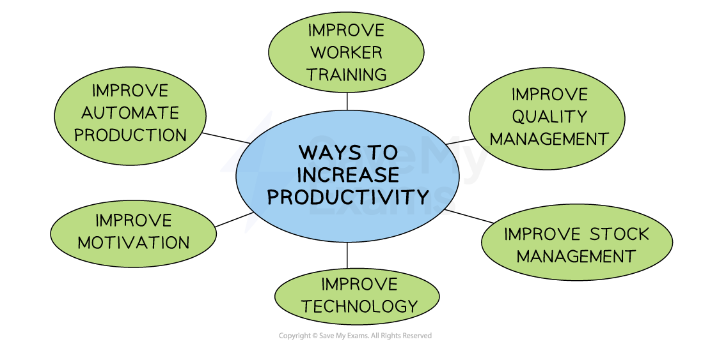

# The Meaning of Production

## Introduction to Production

> **Spec point** — `spcpt_wBMgbHQNSfmKpDWT` · "• Managing resources effectively to produce goods and services
• Difference between production and productivity
• Benefits of increasing efficiency and how to increase it, e.g. increasing productivity by automation and technology, improved labour skills
• Why businesses hold inventories"

## An introduction to production

- Production is the **transformation of resources** (e.g. raw materials, components and labour) into finished goods or services

  - Goods are **physical products**, such as bicycles and T-shirts
  - Services are **non-physical items **such as hairdressing, tourism and manicures

#### The purpose of production

*Raw materials are converted into finished goods/services. This process requires production and the productivity of workers or machines*

- The process of transforming inputs into outputs (goods and services)** *****adds value***** **to the raw materials
- Competitive businesses combine **these inputs of resources efficiently, making the most of the resources so as **to minimise costs and generate a ***profit***
- Operations management focuses on **designing, controlling **and **improving** the **processes **used in the **production of goods and services**

  - It involves overseeing the entire production process, from acquiring raw materials to delivering the final product/service to customers
  - Its goal is to ensure that the **production process is efficient, cost-effective and meets quality standards**

## The Difference Between Production & Productivity

> **Spec point** — `spcpt_snMwTNPjWqjqX4qY`

## The difference between production and productivity

- The terms** production and productivity** are fundamentally different
- **Production** is the act of ***adding value*** to the factors of production to create goods/services e.g. using tomatoes & basil to create a soup

  - It is the process of converting the ***factors of production***** **into goods/services
  - It is a **measure of output** e.g. 3 cans of soup
- **Productivity **is a **measure of efficiency** that calculates the amount of **outputs produced per unit of input**

  - It calculates **how efficiently **resources are being used in the creation of goods/services and aids comparison of performance e.g. after training, workers proved to be 27% more efficient in their productivity
- **Labour productivity** is calculated using the formula

$\mathrm{Labour} \mathrm{productivity}=\frac{\mathrm{Output}}{\mathrm{Number} \mathrm{of}w\mathrm{orkers}}$

### Improving productivity

- Productivity can often be improved so as to **reduce** **costs**
- This can be achieved by:

  - Increasing output using the same level of inputs
  - Maintain the level of output but using fewer inputs

- When costs decrease, a business can either pass on savings to consumers in the form of **lower prices** or maintain the selling prices and enjoy higher ***profit margins***
- Businesses that increase their level of productivity are likely to be** more competitive** and are more likely to be successful in the long term

> **Worked Example**
> The table shows the number of pairs of luxury wool socks produced by *Sokkemani* in 2021 and 2022
> 
> | **Year** | **Units Produced** |
> |---|---|
> | 2021 | 46,000 |
> | 2022 | 69,000 |
> 
> In 2021 *Sokkemani* employed 50 staff. In 2022 the number of staff employed by the business increased by 20%
> 
> Calculate *Sokkemani*'s* *productivity in 2021 and 2022.**  ****[3 marks]**
> 
> **Step 1: Calculate the labour productivity for 2021**
> 
> $=\frac{46,000\mathrm{units}}{50\mathrm{workers}}\,\,=920\mathrm{units} \mathrm{per} \mathrm{worker}$**         **** (1)**
> 
> **Step 2: Calculate the number of workers in 2022**
> 
> $=50\mathrm{workers}\times1.20\,\,=60\mathrm{workers}$              **(1)**
> 
> **Step 3: Calculate the labour productivity for 2022**
> 
> $=\frac{69,000\mathrm{units}}{60\mathrm{workers}}\,\,=1,150\mathrm{units} \mathrm{per} \mathrm{worker}$**        ** **(1)**

## The Benefits of Increased Efficiency

> **Spec point** — `spcpt_678gfYxX4HBNnYzW`

## The benefits of increased efficiency

- Efficiency refers to the ability of a business to **use its production resources** as cost-effectively as possible

  - Efficiency is often measured in terms of the **average cost per unit**
  - The average cost per unit is calculated using the formula

$\mathrm{Average} \mathrm{cost} \mathrm{per} \mathrm{unit}=\frac{\mathrm{Total} \mathrm{costs}}{\mathrm{Number} \mathrm{of} \mathrm{units}}$

- **Maximum efficiency **is achieved when the cost per unit is at its lowest
- Businesses that increase their level of productivity (e.g of workers or capital equipment) are likely to be** more competitive**

#### The benefits of improved efficiency

*The link between productivity and competitiveness*

- Businesses that are competitive usually generate more profit
- This provides the **financial resources** to continue investing in improvements to their productivity

## Why Businesses Hold Inventories

> **Spec point** — `spcpt_jP7zfnd5mPJwHvKJ`

## Why businesses hold inventories

- Businesses hold inventories (also called stock) to support smooth operations and avoid disruptions
- Types of inventories include:

  - **Raw materials**—to keep production running without delays
  - **Work-in-progress**—partially completed goods between stages of production
  - **Finished goods**—ready to be sold to meet customer demand promptly
- Reasons for holding inventories include:

  - To **prevent *****stockouts*** and lost sales
  - To take advantage of *bulk purchasing discounts*
  - To **buffer against supply chain delays**
  - To ensure **continuous production** even when delivery of materials is uncertain
- However, holding too much inventory can increase **storage costs** and **risk of damage or ***obsolescence*, which is why inventory levels must be carefully managed
