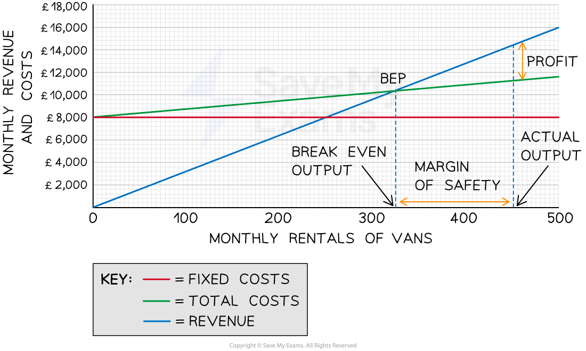

# Break-Even Charts

## An Introduction to Break-even

> **Spec point** — `spcpt_ChcPKXMp4tqWYkJg` · "• The concept of break-even
• Construct, complete or amend a simple break-even chart
• Interpret a given chart and use it to analyse a situation"

## An introduction to break-even

- **Break-even analysis** is a financial tool used to determine **the number of units a business must sell to reach the point where the business revenue equals its expenses (no profit nor loss)**

  - It helps businesses understand the **minimum level of sales or output they need to achieve in order to cover all costs**
  - This helps business managers to make **informed decisions about pricing and production volumes**
- The break-even point is the number of units that need to be sold for** total costs to equal the sales revenue**

#### The elements of a break-even analysis

*Variable costs, fixed costs and sales revenue are all used in calculating the break-even point*

- **Fixed costs** are costs that do not change regardless of the level of production or sales

  - E.g. rent, salaries and insurance
- **Variable costs** are costs that vary with the level of production or sales

  - E.g. raw materials, direct labour costs, packaging and shipping costs
- **Sales revenue** is the money gained from selling products/service and is calculated as follows:

  - **Sales revenue = number of items sold x selling price**

## Constructing a Break-even Chart

> **Spec point** — `spcpt_rYqW8Vf2Yh7NNH4n`

## Constructing a break-even chart

- Break-even charts are **graphs which **identify the number of units a business must sell in **order to break-even**

  - The break-even point occurs when the total cost = total revenue
  - The break even point is the number of units that have to be sold for the total cost to equal the total revenue
- In order to **construct a break-even chart, **the business needs to know the estimated fixed costs, variable costs and sales revenue

> **Case Study**
> #### Costs and revenue summary for Tee-Crazy Ltd.
> 
> |   | ** 0 units** | **500 units** | **3000 units** |
> |---|---|---|---|
> | **Fixed Costs** | 8,800 | 8,800 | 8,800 |
> | **Variable Costs** | 0 | 2,000 | 12,000 |
> | **Total Costs** | 8,800 | 10,800 | 20,800 |
> | **Total Revenue** | 0 | 5,000 | 30,000 |
> 
> - Tee Crazy Ltd has the following estimates:
> 
>   - Fixed costs are \$8,800 per year
>   - The variable costs of each t-shirt is \$4
>   - Each t-shirt is sold for a price of \$10
>   - The factory can produce a maximum output of 3000 t-shirts per year** **
> 
> #### How to construct a break-even chart
> 
> 
> 
> *Step 1 and 2 in constructing a break even chart*
> 
> 
> 
> *Step 3 and 4 in constructing a break even chart*
> 
> 
> 
> *Step 5 in constructing a break even chart*
> 
> - Production output below the break-even point results in the business making **a loss**
> 
>   - Production output above the break-even point results in **a profit**

## Interpreting a Break-even Chart

> **Spec point** — `spcpt_PnKMg4NhtRGHGWx3`

## Interpreting a break-even chart

- A break even chart is a **visual representation** of the break-even point and is used to identify several key metrics

  - The break-even point
  - The margin of safety
  - The expected profit or loss

#### A break-even chart

*The break-even chart for A2B Limited shows that at 324 units the total revenue = the total costs*

### Diagram analysis

- **Fixed costs:**

  - Fixed costs do not change as output increases
  
    - A2B's fixed costs are £8,000 and these do not change whether the business produces 0 units or 500 units
- **Total costs:**

  - Total costs are made up of fixed and variable costs
  
    - At 0 units of output, they are made up exclusively of fixed costs
    - At 500 units the total variable costs equate to £11,800
    - This line **slopes upwards **because total variable costs increase as output increases
- **Sales revenue:**

  - The revenue line also slopes upwards
  
    - At 0 units of output, the revenue is £0
    - At 500 units the total revenue equates to £11,800
    - Revenue will increase with the output
    - The line will **slope more steeply than the total costs **and will **cross the total costs line **at some point
- **Break-even point:**

  - The point at which the total costs and the revenue lines cross is the **break even point**
  
    - The break even level of output for A2B is 324 units
- **Margin of safety:**

  - **The margin of safety can be identified as the difference on the x-axis between the actual level of output (in this case 450 units) **and the break even point (300 units). The margin of safety is 150 units
- **Profit:**

  - The profit made at a specific level of output can be identified as the **space between the revenue and total costs lines**
  
    - In this instance, the profit made at 450 units of output is £14,400 - £11,250 = £3,150

> **Exam Hint**
> When calculating the break-even point, write down the break-even formula first and then find the figures you need to fill in the data required.
> 
> This allows you to check that you have everything you need for the calculation. You will be able to identify very quickly whether you need to carry out further calculations such as total fixed costs.
