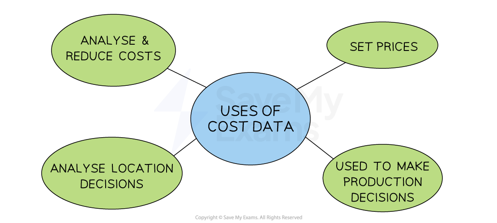

# Different Types of Costs

## Different Types of Business Costs

> **Spec point** — `spcpt_BXJjv4cyqHWhqJc8` · "• Classifying costs using examples, e.g. fixed, variable, average, total
• Use cost data to help make simple cost-based decisions, e.g. to stop production or continue"

## Different types of business costs

- Businesses** incur a range of costs **

  - Examples include **purchasing raw materials**, paying staff salaries/wages and **paying utility bills** such as electricity

- These costs can be classified as follows

  - Fixed costs
  - Variable costs
  - Total costs
  - Average costs

### 1. Fixed costs

- **Fixed costs (FC) **are costs that do not change as the level of output changes

  - These have to be paid whether the output is zero or 5000
  - Examples include rent, management salaries, insurance and bank loan repayments

- Fixed costs can be plotted on a graph as a horizontal line
- The fixed costs for this firm are \$4,000 at all levels of output

### 2. Variable costs

- **Variable costs (VC) **are costs that change directly with the output

  - These increase as output increases and vice versa
  - Examples include raw material costs and wages of workers directly involved in the production

*Graphical representation of total variable costs*

- Variable costs are plotted on a graph as an upwards sloping line, starting at 0

### 3. Total costs

- The **total cost** is the sum of the variable and fixed costs

*Graphical representation of total costs*

- The total costs **cannot be 0**, as all firms have some level of fixed costs
- Total costs are plotted on a graph as an upwards sloping line, parallel to the variable costs, starting at the level of fixed costs

### 4. Average costs

- As a firm grows, it is able to increase its **scale of output **generating efficiencies that lower its **average total costs (AC)** of production
- These efficiencies are called ***economies of scale***

*Graphical representation of average costs*

- As a firm continues increasing its **scale of output**, it will reach a point where its **average total costs (AC)** will start to **increase**
- The reasons for the increase in the average costs are called ***diseconomies of scale***

### Cost calculations

- Based on the above definitions, we can calculate several different types of costs

#### 1. Total costs

- Total costs are calculated using the following formula:

$\mathrm{Total} \mathrm{costs}(\mathrm{TC})=\mathrm{Total} \mathrm{fixed} \mathrm{costs}(\mathrm{TFC})+\mathrm{Total} \mathrm{variable} \mathrm{costs}(\mathrm{TVC})$

#### 2. Total variable costs

- Total variable costs are calculated using the following formula:

$\mathrm{Total} \mathrm{variable} \mathrm{cost}(\mathrm{TVC})=\mathrm{Variable} \mathrm{cost}(\mathrm{VC})\times\mathrm{Quantity}(Q)$** **
**      **

**Cost Calculations Using the Above Formulas Where FC is \$200 and VC is \$60 per unit**

| **Output (Q)** | **FC** | **TVC = **`$ 60 space straight x space straight Q` | **TC = **$\mathrm{TFC}+\mathrm{TVC}$ |
|---|---|---|---|
| 0 | 200 | - | 200 |
| 1 | 200 | 60 | 260 |
| 2 | 200 | 120 | 320 |
| 3 | 200 | 180 | 380 |

> **Worked Example**
> *Aromas Cannelles* manufactures luxury scented candles. The production of each candle incurs the following costs:
> 
> | **Item** | **€ per Candle** |
> |---|---|
> | Wax | 0.14 |
> | Perfume oil | 0.72 |
> | Loan repayment | 100 |
> | Glass jar | 1.46 |
> | Outer Packaging | 0.33 |
> 
> Calculate the variable cost in € for each candle.** (2)**
> 
> **Step 1 - Identify the variable costs in the list**
> 
> Loan repayment is classified as a fixed cost and should not be included in the calculation
> 
> **Step 2 - Total the variable costs listed**
> 
> $0.14+0.72+1.46+0.33=2.65$    **(1 mark)**
> 
> **Step 3 - Express the answer in € per Candle**
> 
> `equals space € 2.65`    ** (1 mark)**

> **Exam Hint**
> Take care when calculating variable costs per unit, as it is likely that one or more fixed costs will be included in the list as seen above.
> 
> If you are asked to calculate the total variable costs, follow the above process and multiply the answer by the number of units produced/sold.

## Using cost data to make Decisions

> **Spec point** — `spcpt_QnMVjB9WHxpTs63K`

## Using cost data to make decisions

- Businesses can use cost data to **make data-driven business decisions**

*Accurate cost data can help a firm to be more precise in its price setting and production decisions*

### 1. To reduce costs

- Accurate cost data can help a business identify if their costs are too high
- An important way to** improve profit is to reduce costs**

  - **Fixed costs** may be reduced by relocating to cheaper business premises, reducing salaries for workers, spending less on promotional activities or seeking lower-priced utility providers
  - **Variable costs **may be reduced by sourcing cheaper materials, buying raw materials in bulk, or outsourcing distribution to a third party business
  
    - E.g., Many businesses sell their products using *Amazon* which manages the packaging and shipping of items, usually at a cost much lower than the business itself could achieve
- Businesses must carefully consider the** impacts of reducing costs** on customer service, quality and speed of delivery

  - Paying lower salaries to staff may mean that employees have fewer customer service skills or experience
  - Cheaper raw materials and components may lead to worsening quality

### 2. To set prices

- Costs play an important role in the determination of selling prices

  - They are a crucial part of making, or increasing ***profit***
  - E.g., If the average cost of making a cake is \$3 and the business wants to make \$1 profit on each cake sold, it will need to **charge a price of \$4**

### 3. To make production decisions

- If the **cost of producing a product is higher than the revenue it generates, **the business will make a loss

  - It will need to decide whether to **continue making the product or stop**
- This decision **depends on various factors** including

  - Whether the product has just been launched on the market, in which case the **sales revenue** may increase in future
  - Whether the **fixed costs** will still have to be paid

### 4. To make location decisions

- Property rental or the purchase of premises can be a **substantial monthly cost**
- Some locations are cheaper than others

  - A business must **weigh up the cost of the location against other important factors** such as transport links, proximity to customers and availability of a workforce
