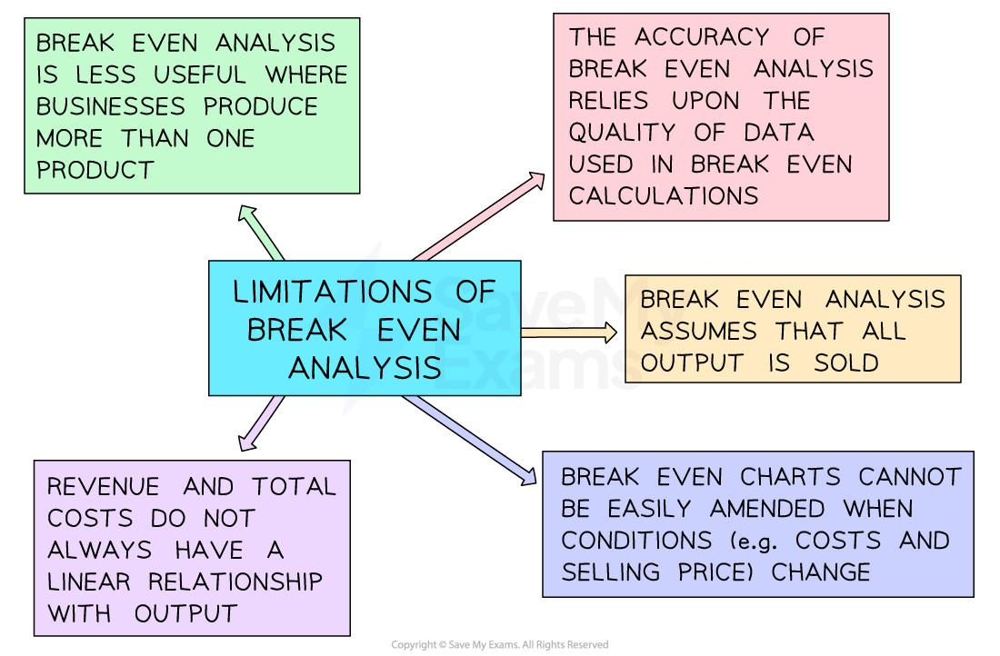

# The Limitations of Break-Even Analysis

## The Limitations of Break-Even Analysis

> **Spec point** — `spcpt_FzfZJm2kqcJn5SGn`

## The limitations of break-even analysis

- Break-even analysis provides valuable insights into the **financial viability and performance of a business**
- The sooner a business can reach **break-even point**, the more likely it is to survive and make a profit
- There are several limitations to the use of break-even analysis

*Break-even analysis is only useful if the data it is based on is accurate*

- The limitations of break even analysis can be used to evaluate the usefulness of this tool for a **start up or growing** business
- The most significant limitation of break-even analysis, is that it is entirely dependent on the accuracy of the data used to construct it

  - This data may be difficult to accurately calculate
  - The data may be subject to frequent fluctuations, which can significantly impact the break-even level of output
  - The data may require specialist knowledge/skills to gather, meaning that it is perhaps easier to be accurate in larger organisations than smaller ones

> **Exam Hint**
> When evaluating break-even analysis, ensure that you explain why it has an important internal planning role - but don’t forget that it has a significant external role too. Break-even analysis should be included in a business plan when a business is trying to secure external finance. Businesses looking to borrow money or attract investors seeking to manage their risk should take care to model the break-even point, margin of safety, and level of profit (or loss) at different levels of output and be prepared to be scrutinised on the figures.
