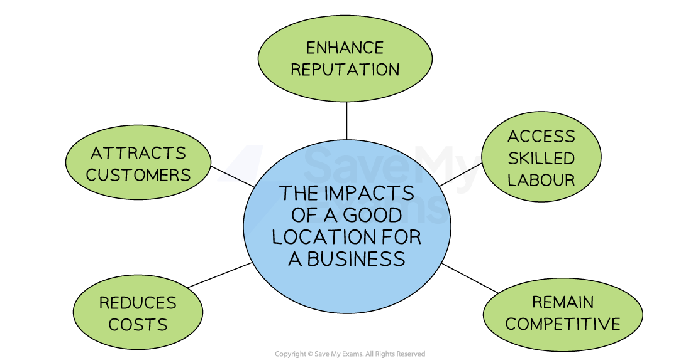
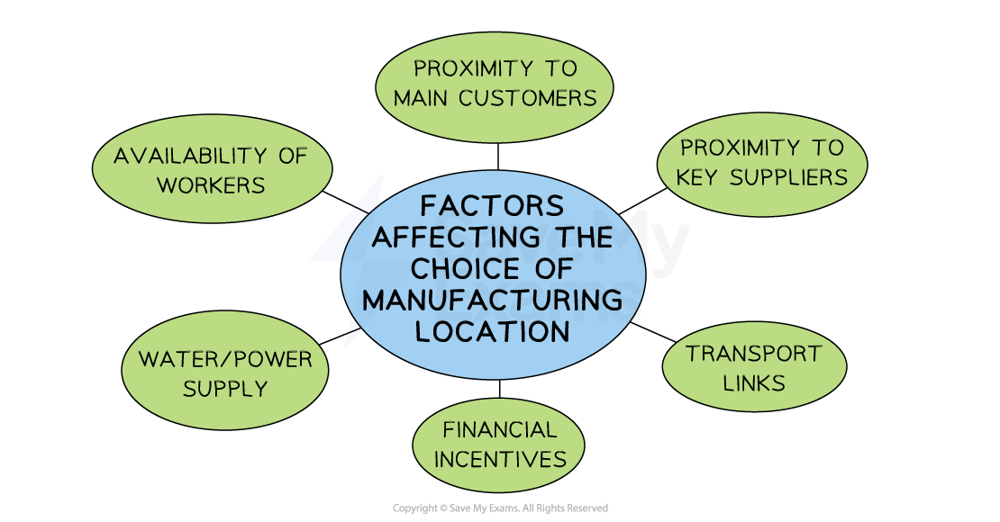

# Different Location Needs for Manufacturing and Service Businesses

## Location Decisions

> **Spec point** — `spcpt_xr8RrQPZ88q9ZSQn` · • Factors relevant to the location decision of manufacturing businesses and service businesses

## Location decisions

- **Location **is the site from which a business decides to operate
- A business may look for a new location if it is **setting up for the first time **or the **existing location no longer meets its needs**

  - A new site may become available that is more attractive to the business, e.g., it has a larger staff car park or room for further expansion
- The business may look to **locate sites in their home country or abroad**

  - Large companies such as Apple or Nike have chosen to locate their factories where labour and material costs are low
- Choosing a good location can generate** positive impacts for the business**

#### The impact of a good location

*Irrespective of the size of the business, a good location (online or physical) reduces costs and increases sales*

- Many businesses have failed due to having established themselves in a poor location

  - A good location can **reduce costs**, whereas a poor location will increase them
  - A good location provides excellent access to sufficient customers, whereas a poor location **limits customer interactions**
  - A good location provides **access to a skilled workforce**, whereas a poor location limits access to the required human skills

## Factors Affecting the Location of a Manufacturing Business

> **Spec point** — `spcpt_JWsmJWrKTcD9MPHY`

## Factors affecting the location of a manufacturing business

- The ideal business location depends upon the **type of business **and **what it produces/sells**

  - Manufacturing business are likely to have different location priorities than service sector** **businesses
  - ***B2B*** businesses are unlikely to need to locate close to passing trade, whilst ***B2C*** businesses may choose a location with high footfall

*Manufacturing locations often require access to very specific resources, such as raw materials or labour*

### Explaining the factors

#### Proximity to key supplies

- Businesses that need to **process fresh raw materials quickly **may be better located close to their source, e.g. seafood processing
- Those that adopt ***lean production ***techniques may locate close to key suppliers to reduce ***lead times***

#### Proximity to main customers

- Businesses selling **perishable goods** may locate close to the target market to ensure products are at their peak
- Manufacturers of **heavy or difficult-to-transport **goods may locate close to their end market to reduce transportation costs

#### Availability of workers

- Businesses that require skilled labour choose locations where workers with those skills are readily available
- Hi-tech businesses may locate in areas where competitors operate to take advantage of the concentration of skilled workers
- Research-focused businesses may locate close to **universities**

#### Financial incentives

- Governments sometimes provide **grants** or low-cost **loans **to firms that set up in areas with high-unemployment
- Low **business rates **may encourage manufacturers to expand in particular regions

#### Transport

- Good transport links provided by **major roads** and **efficient rail links** are particularly important for businesses that require an effective logistics network

#### Power/water supply

- A reliable and steady supply of water and power are required by factories

## Factors Affecting the Location of a Service Business

> **Spec point** — `spcpt_qSpYYTWxk6rMTW7R`

## Factors affecting the location of a service business

- Businesses in the service sector also consider further factors when determining a suitable location

  - **Proximity to customers** is very important for retail businesses
  
    - Premises must be accessible and convenient so a location with a car park or close to transport links is likely to be a key influence
    - Locating in areas with high footfall, such as on a high street or in a shopping mall, is a popular choice for retailers
  - In some cases, a location may be chosen to **take advantage of a shared customer base** or a particular reputation
  
    - Examples include bookshops on London's Charing Cross Road and luxury fashion brands on New York's Fifth Avenue
  - **Climate and geographical factors** can be a key factor for some specialist service providers
  
    - E.g. Businesses offering ski instruction will locate in mountainous areas with high annual snowfall
  - Services businesses that **do not rely on passing trade** may locate in out-of-town premises
  
    - Rent and business rates tend to be lower
    - Incentives for job creation such as ***grants*** may be available from local authorities
  - In addition, businesses are likely to avoid locating in areas with **high levels of anti-social behaviour and crime,** as this could impact insurance costs
