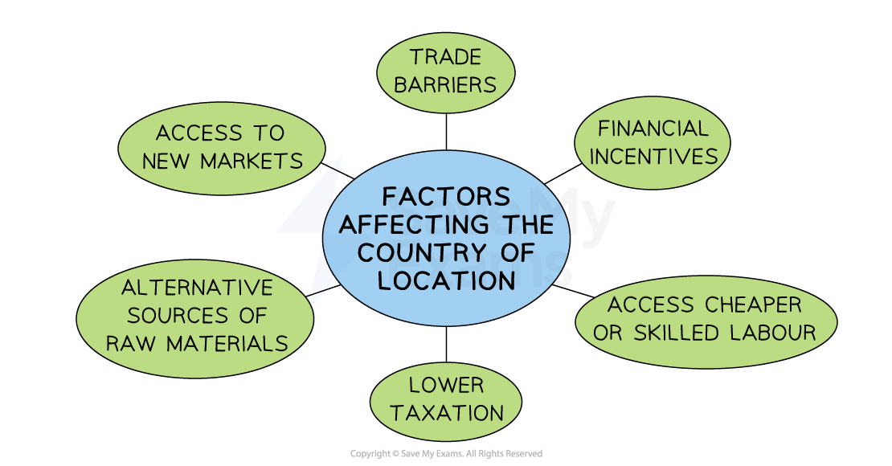

# Influences on the Choice of Production Location

## Factors to Consider when Choosing a Country to Produce In

> **Spec point** — `spcpt_kZr2PSchBmbxpwkH` · "• Factors that a business could consider when deciding which country to locate operations in
• The role of legal controls on location decisions
• Recommend and justify an appropriate location for a business in given circumstances"

## Factors to consider when choosing a country to produce in

- A **multinational company** (MNC) is a business that has operations in more than one country

  - This can include physical stores, manufacturing plants, factories, offices and service operations
- ***Globalisation*** means that many firms can now consider establishing production **locations worldwide** rather than just their home country

*Businesses may choose international locations based on factors such as trade barriers, levels of taxation and the attractiveness of accessing a new target market*

- When choosing a location in another country, a business will consider several factors

### Explaining the factors

#### 1. Trade barriers

- A business located in a market within a trade bloc will be able to access many advantages, such as **reduced protectionist measures **

  - E.g. Chinese companies are increasingly locating operations in countries with trade agreements with the EU and US to circumvent restrictions on products made in those countries

#### 2. Financial incentives

- Governments may **offer incentives** (e.g. grants, business loans and tax breaks) to locate in their country as MNCs bring in investment, foreign currency and job opportunities

#### 3. Access cheaper or skilled labour

- Businesses may choose to locate production in a market where labour** costs are lower** or where significant numbers of **workers have specialist skills**

  - Clothing brands frequently locate production facilities in lower-wage countries such as Bangladesh or Turkey, where skilled workers produce high-quality garments

#### 4. Lower taxation

- Some countries **tax businesses and their employees** at very** low rates**

  - Ireland's low rate of corporation tax has attracted large multinationals, including Google and Microsoft, to the country

#### 5. Alternative sources of raw materials

- Some countries have **cheaper raw materials or are sources of rare raw materials** that are used in the production process

#### 6. Access to new markets

- Many businesses choose to **locate near to customers in another country** to reduce transport and distribution costs
- This is particularly important when markets in the businesses home country have become ***saturated***
- External factors such as **changes in the law** may have made the home market unviable so growth may only be possible by moving the business to an alternative location

## The Role of Legal Controls on Production Location Decisions

> **Spec point** — `spcpt_gh4GrJTdPbK5Jvbv`

## The role of legal controls on production location decisions

- **Laws** are **rules** created by the government of a country with the aim of **regulating the actions of its citizens and businesses**

  - **Regulation** is the process of enforcing the laws that have been created and ensuring that businesses abide by them

- Governments and local authorities can **incentivise** businesses to locate in particular areas

  - In areas of** high unemployment **or** industrial decline** ***grants*** or reduced tax rates** **may be offered to businesses that create jobs or improve communities
- In some cases, businesses are **deterred** from locating in particular areas

  - E.g. In areas of outstanding natural beauty, strict ***bylaws*** or city ordinances may regulate the type of business activity that is permitted
  - E.g. A country with strict environmental laws might not be an attractive location for a manufacturing company that produces a lot of waste

### LEDCs and MEDCs

- The **presence or absence of laws** can affect a businesses's choice of location differently in less economically developed countries as compared with more economically developed countries

#### 1. Less economically developed countries

- Less economically developed countries often have fewer laws and** less enforcement of their existing laws, **which is likely to be attractive to some businesses

  - Businesses enjoy **lower costs** as they have to meet fewer legal requirements, such as safe handling of waste material
  - Labour can be paid very low rates as no minimum wages exists
  - Employees and customers have less opportunity to pursue **legal action**

#### 2. More economically developed countries

- Developed economies with **extensive laws** can be attractive to businesses who desire to locate in region with

  - **Good infrastructure**
  - **Highly-skilled workers**
  - **High standards of living**

#### Measures used by local government to influence location decisions

| **Method** | **Explanation** | **Example** |
|---|---|---|
| **Planning regulations** | - Regulations **limit the operations** of businesses in certain locations    - Opening hours can be restricted - **Planning permission** has to be agreed and granted before a business can build on or extend a site    - The appearance of new buildings may be strictly regulated | - **Brompton Bikes** is the UK's  largest bicycle manufacturer    - Its **planning application** for a new factory involves construction on a floodplain, which will **restore the local wetland **and promote walking and cycling |
| **Government grants or subsidies** | - **Grants **and** subsidies** encourage businesses to set up and expand in areas of **high unemployment, underdeveloped regions **or those that have suffered from **industrial decline** - This assistance could be **grants **or** subsidies paid to businesses** which do not normally need to be repaid | - The **EU** offers a range of grants to businesses that are prepared to set up or expand in less developed areas of the trade bloc to reduce differences in wealth between regions and between the various member states |
