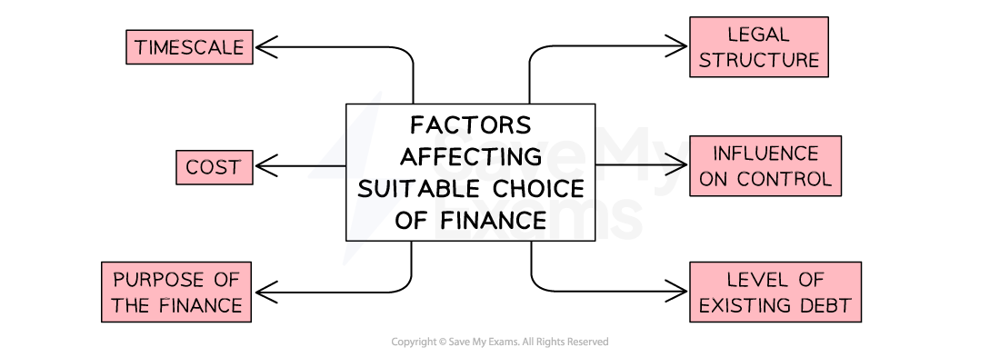

# Choosing the Best Type of Finance

## Factors to consider when choosing a source of finance

> **Spec point** — `spcpt_ft4MywFcbBHWcJGz` · "• The main factors considered in making the financial choice, e.g. size and legal form of business, amount required, length of time, existing loans
• Recommend and justify appropriate source(s) of finance in given circumstances"

## Factors to consider when choosing a source of finance

- There are** many factors that managers must consider** before deciding upon the type and source of finance required

  - They may need to **use more than one source of finance **at the same time

#### Factors affecting the choice of finance

*The level of existing debt may be so high that a business will rather sell shares than borrow more*

#### Explanation of the factors affecting the choice of finance

| **Factor** | **Explanation** |
|---|---|
| **What is the purpose of obtaining finance?** | - Fixed assets are most likely to need a long-term source of finance, such as a bank loan - Day-to-day costs such as rent and wages could be covered by a short-term overdraft |
| **How long is the finance required for and when can it be paid back?** | - Overdrafts are a short term option to help a firm who needs a smaller amount of finance urgently - Mortgages can be paid back over many years |
| **How much finance is needed?** | - Large amounts of capital can be raised through the issue of shares to family and friends, or through a ***flotation*** on a stock exchange - Smaller sums may be accessed through business credit cards or overdrafts |
| **What is the legal structure of the business?** | - Businesses which are already **Public Limited Companies** can issue ***shares ***or ***debentures*** - Sole traders often rely on owners' capital |
| **How much risk is involved? ** | - Businesses with existing loans may have high ***gearing*** and pay high rates of interest as they are seen as risky - ***Leasing ***involves little risk as assets can be returned if finance costs are not paid |
| **How much control and ownership does the company want to keep?** | - If limited companies issue too many shares, the current owners may lose some control of the business - Borrowing retains control, though interest is payable |

### Reducing the risk of being unable to raise finance

- This** risk of not being able to raise the finance can be reduced** in several ways
- **Bank loans will most likely be approved when**

  - A business presents a convincing business plan including a ***cash-flow statement***, and ***income statement*** for the last time period
  - Existing sources of external finance are minimal and being managed effectively
  - A business has ***collateral*** to reduce risk to the bank
- **Investment from shareholders will most likely happen when**

  - The share price is improving
  - ***Dividends*** are generous
  - The company has good profit potential and is planning to grow
  - Alternative investments are less attractive

## Recommending an appropriate source of finance

> **Spec point** — `spcpt_4BQGTc5xn7RNh39H`

## Recommending an appropriate source of finance

- Finance managers frequently have to make recommendations to their CEOs about the most suitable form of financing to use

  - The most suitable form is determined by conducting an analysis using the questions in the table above

> **Case Study**
> A very successful **private limited company** manufactures and sells wooden tables and chairs. It has been running for 15 years and has an excellent reputation. It has previously **reinvested profits** to fund expansion. It now **needs more finance to fund growth into new markets**
> 
> **Key considerations**
> 
> - The business is a** limited company,** so **selling shares to family and friends **is an option to raise a **limited amount **
> - With 15 years of success, it is** less of a risk **than a new start-up, so a **bank loan** could be obtained
> - The scenario indicates that **reinvesting profits** will not be enough to finance growth plans

#### Recommendation

- A **bank loan **could be easy to obtain due to business success over the last 15 years. Repayments are spread over several years and interest must be paid
- The business could** issue new shares to existing shareholders, which** may increase their investment due to business success as family and friends may want to be part of its exciting growth plans
- The decision will depend upon** how much control and ownership the business owner may lose **by issuing more shares
- Most finance managers would recommend **obtaining a bank loan**, as this is often preferable to losing ownership and a share of future profits

> **Case Study**
> A **retail store** selling fashion trainers has **sold large quantities of stock** since an influencer promoted the store on TikTok and Instagram. It needs to **quickly** replenish its stock. The sole trader, Toby, is considering using his existing **overdraft **or** trade credit**
> 
> **Key considerations**
> 
> - **New stock is needed quickly **so** **the existing overdraft facility on his bank account could be an instant source of finance
> - **Trade credit means he would not have to pay for stock straight away, **which would avoid cashflow problems as stock can be sold before payment to the supplier is due

#### Recommendation

- An **overdraft **is a short-term source of finance and Toby will have to pay interest on the amount that he uses
- Trade credit would **ease financial pressure **as** stock is replenished** and he may receive a discount when he sets up the agreement
- Most finance managers would recommend to Toby that he **first seek trade credit.** If he is unable to secure that, then he should consider using his overdraft facility

> **Exam Hint**
> Which is the best source of finance for this business?
> 
> This is a very common question in the exam
> 
> Be prepared to analyse the advantages and disadvantages of the main sources of finance and give a justified recommendation. Consider the type of business ownership; for example, only a public limited company can sell shares on the stock exchange
