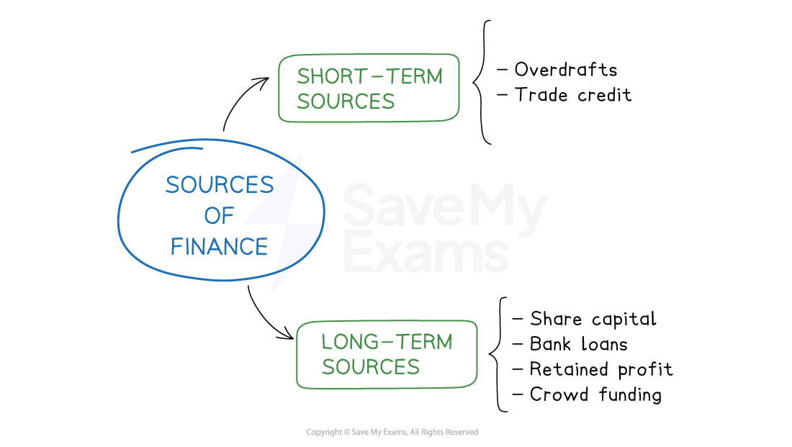

# Short-Term and Long-Term Sources of Finance

## Short-term sources of finance

> **Spec point** — `spcpt_xwFTHd9wyHMWvt4P` · • Short-term and long-term sources with examples, e.g. overdraft for short-term finance and debt or equity for long-term finance

## Short-term sources of finance

- **Short-term** sources of finance will be needed to meet **unexpected costs** or to **pay bills and suppliers**

  - These are likely to be relatively **small amounts **and are rarely needed beyond a year
- **Longer-term** sources of finance will be needed to fund the purchase of non-current assets such as buildings and other types of capital equipment

  - These are likely to be **large sums** that may be required for a significant period of time

#### Short and long-term sources of finance

*The purpose of the finance will ultimately determine if the business chooses a short, or long-term source*

#### Evaluating short-term sources of finance

| **Source** | **Advantages** | **Disadvantages** |
|---|---|---|
| **Overdrafts** | - A** limit **is agreed and **interest is charged** only when a business ‘goes overdrawn’ - Offers significant flexibility and aids ***cash flow*** | - An ***overdraft*** may be **called in **if the bank is concerned about a business's ability to repay what it owes - ***Interest*** on overdrafts tends to be higher than on other loans |
| **Trade credit** | - ***Trade credit ***is usually **interest-free** - A business can increase its stock without having to immediately pay for it, which can significantly **enable positive cash flow** if the stock is sold before payment becomes due | - Suppliers may prioritise delivery to customers who have the shortest repayment dates - Cash needs to be carefully managed to ensure the business **has the money available** to pay its suppliers on the agreed date |
| **Debt factoring** | - ***Debt factoring*** **provides a source of Immediate cash** to the business - The business **does not have to handle the debt collection** themselves | - The **third-party debt company will keep a percentage of the debts** collected as reward    - The business does not get paid the total value of their debts |

## Long-term sources of finance

> **Spec point** — `spcpt_58G2YnrTbRN47x7N`

## Long-term sources of finance

- **Long-term finance** is available for more than a year and can be paid back over a long period of time

  - Many forms of long-term finance appear as ***non-current liabilities*** in the balance sheet

#### Evaluating long-term sources of finance

| **Source** | **Advantages** | **Disadvantages** |
|---|---|---|
| **Bank loans** | - **Bank loans are usually *****unsecured*** and are typically repaid over two to ten years - Interest rates are fixed for the term of the loan so repayments are made in equal instalments, which helps with business planning | - Interest is payable and the business **assets are at risk** if the business does not make repayments as planned |
| **Hire Purchase** | - The firms **does not need to spend a large sum of money **to acquire and use an asset | - A **deposit** is usually payable before the asset is delivered - Interest charges can make the overall cost higher that buying an asset outright |
| **Leasing** | - The business **does not own the asset** during the period of the lease and so is not responsible for maintenance or repair costs | - Leasing is usually **more expensive in the long run** than buying an asset |
| **Share Issue** | - Large amounts of money can be **quickly raised** from wealthy investors - Shareholders who buy a large number of shares may also bring and share expertise, which can be beneficial to the business | - Shareholders are the owners of shares and they are **entitled to a share of the company’s profit** when ***dividends*** are declared - Shareholders usually have a **vote at a company’s *****Annual General Meeting*** (AGM) where they can have a say in the composition of the Board of Directors |
| **Debentures** | - Can be used to raise very long-term finance,  e.g. over 30 years - Unlike share capital,  debenture holders have no share in the company itself | - Interest and the loan itself has to be repaid |
