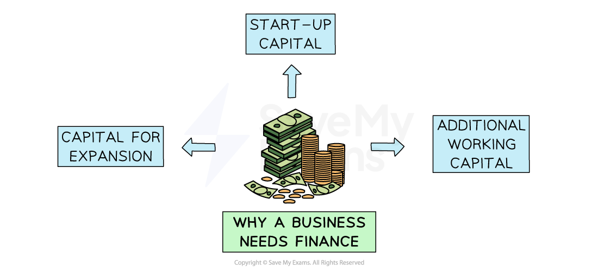

# The Need for Business Finance

## Why do businesses need finance?

> **Spec point** — `spcpt_pXBw79cGrM4nCxXm` · "• The main reasons why businesses need finance, e.g. start-up capital, capital for expansion and additional working capital
• Understand the difference between short-term
and long-term finance needs
• Importance of alternative sources of capital, e.g. micro-finance, crowd-funding
• Internal sources and external sources with examples
• Short-term and long-term sources with examples, e.g. overdraft for short-term finance and debt or equity for long-term finance"

## Why do businesses need finance?

- All businesses need finance to get started, allow them** to grow, **and fund their continuing activity
- Businesses often call the money needed to start and operate** 'capital'**

*The finance department manages the finances and ensures that the business is able to remain liquid*

### 1. Starting a business

- **Start-up capital **is the finance needed by a new business to pay for ***fixed assets*** and ***current assets*** before it can begin trading
- A business usually **estimates the amount of start-up capital they need **in the ***business plan***
- Many small new businesses will get a start-up ***loan*** to cover these initial costs

### 2. Expanding a business

- As a business grows more finance may be needed for ***capital expenditure***

  - It may require more equipment, buildings, IT infrastructure or vehicles which will allow the business to **increase output**
- If a business wants to grow by **developing a new product**, it will need to spend large amounts of capital on ***research and development*** (R&D)

  - E.g. Apple's annual research and development expenses for 2023 were \$29.915 Billion, a 13.96% increase from 2022, as they are investing heavily in Artificial Intelligence (AI) and innovation of new products

### 3. Working capital

- Finance is required for ***working capital*** which is spending on raw materials, wages or utilities
- Having a** steady flow of working capital **is essential to keep the business operational

  - Without working capital, the business would be **unable to cover its day to day expenses**
  - It may suffer ***cash-flow*** problems which could lead to business failure

## The distinction between short-term and long-term finance

> **Spec point** — `spcpt_6MM7sx6w6txNVxBt`

## The distinction between short-term and long-term finance

### Short-term financial needs

- **Short-term finance** is used to help a business maintain a positive ***cashflow***, for example:

  - To get through periods when cash flow** is poor for seasonal reasons, **e.g. a rainy summer for an ice cream seller
  - To **help bridge the gap when a large customer payment is delayed**, leaving the business without enough money to pay its bills that month
  - To **provide extra cash to pay for the manufacturing required to meet sudden or unexpected changes in customer orders, **e.g. A small craft business selling via Etsy may use an ***overdraft***  to buy more stock of beads and threads due to a sudden surge in demand

### Long-term financial needs

- **Long-term finance** is usually used to buy ***fixed assets***

  - Fixed assets are purchased to be used** for a long period of time and tend to be more expensive**
  - Long-term finance is used for expansion, e.g., a toothpaste factory installs a new production facility that costs over £1 million. This is a very large investment, but it will allow the business to increase output, efficiency and its product range
