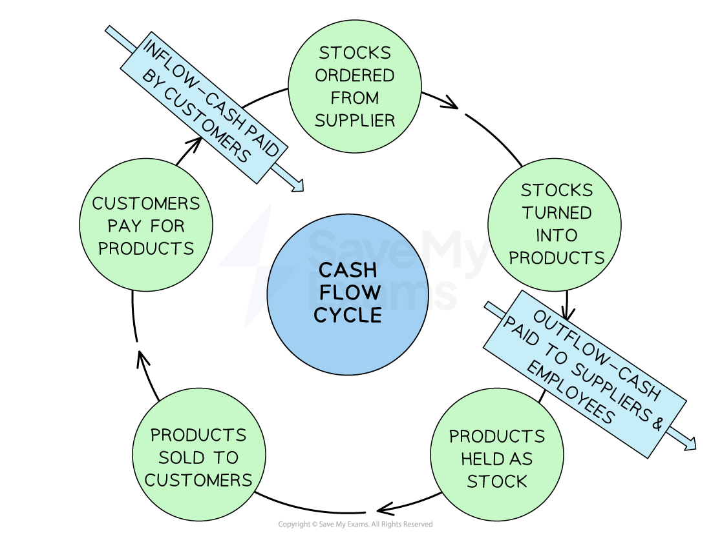

# Using Cash-Flow Forecasts

## The importance of cash to a business

> **Spec point** — `spcpt_M7MND5JC9gDdKHcJ` · "• Why cash is important to a business
• What a cash-flow forecast is, how a simple one is constructed and the importance of it
• Amend or complete a simple cash-flow forecast
• How to interpret a simple cash-flow forecast"

## The importance of cash to a business

- **Cash is the 'blood' of a business, **as without it, a business will die

  - It is a **liquid asset **in the form of notes, coins and money in the bank
- A profitable business is likely to fail if it **does not have sufficient cash**

  - Cash-poor businesses will struggle to pay suppliers, employees and operating expenses
  - This is called **insolvency**
  
    - E.g. Lifestyle retailer Joules announced plans** **to ***liquidate*** in December 2022 as a result of cash-flow difficulties despite making a profit of £2.6 million during the previous year

- A new business may have to **pay cash on purchase for all of its supplies** until its suppliers trust them enough to provide credit terms (buy now, pay later)

  - A supplier may then give the business **trade credit **of 30 or 60 days
  - This means that the business can receive their stock now and only pay for it in 30 or 60 days; the cash outflow is delayed
  - As the business **sells its products**, they receive money generated from the business revenue and this represents **a cash inflow**
  - At the end of 60 days they will pay their supplier **(cash outflow)**, but the firm may still have half of its stock available for sale
- A **cash-flow cycle** shows the stages between paying out cash for labour, materials, and so on, and receiving cash from the sale of goods

#### Cash-flow cycle

*The cash flow cycle shows the process of cash entering the business, being used to generate products, before leaving the business to pay suppliers*

### Explanation of the cash-flow cycle

- The diagram shows that **cash is needed to pay for materials** used to produce the product
- Time is needed to** produce the products** before they can be **sold** to customers
- If customers purchase the goods using a **credit facility provided by the business, then they will not have to pay immediately,** which will delay cash inflows
- When they do pay for the goods immediately**,** this money will be used to** pay business expenses**
- Due to the time between each stage, the business needs to make sure it has enough ***working capital ***to keep running and pay bills
- **Businesses, **particularly start-ups, need to ensure that they manage cash-flow to ensure that it **does not run out of money**
- Cash-flow issues may put the business in a situation where it is

  - U**nable to pay** key stakeholders, such as workers and suppliers
  
    - Production is likely to cease as workers will not work without pay and suppliers will not supply goods if they are not paid
    - Unable to pay **utility bills and rent**
- The business could be forced into ***liquidation*** and, ultimately, is likely to fail

## Constructing a cash-flow forecast

> **Spec point** — `spcpt_JhPNrbN78BJqqyvH`

## Constructing a cash-flow forecast

- A **cash-flow forecast** is a prediction of the anticipated ***cash inflows*** and  ***cash outflows*** typically for a three, six or twelve month period

  - **Typical outflows **include payments for raw materials, paying staff wages and salaries, paying bills such as electricity and  repaying loans
  - **Typical inflows **include receipts from sales, money received from a new bank loan, money from the sale of an asset and money from investors

*The three month cash-flow forecast clearly shows how inflows and outflows of cash into a business are accounted for*

### Steps in constructing a cash-flow forecast

- The business starts with an opening balance of £500 in January
- Total inflows for January are £8,600
- Total outflows are expected to be £4,770
- The **Net Cash-flow** is expected to be £3,830 (£8,600 - £4,770)
- January’s closing balance is expected to be £4,330 (£500 + £3,830)
- Each **closing balance becomes the opening balance for the next month**

  - As the closing balance for January is £4,330, the opening balance for February is therefore £4,330
- The calculation process **starts again in February**, and every month onwards

  - Net cash flow + opening balance = closing balance
- Overall, despite negative net cash flow between February and May, this businesses closing balance is expected to remain positive during the period, suggesting it does not expect to suffer cash flow problems

### The importance of cash-flow forecasts

- By analysing cash flow over time, businesses can **better plan and allocate financial resources**

  - E.g. Problematic months can be identified early and sources of additional finance put in place to ease the cash-flow
- Cash flow forecasts** are useful **in the following situations

  - **Starting up a business:** identifying how much cash is needed in the first few months
  - **Running an existing business: **recognising where a fall in sales may require use of an overdraft facility
  - **Supporting applications for borrowing: **determining the size of loan or overdraft needed, when and for how long it is needed and by when it is likely to be fully repaid
  - **Managing transactions: **identifying how much or how little cash is deposited at the bank can determine when bills should be paid

## Calculating and interpreting cash-flow forecasts

> **Spec point** — `spcpt_GZCBVtQf7WSZGcr3`

## Calculating and interpreting cash-flow forecasts

- It is important for a business to know how to calculate and interpret a cash-flow forecast

#### Example of a start-up 3 month cash-flow forecast (£s)

|   | **Jan** | **Feb** | **Mar** |
|---|---|---|---|
| **Inflows** |   |   |   |
| **Cash received from sales** | 4,600 | 5,100 | 3,100 |
| **Total inflows** | 4,600 | 5,100 | 3,100 |
| **Outflows** |   |   |   |
| **Inventory/stock** | 1,500 | 850 | 900 |
| **Wages** | 2,200 | 2,200 | 2,200 |
| **Utilities** | 840 | 840 | 840 |
| **Total outflows** | 4,540 | 3,890 | 3940 |
| **Net cash flow** | 60 | 1,210 | (840) |
| **Opening balance** | 500 | 560 | 1770 |
| **Closing balance** | **560** | **1,770** | **930** |

### Cash-flow forecast analysis

- Overall, this cash flow forecast **supports a decision **for the business to arrange an ***overdraft facility*** with their bank
- As sales increase in January and February, **inflows are greater than outflows,** and the business **has a positive cash flow**
- This changes in March as the **level of sales falls** and the net cash flow turns negative
- An overdraft facility will help them survive if their **closing balance** drops below zero in the next month or two

#### January

- The opening balance of £500 has been introduced by the owner
- The business is expected to achieve sales of £4,600
- Total outflows are expected to be £4,540
- The **Net Cash Flow** is expected to be £60 (£4,600 - £4,540)
- January’s closing balance is expected to be £560 (£60 + £500)

#### February

- The **closing balance** from January **becomes the opening balance** for February
- Sales of £5,100 are expected to be the business total inflows
- Total outflows are expected to be £3,890
- The **net cash flow** is expected to be £1,210 (£5,100 - £3,890)
- The closing balance is expected to be £1,770 (£1,210 + £560)

#### March

- The closing balance from February becomes the opening balance for March
- The business expects to achieve sales of £3,100 as its total inflows
- Total outflows are expected to be £3,940
- The **net cash flow** is expected to be -£840 (£3,100 - £3,940)
- The closing balance is expected to be £930 (-£840 + £1,770)

> **Worked Example**
> The following is an extract from a cash flow forecast
> 
> |   | **April** | **May** | **June** |
> |---|---|---|---|
> |   | **000s** | **000s** | **000s** |
> | Cash inflow | 23 | 24 | 30 |
> | Cash outflow |   | 28 | 81 |
> | Net cash flow | 10 |   | (51) |
> | Opening bank balance | 30 | 40 | 36 |
> | Closing bank balance | 40 | 36 |   |
> 
> Fill in the three blanks to complete the cash flow forecast. **(3)**
> 
> **Step 1: Calculate the cash outflow for April**
> 
> `Net space cash space flow space equals space Cash space inflow space minus space Cash space outflow
> 
> £ 10 comma 000 space equals space £ 23 comma 000 space minus space £ 13 comma 000`      ** ****(1)**
> 
> **Step 2: Calculate the net cash-flow for May**
> 
> `Net space cash space flow space equals space Cash space inflow space minus space Cash space o utflow
> 
> Net space cash space flow space equals space £ 24 comma 000 space minus space £ 28 comma 000
> 
> Net space cash space flow space equals space minus £ 4 comma 000`     ** ** **(1)**
> 
> ** **
> 
> **Step 3: Calculate the closing balance for June**
> 
> `Closing space balance space equals space Opening space balance space plus space net space cash space flow
> 
> Closing space balance space equals space £ 36 comma 000 space plus space minus £ 51 comma 000
> 
> Closing space balance space equals space minus £ 15 comma 000`       **(1)**

> **Exam Hint**
> When calculating opening and closing balances, work through each month in turn. Always double-check your calculations in cash-flow forecasts, as one mistake will have a knock-on effect elsewhere and may lead you to make inaccurate judgements
