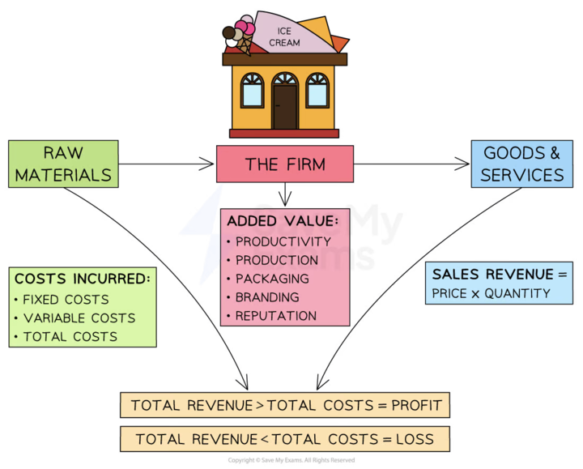
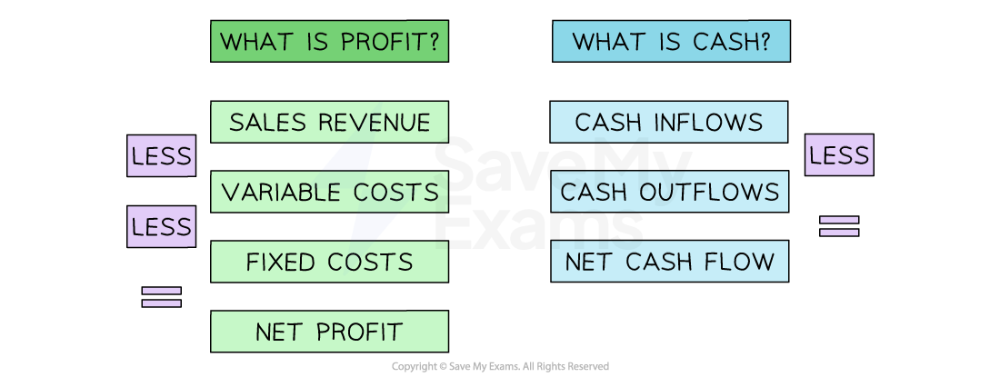

# The Importance of Profit

## An introduction to profit

> **Spec point** — `spcpt_dc4hDzXmDmJzQDMr` · "• How a profit is made
• Importance of profit to private sector businesses, e.g. reward for risk- aking/enterprise, source of finance
• Difference between profit and cash"

## An introduction to profit

- Most businesses have the **main objective of making a profit**

  - Profits help new businesses survive and break-even
  - It is a **reward** for risks taken by entrepreneurs and investors
  - For more established businesses, **profits can enable long-term growth **
- The most simple formula for calculating profit is:

$\mathrm{Profit}=\mathrm{Sales} \mathrm{Revenue}--\mathrm{Total} \mathrm{Costs}$

- Profit can be categorised into **net profit and gross profit**

  - **Gross profit** is the difference between the money received from selling goods or services and the cost of making or providing them
  
    - It is calculated using the formula

$\mathrm{Gross} \mathrm{Profit}=\mathrm{Sales} \mathrm{Revenue}--\mathrm{Cost} \mathrm{of} \mathrm{Sales}$

- **Net profit** is** **the difference between the gross profit and all of the other business expenses

  - It is calculated using the formula

$\mathrm{Net} \mathrm{Profit}=\mathrm{Gross} \mathrm{Profit}--\mathrm{Expenses}$

- **Profit is the surplus** that remains after business costs have been subtracted from the total sales revenue

  - If **costs exceed revenue,** the business makes a **loss**

#### The process of making a profit

- Profit **can be increased using the following strategies**

  - Increasing ***sales revenues***
  - Reducing costs
  - A combination of increasing revenue and reducing costs

## The importance of profit to private sector businesses

> **Spec point** — `spcpt_8ChrS5QJmTsRpg24`

## The importance of profit to private sector businesses

- **Profit is the financial reward **that entrepreneurs receive in return for the risks they take

  - Business owners invest long hours, creativity, their own money, and effort to make a successful business
- **Profit is a useful source of finance**

  - E.g. R**etained profit** can be used to fund the purchase of assets, pay bills and invest in research and development
- **Profit is an indicator of success**

  - Increasing profitability suggests that a business is being run effectively and could be an **attractive investment**
  - Profit levels can be compared over time and with similar businesses to determine how well a business is performing
- Some **public sector organisations, **such as public corporations, can have the objective of making a profit

  - Although **social objectives may be more important, **such as serving the local community, profits can be reinvested back into services such as education and healthcare
  - These profits, known as surpluses, could also be used to improve quality and service efficiency
- **Social enterprises** also need to make a profit to survive, as they often have similar objectives to grow so that they can fund their social objectives

## The difference between profit and cash

> **Spec point** — `spcpt_bdwCrcVYmg23gzpQ`

## The difference between profit and cash

- **Profit and cash **are different financial terminologies

  - Profit is calculated at a specific point in time
  - While a company may be in profit, they **may lack cash**, as some customers may not actually have paid them yet
- Profit is **the difference between revenue generated and total business costs** during a specific period of time

  - Profit can be an important indicator of a company's financial health and long-term success, as it helps to assess **the effectiveness of a company's operations**
- Cash is measured by taking into account the full range of** money flowing in and out of a business**

  - This includes **revenue from sales,** operating expenses, investments, loans, and any other cash-related transactions

#### Profit vs cash flow

*Profit and Cash are different concepts in business. A business may make a profit yet lack cash.*

- A profitable business is likely to fail quickly if it **does not have sufficient cash**

  - Cash-poor businesses will struggle to pay suppliers, employees and operating expenses
  - This is called **insolvency**
  
    - Lifestyle retailer Joules announced plans** **to ***liquidate*** in December 2022 as a result of cash-flow difficulties, despite making a profit of £2.6 million during the previous year
