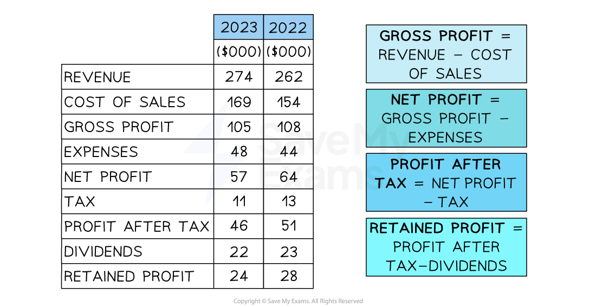

# The Main Features of an Income Statement

## An introduction to income statements

> **Spec point** — `spcpt_hcY8nwjW62fyvKG5` · • Main features of an income statement, e.g. revenue, cost of sales, gross profit, profit and retained profit

## An introduction to income statements

- An **income statement** records the income and costs of a business incurred over a period of time (usually one year)

  - The statement is also known as a **profit-and-loss account**
- **Four types of profit **are calculated in the income statement

  - Gross profit, net profit, profit after tax, and retained profit
- The extract from the income statement for ***Toys and Trikes PLC ***shows figures for both 2022 and 2023, which enables year-on-year comparisons to be made

#### Income statement for Toys and Trikes Ltd

*Four different types of profit are calculated in an income statement*

### The main features of an income statement

#### Sales revenue

- Money generated through selling goods and services
- Calculated by **Price x Quantity**

  - In 2023, *Toys and Trikes Ltd *earned Sales Revenue of \$274,000

#### Cost of sales

- The cost of producing or buying in the goods actually sold by the business during a time period
- Includes the costs of raw materials and labour used to produce the goods

  - In 2023, *Toys and Trikes Ltd *had Cost of Sales of \$169,000, which included materials and labour

#### Gross profit

- Gross profit is made when revenue is greater than the cost of sales
- Calculated by **Sales Revenue - Cost of Sales**

  - The Gross Profit for *Toys and Trikes Ltd *was therefore \$274,000 - \$169,000 = \$105,000

#### Net profit

- Profit made by a business after all costs have been deducted from revenue
- Calculated by **Gross Profit - Expenses**

  - In 2023, *Toys and Trikes Ltd *made a gross profit of \$105,000* *
  - It had expenses of \$48,000, which included advertising and equipment
  - The Net Profit was therefore \$105,000 - \$48,000 = \$57,000

#### Profit after tax

- The income statement for** limited companies** needs to account for ***corporation tax ***paid on net profits

  - In 2023, *Toys and Trikes Ltd *made a Net Profit of \$57,000* *
  - The tax payable was \$11,000
  - The Profit after Taxes was therefore \$57,000 - \$11,000 = \$46,000

#### Retained profit

- Profit remaining for **reinvestment into the business** after any dividends have been distributed to shareholders

  - In 2023, *Toys and Trikes Ltd *made a Profit after Tax of \$46,000* *
  - The dividends payable were \$22,000
  - The Retained Profit was therefore \$46,000 - \$22,000 = \$24,000
