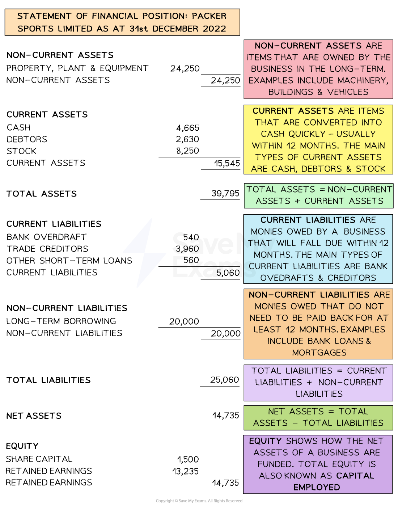

# Using the Statement of Financial Position To Make Decisions

## Interpreting a statement of financial position

> **Spec point** — `spcpt_tsq9ZbqqzvqHYV7w` · Interpret a simple statement of financial position and make deductions from it, e.g. how a business is financing its activities and what assets it owns, sale of inventories to raise finance (constructing statements of financial position will not be assessed)

## Interpreting a statement of financial position

- The statement of financial position is a **key document** that is part of a business's **annual accounts**
- It generally follows the** structure** shown below

#### Example statement of financial position

*The statement of financial position shows assets and liabilities of a business and how the business is funded*

### Interpreting the statement of financial position

- Several deductions can be made from the Statement about how a **business finances its activities, what it owns, and what it owes**

  - This information is useful as it can inform the decision-making process

#### Financing its activities

- *Packer Sports Limited *is funded through share capital of \$1,500 and ***retained earnings*** of \$13,235

  - The business has long-term liabilities of \$20,000
  
    - This is likely to be a long-term loan
    - This is significantly greater than share capital so its ***gearing*** is high
    - **Future applications for loans may be declined** as the business is likely to be seen as a lending risk

#### What the business owns

- On the stated date, *Packer Sports Ltd *owned **assets** worth \$39,795 in total

  - Non-current assets of \$24,250 consisting of property, machinery (plant) and other equipment
  - Current assets worth \$15,545, comprised of cash, debtors and stock
  
    - Stock will be sold and converted to cash or debtors
  - When debtors pay their ***invoices*** they will become cash

#### What the business owes

- On the stated date, the business had total** liabilities **of \$25,060

  - Its current liabilities were \$5,060, comprised of a bank overdraft, trade creditors and other short-term loans
  - Its **long-term liabilities** were valued at \$20,000

> **Exam Hint**
> In your exam, you will not be required to construct a Statement of Financial Position. You do need to understand how they work and more importantly, how the information contained in them can be used to make decisions.
