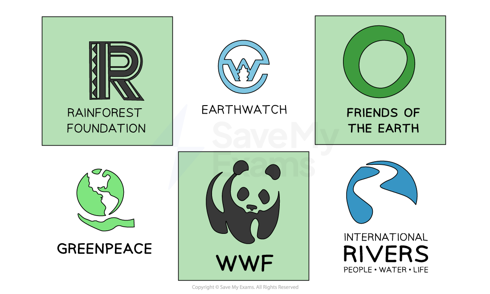

# Environmental Concerns: Pressure Groups

## Sustainable development

> **Spec point** — `spcpt_bZcV7BBXbpC9c6VB`

## Sustainable development

- Sustainable development **meets the needs of the present population** without compromising the ability of future generations to achieve a comparable standard of living

  - It may involve several aspects
  
    - **Limiting the use of non-renewable resources** and **reducing harmful emissions**
    - **Protecting natural habitats** and **at-risk species**
    - Using **land and natural resources** in an environmentally responsible way

- **Governments** often encourage business sustainability by **providing information** as well as ***grants***** or low-interest loans** and sometimes ***legislate*** to enforce more responsible decision-making

## Environmental pressures and opportunities

> **Spec point** — `spcpt_HDdx6rmKCjvmGMby`

## Environmental pressures and opportunities

- Businesses can **contribute to sustainable development** in several ways

  - By doing so, they can benefit from an **improved reputation,** which can **attract new customers** and **increase their sales**
  - Business **costs may be reduced** by adopting responsible practices, and this can help improve** profits**

#### How businesses can contribute to sustainable development

| **Contribution** | **Explanation** | **Example** |
|---|---|---|
| **Recycling** | - Re-use scarce resources and purchase recycled raw materials and components - Use recycling services - Encourage customers to return items for reuse or recycling | - **M&S**'s *Buy Anywhere, Return Anywhere* reusable packaging scheme involves customers buying certain products in reusable packaging in exchange for deposit - They can return empty containers which have been washed and sanitised, refilled and put back in supermarkets for new consumers to use |
| **Limiting resource use** | - Adopt ***lean production*** techniques to minimise resource use and wastage - Encourage customers to consume products responsibly | - **Coca-Cola** aims to replace all water used in creating their drinks back to the environment to ensure water security by 2030 |
| **Use renewable energy sources** | - Invest in renewable energy sources such as solar panels - Replace equipment with energy-efficient technology to minimise ***carbon footprint*** | - **Unilever **is using 100% renewable electricity across all its factories, offices, warehouses and distribution centres - They also generates their own power with on-site solar installations in 23 countries |
| **Innovation** | - Design products that are durable, reusable and recyclable - Implement eco-friendly practices in production, packaging and distribution to reduce the environmental impact | - **IKEA**'s *Take-Back* programme allows customers to return furniture to be repurposed or recycled |

## The impact of pressure groups on business

> **Spec point** — `spcpt_WMRZzS328KbH7g9R`

## The impact of pressure groups on business

- Pressure groups are organisations, or groups of people, that seek to **influence the policies and actions of businesses** or governments
- Their primary objective is to promote a **specific cause or agenda**
- Pressure groups want the company to support their cause or take action on an issue

  - E.g. An animal rights group may want a clothing company to **stop using animal products** in their clothing
- **Consumers** have the ability to be one of the most powerful pressure groups

#### Ways consumers can encourage environmentally sustainable business practices

| **Purchase** products that are **eco-friendly** and have **minimal environmental impact, **such as FairTrade or USDA Organic | Use s**ocial media** platforms to **congratulate **and** share** details of sustainable businesses | **Communicate directly **with businesses to **express concerns** about their environmental practices |
|---|---|---|
| **Support campaigns** that promote sustainability and put pressure on companies to make positive changes | **Boycott **businesses with poor environmental records | **Contact political representatives** to request stronger environmental laws and policies at local, national and international levels |

### Pressure groups

- Pressure groups also** lobby political representatives** to enact **laws **that require businesses to **meet environmental standards** and **cease environmentally-damaging practices**

  - Well-known **international environmental pressure groups** include Greenpeace, Friends of the Earth and Earthwatch
  
    - **Greenpeace**'s programme of direct action has led to the outlawing of many environmental threats including the 1982 worldwide ban on commercial whale culling, the prohibition on mining in Antarctica and the 2018 UK ban of microbeads in personal cleansing products

- **National** or **regional pressure groups** can also achieve significant targeted success in persuading - or forcing - businesses to improve their practices or change decisions

  - In 2015 UK-based pressure group **Buglife** campaigned successfully to stop a building development which had threatened a critically endangered species of insect
  - Dutch pressure group **Milieudefensie** **bought land on which a new international airport was to be constructed and sold small pieces of that land to many individuals, making it impossible for the development to continue**

#### Examples of international environmental pressure groups

*Powerful international pressure groups can have a significant impact on business activities*
