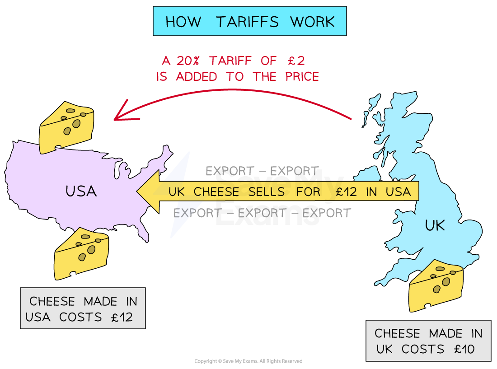

# Tariffs & Quotas

## Import tariffs and quotas

> **Spec point** — `spcpt_GHxpyGKWXztMVBpV` · • Why governments might introduce import tariffs and import quotas

## Import tariffs and quotas

### Import tariffs

- A **tariff** is a tax placed on imported goods from other countries

  - E.g. Tennis rackets imported into the UK from China have a tariff of 4.7%
- A tariff **increases the price** of imported goods, which helps **shift demand** for that product or service from foreign businesses to **domestic businesses**

*When the USA places a tariff on imported cheese from Britain, the price of British cheese in the USA rises*

- American customers are more likely to** purchase American cheese** now that the tariff has made British cheese** more expensive**

#### The benefits of tariffs

- They protect ***infant industries*** so they can eventually become more competitive globally
- An increase in **government tax revenue**
- Reduces ***dumping*** by foreign businesses as they cannot sell below the  market price

#### The disadvantages of tariffs

- **Increases the cost** of imported raw materials, which may affect businesses that use these goods for production, leading to higher prices for consumers
- **Reduces competition** for domestic firms, who may become more inefficient and produce poor-quality products for their customers
- **Reduces consumer choice **as imports are now more expensive and some customers will be unable to afford them

> **Exam Hint**
> Students are often confused about who pays the tariff. It is not the foreign company, but the domestic company who pays the tariff. In our cheese example above, any retailers in the USA who import cheese from Britain have to pay the tariff (import tax) when it crosses the border into the USA. This policy may help cheese manufacturers in the USA but it harms any other business that imports and sells foreign cheese as it raises their costs of production.

### Quotas

- An **import quota** is a** government-imposed limit** on the amount of a particular product allowed into the country

  - E.g. China has set an import quota on Cambodian rice of approximately 5.32 million tonnes per ye

- Restricting the physical quantity of imports means that domestic businesses face l**ess competition **and benefit from a higher market share

  - More of the domestic demand is now met by domestic businesses

#### The benefits of import quotas

- To **meet extra demand, domestic businesses may need to **hire more workers, which reduces unemployment and benefits the wider economy
- The higher prices for the product may encourage **new businesses to start up** in the industry
- Countries are able to **easily change** import quota as market conditions change
- Foreign countries view quotas as **less confrontational **to their business interests than tariffs

  - Their exporters can still sell their goods at a higher price in domestic markets (but a limited amount of it)

#### The disadvantages of import quotas

- Quotas limit the supply of a product and whenever supply is limited, the **price of the product rises**
- They may generate tension in the relationship with trading partners
- Domestic firms may become **more inefficient **over time as the use of quotas reduces the level of competition
