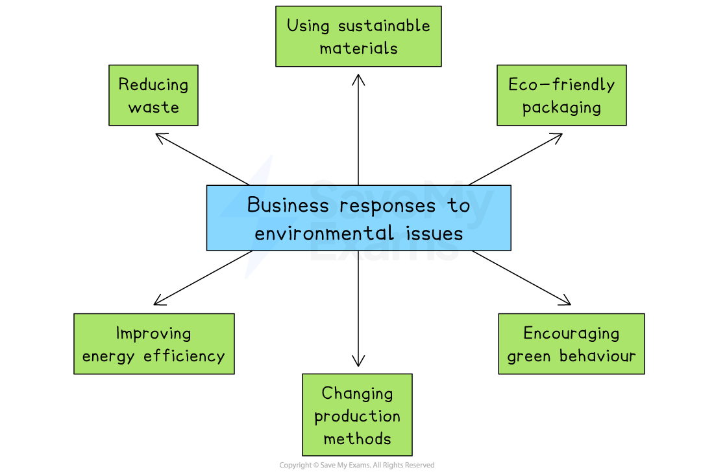

# Business Impacts on the Environment

## Pollution

> **Spec point** — `spcpt_DQW22H7WwhtMt25r` · how business activity can negatively affect the environment, e.g. pollution, depletion of resources

## Pollution

- Some **industrial processes generate pollutants,** including air and water emissions, hazardous waste and chemical byproducts

  - **The disposal **of these pollutants can harm ecosystems, wildlife and human health
  - For example, the** burning of *****fossil fuels*** releases large amounts of ***greenhouse gases*** into the atmosphere
- Food and consumer goods manufacturers account for 60% of worldwide **greenhouse gas emissions**
- **Single-use plastics** are also a huge concern

  - They produce toxic chemicals when they break apart
  - This causes pollution and harms animals, such as marine turtles, who become entangled in plastic found in the sea

## Depletion of resources

> **Spec point** — `spcpt_jWRqKQYR3SwPw5W3`

## Depletion of resources

- Natural resources, such as **water, energy and raw materials,** are used in business operations

  - Excessive consumption of these resources can lead to their **depletion**
- Materials and products may be sourced from **environmentally sensitive** areas

  - Industries like logging, agriculture, and construction contribute to ***deforestation*** in locations such as South America
  - This has a significant impact on biodiversity and contributes to ***global warming***

## Why businesses respond to environmental issues

> **Spec point** — `spcpt_kHvGfHHhMCpVZqfD` · e.g. improved reputation, increased sales

## Why businesses respond to environmental issues

- More businesses are taking action to reduce their environmental impact
- This is partly due to **growing public concern**

  - According to a 2023 UK survey, **over 80% of consumers** said they were more likely to buy from a company that takes sustainability seriously
- Governments are also introducing **stricter environmental laws**, and **pressure from *****stakeholders**** *like customers, employees and investors is increasing

#### Reasons to respond to environmental issues

| **Reason** | **Explanation** |
|---|---|
| **Improved reputation** | - By taking action to reduce environmental harm, businesses can build a positive image - This improves their relationships with customers, the *media *and the wider community |
| **Increased sales** | - Selling eco-friendly products or using *sustainable *methods can attract new customers and increase customer loyalty |
| **Legal requirements** | - Businesses must follow these laws or face fines, legal action or forced closures |
| **Pressure from stakeholders** | - Customers, employees, investors, and pressure groups may demand that a business takes action on environmental issues - Responding to these concerns helps **maintain support and trust** |
| **Cost savings** | - Using less energy, reducing waste and recycling materials can lower *operating costs* in the long term |
| **Competitive advantage** | - Being more environmentally friendly than competitors can help a business stand out in the market - It may also allow them to **charge higher prices **for eco-friendly products |
| **Access to new markets** | - Being environmentally responsible can help a business win *contracts *or attract investment |

> **Exam Hint**
> Many students think environmental responsibility only increases costs. Remember, it can also be an opportunity—such as attracting eco-conscious customers or gaining a competitive edge. Examiners reward answers that recognise both challenges and benefits

## How businesses respond to environmental issues

> **Spec point** — `spcpt_4qBvvJnkCB2ZkQqk`

## How businesses respond to environmental issues

- With growing concern about climate change, pollution and resource use, many businesses are taking action to reduce their environmental impact
- These actions can help businesses save money, follow the law and build customer trust

*Businesses may respond to environmental issues by reducing waste, using sustainable materials and eco-friendly packaging and encouraging green behaviour*

### Business responses to environmental issues

#### Reducing waste

- Businesses can reduce, reuse and recycle materials to cut down on *landfill *waste and pollution

#### Improving energy efficiency

- Installing energy-saving equipment, such as LED lighting or solar panels, helps reduce electricity use and lower carbon emissions

#### Using sustainable materials

- Switching to recycled or eco-friendly materials can reduce environmental damage and appeal to green customers

#### Changing production methods

- Businesses may invest in cleaner technology or reduce harmful emissions during manufacturing to lower their overall *environmental footprint*

#### Eco-friendly packaging

- Using *biodegradable *or recyclable packaging helps reduce plastic waste and limits environmental harm

#### Encouraging green behaviour

- Businesses can promote eco-friendly habits, such as offering discounts for reusable bags or encouraging employees to cycle or walk to work

> **Case Study**
> **Danone's Steps To Reduce Its Environmental impact**
> 
> Danone, known for brands like Activia and Evian, has taken major steps to reduce its environmental impact, especially in food production and packaging
> 
> 
> 
> **Actions**
> 
> - It  has committed to becoming **carbon neutral by  2050 **and has already achieved *carbon neutrality* in several of its factories
> - The company works with farmers to support **sustainable agriculture**, using fewer chemicals and protecting soil health
> - It has invested heavily in **plant-based products**, such as dairy-free yoghurts and drinks, which generally have a lower environmental footprint than animal-based alternatives
> - Danone is redesigning its packaging to use **100% recyclable, reusable **or** compostable materials** by 2025, with several water brands already using bottles made entirely from recycled plastic
> 
> **Outcome**
> 
> These actions help Danone meet **legal requirements**, reduce its **carbon footprint** and build a strong **reputation with environmentally aware consumers**

## Legal controls over business activity affecting the environment

> **Spec point** — `spcpt_xVp7C9XrFbZWGzrm` · "effects of legal controls over business activity affecting the environment: how, what and where to
produce or sell, influence on costs"

## Effects of legal controls on business activity and the environment

- Governments pass **environmental laws** to reduce damage caused by business activity. These laws affect:

  - **How** businesses produce
  - **What** they produce
  - **Where** they produce or sell
  - **The costs** of doing business

### 1. How businesses produce

- Legal controls may ban or restrict harmful production methods (e.g., limits on factory emissions, rules on waste disposal)
- Businesses may need to invest in cleaner technology, filters, or recycling systems
- **Impact:** Higher production costs, but safer working and living environments

### 2. What businesses produce

- Certain products may be banned if they harm the environment (e.g., plastic bags, toxic chemicals)
- Businesses may be forced to redesign or switch to sustainable alternatives
- **Impact:** Higher R&D costs, but opportunities to innovate and appeal to eco-conscious consumers

### 3. Where businesses produce or sell

- Firms may be prevented from locating near protected areas (e.g., national parks, residential zones)
- Laws may restrict selling in markets where environmental standards are not met (e.g., exporting to the EU with strict rules)
- **Impact:** Limits expansion but protects communities and ecosystems

### 4. Influence on costs

| Area of Impact | Examples | Effect on business costs |
|---|---|---|
| ***Compliance costs*** | - Buying new equipment, paying for waste treatment | - Costs rise as businesses invest in cleaner processes |
| **Fines and penalties** | - Breaking pollution or dumping laws | - Non-compliance can be very expensive |
| **Product redesign** | - Replacing banned materials, eco-friendly packaging | - Increases R&D and production costs |
| **Reputation & sales** | - “Green” image improves customer loyalty | - Can increase sales and offset higher costs |
