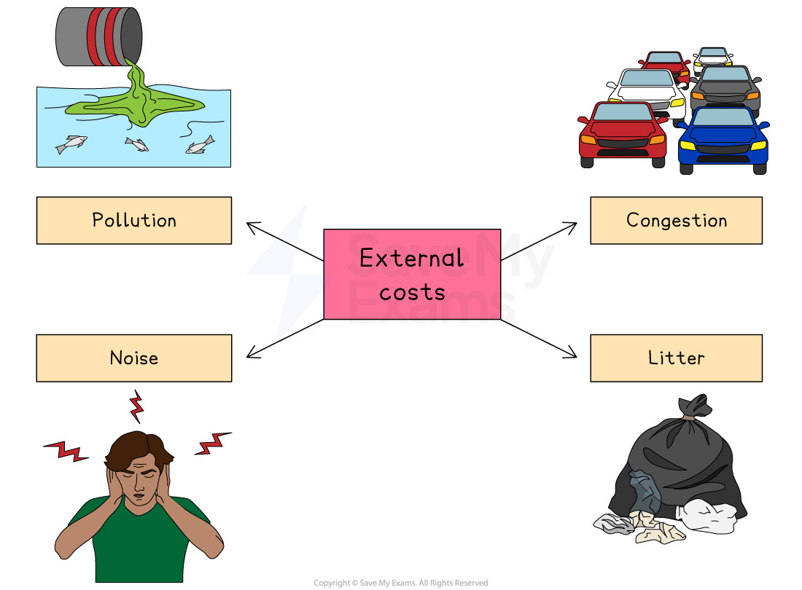
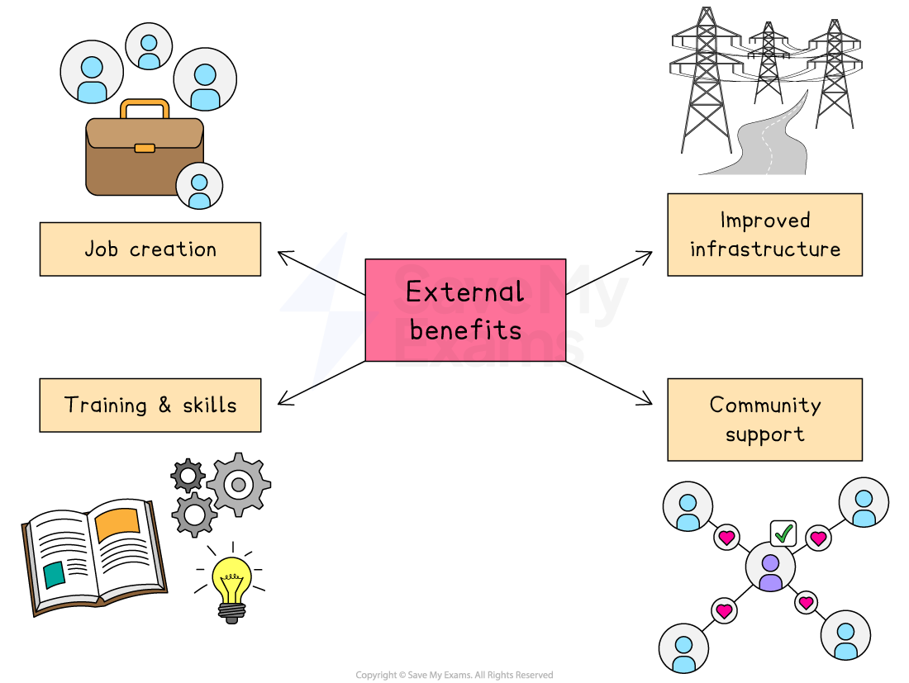

# External Costs & Benefits

## External costs of business decisions

> **Spec point** — `spcpt_ftf5v8JYWrvt29bR`

## External costs of business decisions

- **External costs are unwanted side effects of business activity that affect people or the environment outside the business**

  - These costs are not paid by the business, but by society
- External costs can lead to **public pressure**, **government regulation** or **reputational damage**, which may eventually affect the business’s profits or operations

### Examples of external costs

#### Environmental damage

- Business activity can lead to pollution, deforestation, and resource depletion.

  - For example, oil spills from **BP’s Deepwater Horizon disaster** in 2010 caused severe marine pollution in the Gulf of Mexico
  - The clean-up costs and environmental impact were huge, affecting local fishing and tourism industries

#### Traffic congestion

- Businesses that rely on large transport fleets or attract many customers can cause road congestion and longer travel times for others

  - For example, large out-of-town retail parks in the UK, such as **Bluewater Shopping Centre**, have been criticised for increasing traffic congestion, especially during peak shopping periods

#### Noise pollution

- Factories, airports, and construction projects can create disruptive noise for local residents and businesses

  - For example,** **Indonesian residents living near the **Soekarno-Hatta International Airport** have complained about constant aircraft noise, especially at night, which affects sleep, health and quality of life

#### Waste and litter

- Businesses that produce packaging or operate food outlets may contribute to local waste problems

  - For example, fast food chains like **McDonald’s** have faced criticism over the amount of litter left around their stores, particularly in busy city centres

> **Exam Hint**
> Don’t confuse external costs with private costs. External costs affect society (e.g. pollution), while private costs affect the business (e.g. wages, materials). Examiners often see students mix these up—be precise, as clear definitions and examples secure higher marks

## External benefits of business decisions

> **Spec point** — `spcpt_XwswSnxXGNfYJ6F6`

## External benefits of business decisions

- **External benefits are advantages that a business’s activities provide to people or the environment outside the business**

  - These benefits are not paid for by those who receive them
- External benefits can help improve a business’s **reputation**, build **good relationships with local communities** and make it easier to operate in different countries

### Examples of external benefits

#### Job creation

- Businesses that open new factories, offices, or stores provide employment for local people

  - For example, when **Toyota** opened its manufacturing plant in **Durban, South Africa**, it created thousands of jobs
  - This boosted the local economy and reduced *unemployment* in the region

#### Improved infrastructure

- Business investment can lead to improvements in roads, public transport or *utilities*, which benefit the wider community

  - For example, the development of **Silicon Valley** in the USA led to better roads, high-speed internet, and power supply in surrounding areas
  - These benefited not just tech firms, but also schools, hospitals and residents

#### Training and skills development

- Some businesses offer training that improves workers' skills, which they can later use in other jobs or industries

  - For example, **Samsung** in **Vietnam** provides extensive training for factory workers, increasing the overall skill level of the workforce

#### Support for local services

- Large businesses may donate to schools, hospitals, or community projects near their operations

  - For example,** Coca-Cola** in **Kenya** has supported clean water and sanitation programmes in rural areas, helping to improve public health
