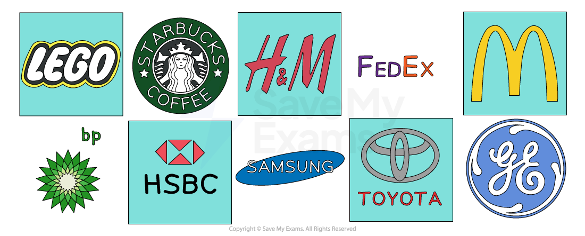
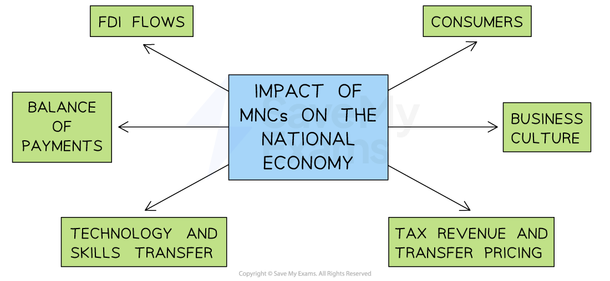

# Multinational Companies (MNCs)

## Definition of multinational companies

> **Spec point** — `spcpt_sF5thx7MzYgTGzXJ`

## Definition of multinational companies

- **A multinational company (MNC)** is a business that is registered in one country but has manufacturing, processing and/or service outlets in many different countries

  - For example, **Starbucks **headquarters are in Washington, USA but they have 32,000 stores in 80 countries

#### Examples of multinational companies

*Well-known multinational businesses include BP, General Electric (GE), McDonalds and FedEx*

- Factors such as ***globalisation*** and ***deregulation*** have contributed to the growth of MNC’s
- MNC’s often choose locations based on factors such as **cost advantages** and **access to markets **

  - **Nike** originates from the USA, but 50% of their manufacturing takes place in Mexico, China, Vietnam and Indonesia due to the **lower production costs** in these countries

## Advantages of becoming a multinational company

> **Spec point** — `spcpt_6RChSfFf56QVhxRc`

## Advantages of becoming a multinational company

- Multinational companies benefit in many ways by operating in different countries
- These advantages help** increase profits, reduce costs** and lower business risks

| **Advantage** | **Explanation** |
|---|---|
| **Economies of scale** | - By operating globally and increasing output, MNCs benefit from lower *average costs*, improving efficiency and competitiveness |
| **Increased profit** | - MNCs often make large profits, some of which are sent back to their home country - However, some use *offshore bank accounts* and do not return profits home |
| **New markets** | - MNCs can enter new markets in different countries, which increases sales and spreads risk across multiple regions |
| **Transportation costs** | - Setting up production facilities closer to customers reduces transportation costs and speeds up delivery times |
| **Risk management** | - Selling in many countries reduces the risk of overall business failure - For example, if Egypt enters a *recession* and sales fall there, rising sales in a strong German market may offset the losses |
| **Tax incentives** | - MNCs may increase profits by locating in countries with low *corporation tax* or where *tax breaks* are offered |
| **Avoidance of protectionism** | - MNCs can avoid import tariffs by setting up production in countries with *protectionist policies* - For example, a Chinese MNC might open a factory in the USA to avoid tariffs on Chinese exports |

## Advantages to a country of hosting a multinational company

> **Spec point** — `spcpt_dFYp3ygTqhxVr5fD` · "e.g. jobs, exports, increased choice,
investment"

## Advantages to a country of hosting a multinational company

- Many governments are in favour of MNCs establishing in their country, as there are **benefits** to the wider economy, but their presence can also have **negative consequences**

#### Positive impacts of MNCs on the national economy

*MNCs impact several business metrics in the national economy*

#### Foreign direct investment (FDI)

- There will be an **inflow of money **into a country if a MNC decides to invest into a country through  ***foreign direct investment***

  - This money** enriches local firms or citizens,** who now have more money available to spend in the economy
  - If this money is **reinvested** **back into the local economy**, it may help to generate new jobs and boost economic growth

#### Balance of payments

- MNCs can help** improve** the *balance of payments* of a country as FDI flows into the country

  - Any goods and services **exported for sale** by the MNC will generate further inflows to the country’s balance of payments
  - This is especially beneficial to a country when the MNC is exporting a **rare and valuable raw material, e.g cobalt**

#### Technology and skill transfer

- MNCs can bring new technologies and skills to local businesses

  - This will help to** improve efficiency and productivity**, helping domestic businesses become** more competitive** in national and international markets

#### Consumers

- Customers in countries which host MNCs often benefit from

  - **Better** **quality,** a **wider choice of goods** and services and **lower prices** if MNCs pass their cost advantages on in the form of lower prices
  - **Improved *****living standards,*** as people may have higher incomes due to job creation and lower unemployment

#### Business culture

- Domestic businesses may be influenced by the  ***business culture*** of MNCs

  - For example, in the 1990s, European businesses adopted the working practices of Japanese businesses such as Nissan
  - Workplaces became more open and employers started to copy ideas such as ***Kaizen*** and continuous improvement
- MNCs may also encourage a culture of **entrepreneurship**

  - This can help boost overall  economic growth

#### Tax revenue

- There is the potential for the host country to earn significant *tax revenue* from MNCs
- Governments can use this to invest in improving public services and *infrastructure*

## Disadvantages to a country of hosting a multinational company

> **Spec point** — `spcpt_834c4BHdpshk9Htm` · "e.g. increased competition,
environmental damage, exploitation of natural resources, repatriation of profits"

## Disadvantages to a country of hosting a multinational company

- Multinational companies can also present some **challenges,** which **governments sometimes struggle to mitigate**

#### Loss of assets

- Business assets from the home country are now fully or partly **owned **by foreign businesses
- Local firms or individuals who have sold the asset may not reinvest the money into the local economy but may **move it abroad or offshore**

#### Balance of payments

- MNCs can have a** negative impact** on the ***balance of payments***

  - If the MNC buys raw materials or equipment abroad (imports), there is a flow of money out of the country
  - If the MNC **send profits back** to their home country, it will also represent a flow of money out of the country

#### Consumers

- In the long run, MNCs can **push domestic businesses out of the market,** leaving customers with less choice

  - This may lead to MNCs exploiting customers with **higher prices** and **low-quality products,** as they have limited choice

#### Business culture

- MNCs may demonstrate** *****unethical behaviour*** and have a company culture of *exploitation*

  - For example, Bangladesh is used by many clothing brands to produce cheap clothes and many ignore poor working conditions
  - This encourages local firms to** also ignore the working conditions**

#### Transfer pricing

- MNCs often seek to maximise profits and try to **reduce their *****tax liabilities***

  - ***Transfer pricing*** is a method used by MNCs to shift profits from where they are generated to countries with lower tax rates
  - This is a method of ***tax avoidance*** and means that the businesses will deprive the host country of tax revenue

> **Exam Hint**
> Many students only focus on the benefits of multinational companies. Examiners expect balance. Always **consider both sides**: while MNCs bring jobs and investment, they may also exploit resources or repatriate profits. A one-sided answer will limit your marks

> **Case Study**
> **Shell in Nigeria**
> 
> Shell, one of the world’s largest oil multinationals, has operated in Nigeria for decades. While it created jobs and export income, it has also caused major problems for the host country.
> 
> 
> 
> **Context**
> 
> - Nigeria depends heavily on oil exports for government revenue.
> - Shell and other MNCs dominate production and control much of the sector.
> - Oil makes up around 90% of Nigeria’s foreign exchange earnings.
> 
> **Disadvantages**
> 
> - **Loss of assets**
> 
>   - Nigeria’s oil is largely controlled by foreign firms. Profits flow abroad rather than staying in the local economy
> - **Balance of payments**
> 
>   - Shell imports machinery and repatriates profits to Europe, creating large outflows of money
> - **Consumers**
> 
>   - Local energy firms struggle to compete, leaving customers dependent on one major supplier
> - **Business culture**
> 
>   - Oil spills polluted land and rivers, setting a poor standard for environmental responsibility
> - **Transfer pricing**
> 
>   - Shell has been accused of shifting profits abroad, reducing Nigeria’s potential tax revenue
> 
> **Nigeria’s response**
> 
> - The government formed the Nigerian National Petroleum Corporation (NNPC) to secure government ownership
> - They introduced local laws to boost the use of Nigerian suppliers and the employment of Nigerian workers
> - The government sued Shell for oil spills and demanded compensation
> - They renegotiated contracts so more profit stays in Nigeria
> - The government launched tax reforms to reduce profit shifting to other regions
