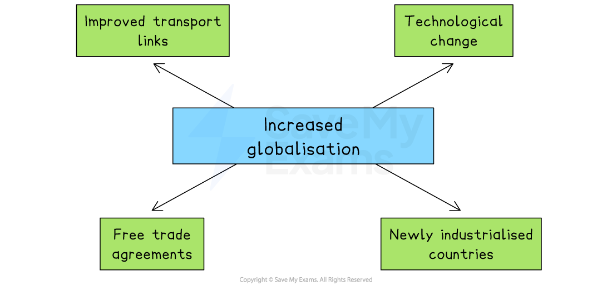

# The Importance of Globalisation

## Reasons for globalisation

> **Spec point** — `spcpt_6Q4PTq7fwNTHkRnG` · "improved transport links, technological change including
communication, free trade agreements, newly industrialised countries"

## Reasons for globalisation

- Globalisation is the **economic integration of countries** through increased cross-border movement of people, goods and services, technology and finance
- In recent years there has been **rapid globalisation **and growing international business expansion
- Businesses that trade internationally import and export goods and services

  - **Imports** are goods and services **bought by people and businesses in one country from another country**
  
    - In 2022, the UK’s biggest import was cars, valued at approximately £3.25 billion
  - **Exports** are goods and services **sold by domestic businesses** to people or businesses in other countries
  
    - In 2022, China’s biggest export was smartphones, valued at approximately \$21.4 billion
- Exports generate **extra sales revenue** for businesses selling their goods abroad
- Imports result in money leaving the country, which generates **extra revenue for foreign businesses**

#### Why globalisation has accelerated

*Globalisation has accelerated for a range of reasons, including improved transport links and free trade agreements*

- **Improved transport links **have made it easier and cheaper to move goods, services and people between countries

  - This allows businesses to expand into global markets and operate *international supply chains*
- **Technological change**, including advances in communication, has made it quicker and cheaper to share information across the world

  - Businesses can now manage international operations, hold *virtual meetings* and advertise to global audiences more easily
- **Free trade agreements **between countries have reduced or removed *tariffs* and other *trade barriers*

  - This encourages international trade by making imported goods more affordable and increasing access to foreign markets
- **The growth of newly industrialised countries **has created new markets for goods and services

  - These countries also offer lower-cost labour and production, attracting businesses to invest and set up operations there

> **Exam Hint**
> Don’t confuse globalisation with just “selling products abroad.” It’s much broader – including improved transport, communication technology, and free trade agreements. In your answers, show how these factors create both opportunities and threats for businesses, not just one side

## Opportunities and threats of globalisation for businesses

> **Spec point** — `spcpt_8xSntZ5SmzTwf5Mw`

## Opportunities and threats of globalisation for businesses

- Globalisation offers businesses the chance to grow beyond their home country

  - By trading internationally, they can increase sales, lower costs and access valuable resources

#### Opportunities of globalisation

| **Opportunity** | **Explanation** | **Impact** |
|---|---|---|
| **Market expansion** | - Globalisation allows businesses to export to new countries and reduce reliance on one market | - This can increase sales revenue and spread risk - E.g. **Jack Wills** has opened stores in Germany, increasing sales by over 4% |
| **Lower costs** | - Businesses can source cheaper *raw materials* or relocate production to countries with lower land and labour costs | - This reduces costs, lowers the *break-even point*, and improves competitiveness - In 2023, **Nike **moved production to Mexico due to rising labour costs in China |
| **Access to resources** | - Businesses can import products not available locally or build facilities near key resources | - This can expand the product range, attract more domestic customers and reduce transport costs - Being first to offer new products may provide a *competitive advantage* |

#### Threats of globalisation

#### Increased competition

- Globalisation exposes businesses to multinational competitors with greater *economies of scale*

  - This makes it harder for smaller firms to compete on price and distribution

#### Greater exposure to global risks

- Businesses become more vulnerable to global shocks such as supply chain disruption, *exchange rate volatility* and rising *commodity* prices

#### Pressure on costs and standards

- Competing globally can increase costs linked to regulation, ethical sourcing and sustainability, which may squeeze *profit margins*, especially for small businesses

## Import tariffs and quotas

> **Spec point** — `spcpt_GXXBt86vvm49HhCt`

## Import tariffs and quotas

- **A tariff is a tax placed by a government on imported goods from other countries **

  - For example, tennis rackets imported into the UK from China have a tariff of 4.7%
- **An import quota is a government-imposed limit on the amount of a particular product allowed into a country **

  - For example, China has set an import quota on Cambodian rice of approximately 5.32 million tonnes per ye

> **Case Study**
> **US Tariffs on Steel and Aluminium Imports**
> 
> In early 2025, President Trump **doubled tariffs** on steel and aluminium imports to the USA. Rates increased from 25% to 50%, including on goods shipped from Canada
> 
> 
> 
> ** The effects on Canadian businesses**
> 
> - **A sharp increase in production costs**
> 
>   - Canadian manufacturers that rely on steel and aluminum saw their *input prices* rise significantly
>   - Some reported ***redundancies ***and **cuts in investment** as shipments declined
> - **Shift in export strategies**
> 
>   - Since the US market accounted for around **75% of Canadian exports**, many businesses began ***diversifying *****into Asia and Europe** to reduce reliance on US buyers
> - **Small businesses under pressure**
> 
>   - Smaller Canadian firms struggled to absorb the additional costs of raw materials and faced reduced *profit margins*
>   - Some had to **raise prices**, while others accepted **lower profit margins** to keep business with US customers

## The effects of import tariffs and quotas on businesses

> **Spec point** — `spcpt_mN3BpDD5cy2sdpJh`

## The effects of import tariffs and quotas on businesses

### The effects of tariffs

- A tariff **increases the price** of imported goods, which helps **shift demand** for that product or service from foreign businesses to **domestic businesses**

*When the USA places a tariff on imported cheese from Britain, the price of British cheese in the USA rises*

- American customers are more likely to** purchase American cheese** as the tariff has made British cheese** more expensive**

#### Advantages of tariffs

- They protect ***infant industries*** so they can eventually become more competitive globally
- An increase in **government tax revenue**
- Reduces ***dumping*** by foreign businesses as they cannot sell below the  market price

#### Disadvantages of tariffs

- **Increases the cost** of imported raw materials, which may affect businesses that use these goods for production, leading to higher prices for consumers
- **Reduces competition** for domestic firms, who may become more *inefficient* and produce poor-quality products for their customers
- **Reduces consumer choice **as imports are now more expensive and some customers will be unable to afford them

> **Exam Hint**
> Students are often confused about who pays the tariff. It is not the foreign company but the domestic company that pays the tariff
> 
> In our cheese example above, any retailers in the USA who import cheese from Britain have to pay the tariff (import tax) when it crosses the border into the USA. This policy may help cheese manufacturers in the USA but it harms any other business that imports and sells foreign cheese, as it raises their costs of production.

### The effects of quotas

- Restricting the physical quantity of imports using a **quota **means that domestic businesses face l**ess competition **and benefit from a higher *market share*

  - More domestic demand is met by domestic businesses

#### Advantages of import quotas

- To **meet extra demand, domestic businesses may need to **hire more workers, which reduces *unemployment* and benefits the wider economy
- The higher prices for the product may encourage **new businesses to start up** in the industry
- Countries are able to **easily change** import quota as market conditions change
- Foreign countries view quotas as **less *****confrontational ***to their business interests than tariffs

  - Their exporters can still sell their goods at a higher price in domestic markets (but a limited amount of it)

#### Disadvantages of import quotas

- Quotas limit the supply of a product and whenever supply is limited, the **price of the product rises**
- They may generate tension in the relationship with trading partners
- Domestic firms may become **more inefficient **over time as the use of quotas reduces the level of competition
