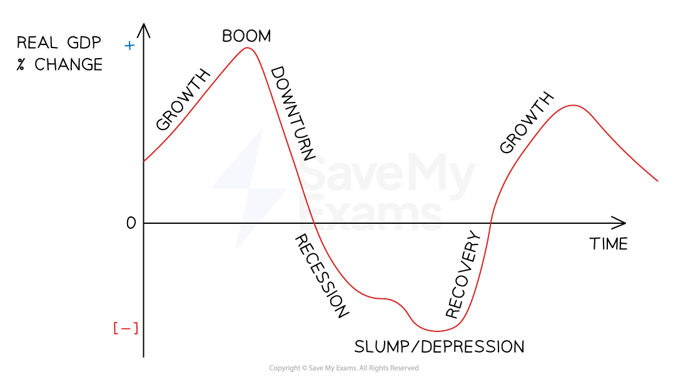

# Business Cycle

## Stages of the business cycle

> **Spec point** — `spcpt_6SF8wJD2cyCkbbYr` · growth, boom, recession, slump

## Stages of the business cycle

- The business cycle describes the** upturns** and** downturns** in the level of a country’s economic activity (***gross domestic product*** or GDP) over time
- Economies **do not experience consistent levels of growth** over time

#### The business cycle

*The business cycle diagram shows periods of growth, boom, recession and slump in an economy*

### Growth

- The **growth** stage is a period of increasing rates of GDP growth

  - *Disposable income* levels rise and lead to increased demand for products
  - This drives an increase in production levels, which leads to a rise in employment levels
  - Businesses look to expand and increase profit

### Boom

- A **boom** is a period of time when an economy experiences an extended period of **increasing rates of GDP growth**

  - Consumer incomes and business profits are high
  - ***Inflation*** is also high due to higher demand for goods and services
  - Unemployment levels are low and wages are high due to a shortage of skilled workers

### Recession

- A **recession **occurs when an economy experiences **two consecutive quarters (6 months) or more of negative GDP growth**

  - Incomes and consumer demand fall, leading to reduced output
  - Consumer and business confidence tend to be low
  - Business profits fall and *unemployment *rises

### Slump

- A **slump** is an **extended period of negative GDP growth**

  - Unemployment is likely to be high as a result of high levels of business failure
  - Significant declines in household incomes and business profits
  - Increased government spending on ***welfare benefits*** and *infrastructure *projects to inject demand into the economy **may benefit some businesses**

## The impact of the business cycle on business

> **Spec point** — `spcpt_RmmS8xswt7GmYN8D`

## The impact of the business cycle on business

- Businesses must **adapt** their strategies at each stage of the cycle

  - For example, cutting costs in a recession or investing in growth during a boom

#### Impacts at each stage of the business cycle

| **Stage of business cycle** | **Impact on business** | **Example** |
|---|---|---|
| **Growth** | - During the growth stage, businesses experience **higher sales and profits** as consumer demand increases - They are likely to invest more in new products, staff, and equipment | - After the 2008 financial crisis, **Apple **saw strong global demand for iPhones and expanded its operations worldwide |
| **Boom** | - In a boom, businesses often enjoy **very high sales and profits**. - However, they may also face rising costs due to **increased wages**, competition for skilled workers and the impact of inflation on materials | - **Tesla **benefited from a booming economy in the late 2010s, with high consumer demand and strong *investor confidence* helping it grow rapidly |
| **Recession** | - During a recession, businesses usually face **falling sales and profits** as consumer spending declines - Many businesses reduce costs by **cutting jobs** or delaying investment | - In the 2020 COVID-19 recession, **Primark **lost significant income due to store closures and reduced customer spending |
| **Slump** | - A slump is the most severe stage of the business cycle, where many businesses **face major losses** or closure due to very low demand - Investment falls, and **unemployment rises sharply,** reducing consumer spending | - In early 2020, many airlines faced a severe slump due to global travel restrictions - Passenger numbers dropped dramatically, leading to cancelled flights, *redundancies*, and government *bailout *requests |

> **Exam Hint**
> Don’t just memorise the four stages of the business cycle – show how each one affects businesses differently. For example, a boom might raise sales but also costs (like wages), while a recession lowers demand but may reduce interest rates.

## Effects of employment, inflation, and economic growth on a business

> **Spec point** — `spcpt_62nCfB5BWt4b72Jn`

## Effects of employment, inflation, and economic growth on a business

### 1. Employment Levels

- **Slump and recession (low employment/high unemployment)**

  - Many people out of work → consumer demand falls, especially for non-essential goods
  - Easier and cheaper to recruit staff (wages lower, labour supply higher)
  - Risk of low staff motivation and morale if job insecurity is high
- **Boom and growth (high employment/low unemployment)**

  - More people in work → consumer demand and sales rise
  - Harder to recruit staff (skills shortages, competition)
  - Wages may rise, increasing business costs

### 2. Inflation

- **Slump and recession (low inflation or even deflation)**

  - Falling prices may encourage consumers to delay spending, reducing sales
  - Lower inflation = more stable costs, easier planning for businesses
  - Risk of squeezed revenue if prices cannot be maintained
- **Boom and growth (higher inflation likely)**

  - Rising costs of raw materials and wages reduce profit margins
  - Businesses may need to raise prices, but risk losing customers
  - Uncertainty in pricing makes planning and forecasting difficult

### 3. Economic Growth

- **Slump and recession (low/negative growth)**

  - Consumer incomes fall → lower demand, especially for luxury or non-essential goods
  - Businesses may cut investment, delay expansion, or make redundancies
  - Some opportunities for “inferior goods” (low-cost options) as consumers switch to cheaper products
- **Boom and growth (high/positive growth)**

  - Rising incomes → strong demand for goods and services
  - More opportunities to expand, innovate, and increase profits
  - Risk of higher costs (wages, rent, raw materials) as demand outstrips supply
