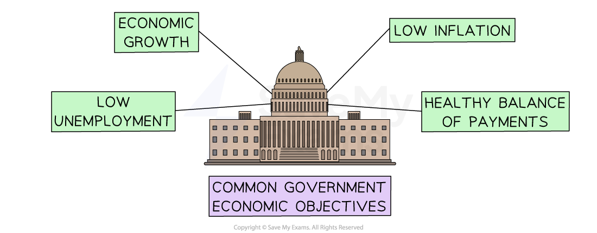

# Effects of Government Policy

## Introduction to government policy

> **Spec point** — `spcpt_R5YbQxTSfzcRhnDQ`

## Introduction to government policy

- Most **governments pursue similar objectives** for their national economies

*Governments aim to achieve economic growth, low inflation, low unemployment and a positive balance of payments*

### 1. Positive economic growth

- **Positive economic growth is the increase in the value of goods and services produced per head of population over a period of time**
- The **standard of living** of the population is likely to increase with GDP growth

  - As output is rising, **more workers are needed,** and **high levels of employment** are achieved
  - Households can **afford to buy more goods and services** as most people become richer
  - Business owners expand their business as people have more money to spend on their products and revenue rises

### 2. Low levels of inflation

- **Inflation refers to a general increase in prices and fall in the purchasing value of money over time**

  - Both the UK and US governments set their ***Central Bank*** an inflation target of 2%
  - Central Banks have a range of tools they can use to achieve this target, such as ***base rates*** and ***quantitative easing***

### 3. Low levels of unemployment

- **Unemployment refers to the number of people without a job who are actively seeking and available for work**

  - Low unemployment **increases national output**, **improves workers’ living standards** and **reduces government spending on *****welfare benefits***

### 4. A healthy balance of payments

- The balance of payments is the relationship between **the value of *****imports*** **and *****exports*** over a period of time
- **Exports bring foreign currency in** to an economy, whilst **imports lead to currency flowing out** of it

  - If a ***balance of payments deficit*** occurs
  
    - The country could **run out of foreign currency** and it may have to resort to **expensive borrowing from abroad**
    - The exchange rate (the price of one country’s currency against another) is likely to fall

## Effects of changes in taxes

> **Spec point** — `spcpt_QBDhpMtZyns45JgT`

## Effects of changes in taxes

- Government decisions on **taxation, spending, and interest rates** have a major impact on businesses. These policies affect both **costs** and **customer demand**, and businesses must adapt their strategies to survive and grow

### Effect on business profits

- **Higher business taxes (e.g. corporation tax):**

  - Reduces the share of profit a business keeps
  
    - There is less money available for reinvestment, expansion, or dividends
  - Why? Because more of the profit is paid to the government
- **Lower business taxes:**

  - Increases retained profit
  
    - Businesses can invest more or reward shareholders
  - Why? Because the business gives less of its earnings to the government

### Effect on people’s income

- **Higher income tax:**

  - Consumers keep less of their wages
  
    - There is less disposable income, and demand for goods and services falls
  - Why? Because more of people’s pay goes straight to the government
- **Lower income tax:**

  - Consumers keep more of their wages
  
    - There is more disposable income, and spending rises, especially on non-essential goods
  - Why? Because less is deducted from their earnings, leaving more to spend

> **Exam Hint**
> A common mistake is to assume that higher taxes always reduce profits. Remember: it depends on the type of tax. Higher income tax affects consumers’ spending, while higher business tax directly reduces firms’ profits. Be clear which tax you are explaining and how it impacts businesses

## Effects of changes in government spending

> **Spec point** — `spcpt_GFKCbK3KbSR8m3GV`

## Effects of changes in government spending

- **Increased government spending:**

  - Creates new demand for goods and services, for example, contracts for construction firms
  
    - It also improves infrastructure like roads, education, and healthcare, which helps businesses operate more efficiently
  - Why? Because the government is injecting money into the economy, creating jobs and income that flow to businesses
- **Reduced government spending (austerity):**

  - Leads to fewer contracts for firms and lower consumer spending
  
    - Public services may weaken, which can harm the workforce or raise costs for firms
  - Why? Because less government money is being spent, which slows down the economy

### Business responses to changes in government spending

| Government policy change | Business response | Why? |
|---|---|---|
| **Government spending rises** | - A business may bid for contracts (e.g. infrastructure projects), expand production, or recruit more employees | - Increased **public sector spending** boosts demand for goods and services. Improved **infrastructure** (roads, transport, education) lowers costs and makes production more efficient |
| **Government spending falls** | - A business may scale back operations, reduce its workforce, or postpone investment | - **Austerity policies** mean the government spends less on goods/services - This reduces sales opportunities and may weaken public services, making it harder for businesses to operate |

## Effects of  changes in interest rates

> **Spec point** — `spcpt_Fwj9HWdGfnCPfF3M`

## Effects of  changes in interest rates

- **The interest rate is the cost of borrowing money and the reward for saving**

### Higher interest rates

- Businesses face higher costs on loans, so they are less likely to borrow for growth
- Consumers also pay more on credit cards or mortgages, so they have less disposable income and reduce spending
- Why? Because interest is the price of borrowing money, and when it rises, both businesses and households borrow less

#### Implications of rising interest rates

| **Implication** | **Explanation** |
|---|---|
| **Higher repayments** | - Businesses will have to **pay more on new loans** - If their existing loan is a *variable-rate* loan, they will have to pay a higher amount back each month |
| **Fall in exports** | - Exporting businesses may see **demand for their products overseas fall** - Higher interest rates strengthen the value of the domestic currency, making their products more expensive abroad |
| **Credit sales fall** | - Customers are **less likely to purchase goods on *****credit*** when interest rates are high, leading to a **fall in sales** |
| **Savings become more attractive than investment** | - Businesses may be **less willing to make**  ***capital investments*** when their retained profit may be more profitably invested into a savings scheme |

### Lower interest rates

- Borrowing becomes cheaper, so businesses are more likely to invest and expand
- Consumers also borrow and spend more, which increases demand
- Why?** **Because lower interest makes loans and credit more affordable, encouraging spending

## Business responses to changes in taxes and interest rates

> **Spec point** — `spcpt_2ZSmYwrTf7zS3jXg`

## Business responses to changes in taxes and interest rates

- Businesses need to **respond appropriately** to changes in government policy

  - **Long- and short-term consequences** of decisions needs to be balanced
  - The** responses of different stakeholder groups** should be carefully considered
  - **Individual business circumstances** may mean that even the closest of competitors respond in different ways

### Typical business responses

| Government policy change | Business response | Why? |
|---|---|---|
| **Taxes rise** | - A business may cut costs by reducing overheads, increase prices to protect profit, or delay expansion plans | - Higher **corporation tax** reduces **profit after tax**, so less is available for reinvestment or dividends - If **income tax** rises, consumers have less **disposable income**, lowering demand and sales revenue |
| **Taxes fall** | - A business may expand production, invest in new equipment, or increase promotion to boost sales | - Lower **corporation tax** increases **retained profit**, giving more funds for growth - Lower **income tax** raises consumers’ **purchasing power**, increasing demand for both essential and luxury goods |
| **Interest rates rise** | - A business may delay borrowing for expansion, cut back on marketing, or focus on reducing costs | - Higher interest increases the **cost of borrowing** for loans and overdrafts. Consumers also face higher mortgage and loan repayments, leaving less **disposable income** for spending |
| **Interest rates fall** | - A business may borrow more to finance growth, invest in technology, or expand into new markets | - Lower interest reduces the **cost of finance**, making borrowing more attractive - Consumers can afford to borrow more, which increases **demand for goods and services** |

> **Case Study**
> **Maruti Suzuki and Rising Interest Rates in India**
> 
> In 2013, the Reserve Bank of India increased interest rates to control high inflation. Maruti Suzuki, India’s largest car manufacturer, had to adapt to these economic conditions.
> 
> 
> 
> **Context**
> 
> - India was facing high inflation, which reduced the purchasing power of consumers
> - To stabilise prices, the central bank raised interest rates, which made car loans more expensive
> - As most cars in India are purchased with bank loans, this directly reduced demand for Maruti Suzuki’s vehicles
> 
> **Business response**
> 
> - Maruti Suzuki introduced lower-cost car models and increased marketing of its small, fuel-efficient cars
> - The company offered special finance schemes in partnership with banks to make loans more attractive
> - It focused more on exports to offset weaker domestic sales
> 
> **Benefits (from Maruti Suzuki’s perspective)**
> 
> - Maintained sales: Cheaper models attracted customers who could not afford higher-priced vehicles
> - Customer support: Special finance deals helped reduce the impact of high interest rates on buyers
> - Diversification: Export growth reduced reliance on the Indian domestic market
> 
> **Challenges and drawbacks**
> 
> - Lower profit margins: Smaller cars are less profitable, so average revenue per vehicle fell
> - Slower growth in India: High interest rates continued to reduce demand for higher-end cars
> - Increased competition: Other low-cost car brands targeted the same customer base
> 
> **Challenges and drawbacks**
> 
> Maruti Suzuki’s response shows how businesses may adapt to rising interest rates by changing product focus, offering financial incentives, and seeking overseas markets. This highlights the importance of flexibility when government policy reduces consumer demand at home
