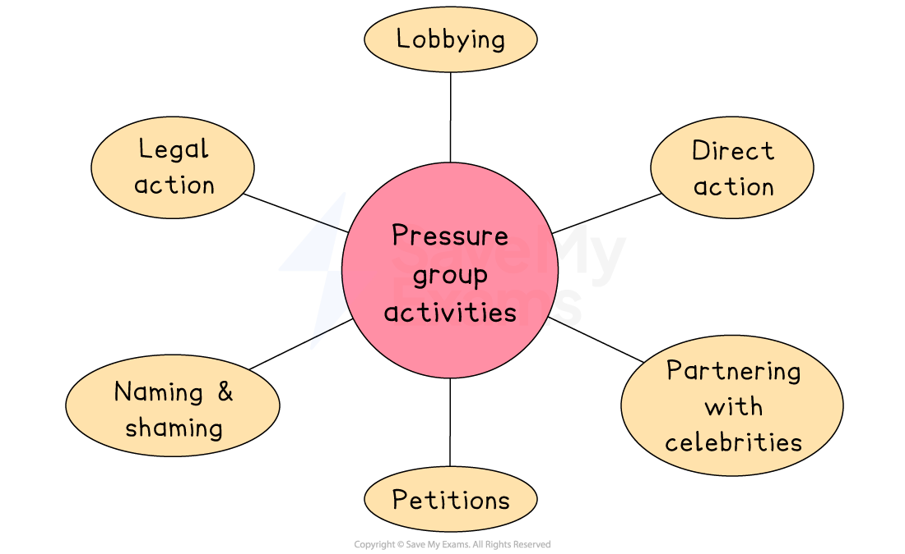

# The Role of Pressure Groups

## Introduction to pressure groups

> **Spec point** — `spcpt_xbbTHNrVnkBS5r6n`

## Introduction to pressure groups

- Pressure groups are organisations, or groups of people, that seek to **influence the policies and actions of businesses** or governments
- Their primary objective is to promote a **specific cause **or **agenda**
- Pressure groups want a business to support their cause or take action on an issue

  - For example, an animal rights group may want a clothing company to **stop using animal products** in their clothing
- They can operate on a **national **or **international scale **

  - *Save the Arctic* campaigned for Lego not to sell their products at Shell petrol stations
  - *Greenpeace* campaigned for Kimberley Clark (the manufacturer of products such as Kleenex and Huggies) to dispose of their products in a sustainable way

## How pressure groups influence business decisions

> **Spec point** — `spcpt_3rBTTMYzzRVxnKGb`

## How pressure groups influence business decisions

*Pressure groups can lobby politicians, name and shame and take direct action to influence businesses*

### Naming and shaming

- Pressure groups often publish reports or use social media to expose businesses behaving unethically
- This can damage the business’s reputation and reduce public trust

  - For example, in 2022, Greenpeace publicly criticised Coca-Cola for being one of the world’s biggest plastic polluters
  
    - This naming and shaming led to media attention and public pressure on the company to improve its packaging

### Direct action

- This includes protests, *strikes*, boycotts and other public demonstrations to draw attention to an issue and pressure the business to change its behaviour
- For example, pressure group **Extinction Rebellion** staged protests outside **Barclays Bank** branches to demand the bank stopped funding fossil fuel projects

  - These protests have affected customer views and generated negative media headlines

### Lobbying

- Pressure groups may meet with government officials or provide evidence to encourage changes in laws or regulations that affect business practices
- For example, the **Living Wage Foundation** has lobbied the UK government to increase the *minimum wage* and encourages businesses to adopt the higher 'living wage'

  - This has influenced major companies like **Lidl** and **Aviva** to increase employee pay

### Other pressure group actions

- Starting online campaigns or *petitions *that go viral
- Partnering with celebrities or influencers to spread a message
- Taking legal action or supporting *court cases* against companies

> **Exam Hint**
> Don’t assume pressure groups always harm businesses. While they may increase costs or force changes, they can also improve reputation and encourage sustainable practices. Examiners look for answers that recognise both positive and negative effects
