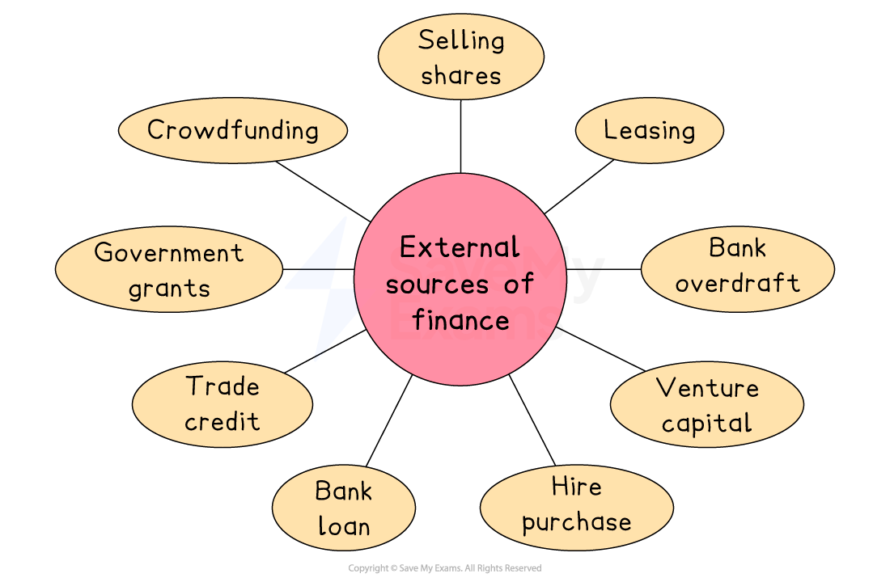

# Sources of Finance

## Internal sources of finance

> **Spec point** — `spcpt_fwRdHzN9b2V7Gdws` · "owners’ investment, retained profit, sale of unwanted assets, working capital
advantages and disadvantages of internal sources of finance"

## Internal sources of finance

- **An internal source of finance is money that comes from within a business such as owners capital, retained profit and money generated from selling assets**
- **An external source of finance is money that is introduced into the business from outside such as a loan or share capital **

### Owner’s investment

- Personal savings are a key source of funds when a** business starts up**

  - Owners may introduce their savings or another lump sum, e.g. money received following a ***redundancy***
- Owners may invest more as the **business grows** or if there is a specific need, e.g. a short-term ***cash flow*** problem

### Retained profit

- **Retained profit is the profit that has been generated in previous years and not distributed to owners is reinvested back into the business**
- This is a cheap source of finance, as it **does not involve borrowing** and associated ***interest*** and arrangement fees
- The ***opportunity cost ***of investing the money back into the business is that ***shareholders *****do not receive extra profit** for their investment

### Sale of unwanted assets

- Selling fixed ***assets*** which are no longer required, such as machinery, land or buildings, generates finance
- A **sale and leaseback arrangement **may be made if a business wants to continue to use an asset but needs cash

  - The business **sells an asset** (most likely a building) for which it receives cash
  - The business then **rents the premises** from the new owners
  - E.g. In early 2023, Sainsbury’s announced that it was in talks to **sell the prime retail property** for £500 million, which will then be **leased back** to them by the new owners, LXi Reit

- Stock may be sold at reduced prices to raise additional finance
- This reduces *stockholding costs*

  - It must be done carefully to avoid disappointing customers if stock runs low
  - E.g. A clothing retail business holds a January sale to get rid of old stock and make space for new Spring stock

### Managing working capital

- A business can also generate additional finance internally by managing its ***working capital*** more effectively

  - They can **negotiate *****extended credit terms*** with suppliers
  - They can encourage customers to **pay more promptly** for *credit purchases*

### Evaluating the use of internal finance

| **Advantages** | **Disadvantages** |
|---|---|
| - Internal finance is **often free** (e.g. it does not involve the payment of  *interest *or charges) - It does not involve third parties who may want to** influence business decisions** - Internal finance can often be **organised quickly **and without significant paperwork - Businesses that may **fail *****credit checks***** (necessary for a bank loan)** can access internal finance sources more easily | - There is a **significant *****opportunity cost***** **involved in the use of internal finance e.g. once retained profit has been used, it is not available for other purposes - Internal finance **may not be sufficient** to meet the needs of the business - Using an internal finance method is **rarely as***** tax-efficient**** *as many external methods e.g. loan repayments may be treated as a business cost and offset against tax |

## External sources of finance

> **Spec point** — `spcpt_KC5nmG8kfXYX32fS` · "share capital or issuing shares, venture capital, bank overdrafts,
leasing, hire purchase, bank loans, trade credit, government grants, crowdfunding
advantages and disadvantages of external sources of finance"

## External sources of finance

- In some cases, a business **may not be able to fulfil its needs with internal sources** of finance

  - Some projects or investments may require a **significant amount** of finance
  - External sources, such as loans or issuing shares, can provide the necessary funds for these expensive projects

*External sources of finance include selling shares, borrowing (e.g. loans and overdrafts)and trade credit*

### External sources of finance

#### Selling shares

- A public limited company (PLC) can raise finance by selling shares on the *stock market*

  - This method can generate large amounts of capital but requires the business to follow strict legal and financial regulations
- Another method is a **rights issue**, which allows existing shareholders the opportunity to buy additional shares

  - This helps raise further finance without bringing in new shareholders

#### Venture capital

- Private limited companies can sell shares to **venture capitalists**

  - These investors often bring experience, guidance and business contacts as part of the investment
- Venture capital is especially useful for new or fast-growing businesses that may be considered too risky by traditional lenders such as banks

#### Bank overdraft

- A bank overdraft is an agreement that allows a business to spend more money than it has in its *current account*
- Overdrafts are flexible and useful for covering short-term cash flow problems
- However, they often come with daily *interest *charges, so using an overdraft for a long time can be more expensive than other sources of finance

#### Leasing

- Leasing allows a business to use assets like machinery or vehicles without owning them

  - The business pays regular amounts for the use of the asset over an agreed period
  - It can help preserve cash as the business avoids large upfront costs
- Leasing is commonly used for items such as vehicles or photocopiers

#### Hire purchase

- Hire purchase is a way for businesses to buy expensive assets by spreading the cost over time

  - Payments are made in regular *installments*, and ownership of the asset only passes to the business once the final payment has been made

#### Bank loan

- A bank loan is a lump sum borrowed from a bank and repaid over an agreed period, with interest
- Loans can be short-term or long-term, depending on the needs of the business
- The bank must approve the loan application, and repayments must be made regularly, including interest charges

#### Trade credit

- Trade credit is an agreement between a business and its suppliers that allows the business to delay payment for goods or services

  - The credit period is usually 30, 60, or 90 days
- This improves the business's *cash flow* by allowing it to sell products before paying suppliers

#### Government grants

- Government grants are sums of money given to businesses by governments or other public organisations
- They do not usually have to be repaid, but are often given under certain conditions

  - For example, a business might be required to locate in a specific area or create jobs for local people to qualify for the grant

#### Crowdfunding

- Crowdfunding is a way to raise finance by collecting small amounts of money from a large number of individuals, often through websites like Kickstarter

  - Businesses promote their ideas with a strong *business plan* to attract investors
  - In return, investors may receive early access to products, samples, or other rewards rather than a financial return

### Evaluating the use of external finance

| **Advantages** | **Disadvantages** |
|---|---|
| - External finance can provide **large amounts of capital** that may not be available internally - It allows a business to **retain its *****cash reserves*** for emergencies or future opportunities - Some methods, such as loans, **offer tax advantages** because interest can often be offset against tax - It enables **longer-term growth** and investment without harming short-term cash flow | - Most external sources involve **interest payments, fees **or **charges**, increasing the overall cost - Lenders or investors may require **financial information and *****collaterol***, adding pressure to the business - The process of applying for external finance can be **slow and involve significant paperwork** - Some sources, such as selling shares, may result in a **loss of control or ownership** |

## Factors affecting the choice of source of finance

> **Spec point** — `spcpt_gGjMKnHH98fvxykq` · "size of business, legal form of
business, amount required, length of time, existing loans, cost, purpose"

## Factors affecting the choice of the source of finance

| Factor | Explanation |
|---|---|
| **Size of the business** | - **Small businesses** have fewer choices because they may not be trusted by lenders or investors - **Large businesses** usually have more options, such as issuing shares, getting large bank loans or attracting outside investors |
| **Legal form of the business** | - **Sole traders and partnerships cannot raise money by selling shares** - Only limited companies, such as private limited companies (Ltd) or public limited companies (PLCs), are allowed to sell shares to raise capital - Some sources of finance, such as venture capital, are only **available to registered companies** with legal protection |
| **Amount required** | - If the business only needs a small amount, such as to buy stock or pay a bill, it may choose a bank overdraft or trade credit - If a **large amount** is needed, such as to buy a building or new machinery, then a** long-term loan** or **issuing shares **may be more suitable |
| **Length of time required** | - Finance needed for less than one year is called **short-term finance**, and options like bank overdrafts or trade credit are often used - If the business needs finance for more than one year, it will usually choose **long-term options such as loans**, leasing or selling shares |
| **Existing lending** | - If a business already **has a lot of borrowing or debts**, it may find it harder to get more finance - High levels of existing debt can also increase financial risk and make repayments difficult |
| **Cost of finance** | - A business must consider **how much finance will cost **and try to choose the most affordable option - Some, like bank overdrafts, have **high interest rates** - Others, like retained profit, have no extra cost at all |
| **Purpose of finance** | - Finance used to buy a machine might be best sourced through leasing or a loan - If the business needs money to pay for a short-term project, it may use an overdraft or existing cash |

> **Exam Hint**
> Avoid the misconception that all businesses can access all sources of finance – examiners reward answers that link the **choice of finance** to factors like business size, legal form, and amount required

## Recommending an appropriate source of finance

> **Spec point** — `spcpt_h6qK9pKzbPyTwpn3` · recommend and justify an appropriate source of finance for a given situation

## Recommending an appropriate source of finance

> **Case Study**
> **StyleWise – Choosing Finance for New Equipment**
> 
> StyleWise is a small clothing retail business that sells fashion items in-store and online. Its owner, Maggi, wants to invest in **new point-of-sale (POS) systems and security equipment** to improve customer service and reduce theft. The total cost of the capital equipment is **€20,000**.
> 
> 
> 
> - Maggi is considering three possible sources of finance
> 
> | **Option** | **Description** |
> |---|---|
> | **Retained profit** | - The business has saved €22,000 from past profits, which could cover the full cost of the new equipment |
> | **Bank loan** | - The business could borrow €20,000 from the bank and repay it over four years with interest |
> | **Leasing** | - StyleWise could lease the equipment and pay a monthly fee to use it, without owning it |
> 
> **Recommendation**
> 
> - Retained profit would allow the business to buy the equipment immediately without taking on *debt *or paying interest
> 
>   - This avoids future financial pressure and keeps overall costs low
>   - It will reduce the company’s savings, but the business has enough profit available to cover the purchase
>   - A bank loan would increase costs through interest, and leasing would not provide ownership and could be more expensive over time
> - For this one-off, essential purchase, retained profit is the most cost-effective and low-risk choice
