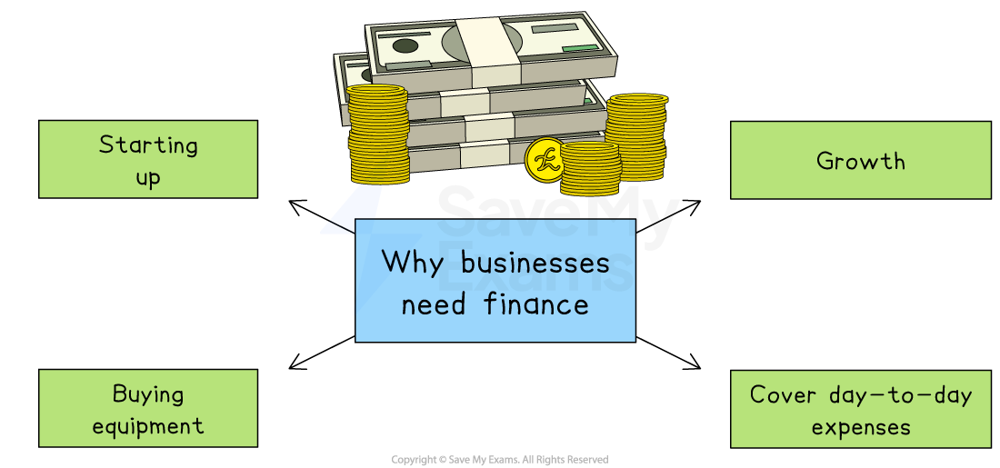

# The Need for Business Finance

## Start-up capital

> **Spec point** — `spcpt_RnSn6H2gtTQzJb8X`

## Start-up capital

- All businesses need finance to **get started**, allow them to** grow, **to fund *capital investments* and their **continuing activity**

*Diagram showing reasons why businesses need finance: starting up, buying equipment, growth, and covering day-to-day expenses.*

- **Start-up capital **is the finance needed by a new business to pay for ***fixed assets*** and ***current assets*** before it can begin trading
- A business usually **estimates the amount of start-up capital they need **in the ***business plan***
- Many small new businesses will get a start-up ***loan*** to cover these initial costs

> **Case Study**
> **Lily’s Local – Starting Up a Retail Clothing Shop**
> 
> Lily plans to open a small clothing shop called *Lily’s Local* in a busy town centre. She will sell affordable fashion aimed at teenagers and young adults.
> 
> 
> 
> - Before she can open her doors to customers, Lily lists her start-up costs
> 
> **Start-up costs for Lily’s Local**
> 
> | **Type of cost** | **Explanation** |
> |---|---|
> | **Premises** | - Lily will need to pay a ***deposit ***and **rent** in advance for the shop unit |
> | **Shop fittings** | - She must install **shelves, rails, mirrors, a counter** and changing rooms |
> | **Stock** | - Initial clothing items must be bought **in bulk** from suppliers |
> | **Insurance** | - Cover for **theft, fire, *****public liability*** and damage to stock or property |
> | **Marketing and signage** | - Lily will pay for **shop signs, flyers, social media adverts** and a basic website |
> | **Technology** | - A ***point-of-sale (POS) system***, card reader and, possibly, a small computer |
> | **Staff costs** | - If hiring part-time help, she will need to **pay wages **and **cover training** |
> | **Utilities connection** | - Setting up **electricity, water, internet** and phone lines |
> | **Legal and professional fees** | - One-time payments for **legal advice**, setting up a business bank account or using an *accountant* |
> 
> - Lily’s start-up costs include both **one-off payments** (like fittings and licences) and **pre-payments** (like rent and stock)
> 
>   - Planning these carefully is vital to avoid running out of cash before the shop opens
> - Once she begins trading, ongoing costs like rent, wages and restocking will become part of her regular *operating expenses*

## Capital for growth

> **Spec point** — `spcpt_hgPyRPvKVQ93Yqqm`

## Capital for growth

- As a business grows more finance may be needed for ***capital expenditure***

  - It may require more equipment, buildings, IT equipment or vehicles, which will allow the business to **increase output**
- If a business wants to grow by **developing a new product**, it will need to spend large amounts of capital on ***research and development*** (R&D)

  - For example. Apple's annual research and development expenses for 2023 were \$29.915 billion
  
    - This represented a 13.96% increase from 2022, with investments in artificial intelligence (AI) and innovation of new products

## Finance to replace fixed assets and invest in new technology

> **Spec point** — `spcpt_Tt696zsPvQ2Vj9vB`

## Finance to replace fixed assets and invest in new technology

- Businesses need finance not just to buy new things, but also to **keep their operations up-to-date**
- Fixed assets like machinery, vehicles, or equipment **wear out or become outdated** over time

  - If they are not replaced
  
    - Production may slow down
    - Maintenance costs may increase
    - Products may become lower quality
  - Replacing old assets helps the business stay efficient and avoid delays
  - However, fixed assets are expensive, so businesses often need ***loans ***or use ***leasing ***to afford them.
- Technology changes quickly, so businesses need to invest regularly in

  - **Modern software** (e.g. for accounts or sales)
  - **Improved machines** (e.g. faster or more accurate equipment)
  - **Digital tools** (e.g. online payment systems or apps)

## Working capital

> **Spec point** — `spcpt_CgRbqHYSQ6N3SvhW` · definition and calculation of working capital

## Working capital

- **Working capital  is the money used in the day-to-day operations of a business**

  - Finance is required for **working capital**, which is spending on raw materials, wages or utilities
- Having a** steady flow of working capital **is essential to keep the business operational

  - Without working capital, the business would be **unable to cover its day-to-day expenses**
  - It may suffer ***cash-flow**** problems* which could lead to business failure

> **Exam Hint**
> Be specific when explaining why finance is needed – link it to clear purposes such as start-up capital, working capital, or expansion, rather than just saying “to run the business”

## Short-term and long-term finance needs

> **Spec point** — `spcpt_WMjDs7rqbPv7XpVD`

## Short-term and long-term finance needs

- Short-term finance needs last **less than one year**

  - Examples include
  
    - Paying for stock or raw materials
    - Paying wages and *utility bills*
    - Covering temporary cash flow problems
    - Paying suppliers or rent
    - Unexpected repairs or inexpensive items of equipment
- Long-term finance needs last for **more than one year**

  - Examples include
  
    - Buying buildings, machinery or vehicles
    - Starting a new business
    - Expanding into new markets or countries
    - Developing new products
    - Replacing outdated equipment or technology
