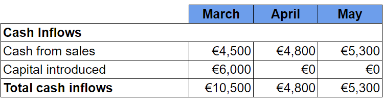
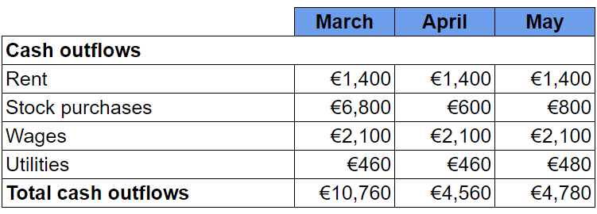
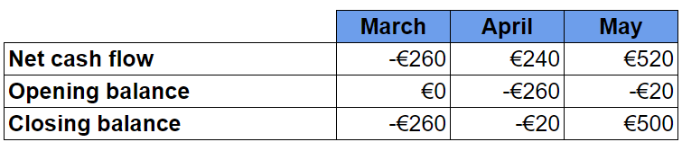
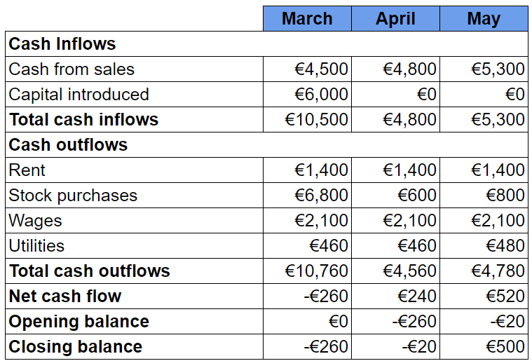

# Completing & Interpreting Cash Flow Forecasts

## Completing cash flow forecasts

> **Spec point** — `spcpt_jpT7FxcdY9B8rbcV` · "amend or complete a simple cash flow forecast
Note: candidates will not be assessed on constructing a cash flow forecast."

## Completing cash flow forecasts

- A business must first **gather information** about **all cash inflows **and **cash outflows** it expects to encounter over the period
- The following steps should then be taken to **construct the cash flow forecast**

### Step 1 – Calculate total cash inflows

- In this instance, the business expects to receive cash inflows from sales in March, April and May
- Owners' capital of €6,000 will be introduced in March
- The total for each month is calculated by adding cash from sales to capital introduced

### Step 2 – Calculate total cash outflows

- In this instance, the business expects to pay rent of €1,400 in March, April and May
- It will purchase a significant amount of stock in March with smaller amounts in April and May
- Wages are expected to be €2,100 in each month
- Utilities of €460 will be paid in March and April, increasing to €480 in May
- Total cash outflows each month is calculated by adding these together

### Step 3 – Calculate net cash flows

- The **net cash flow** is calculated by subtracting total cash outflows from total cash inflows

- In March the net cash flow is €10,500 - €10,760 = €(260)

  - Net cash flow is negative as cash outflows are greater than cash inflows
- In April the net cash flow is €4,800 - €4,560 = €240
- In May the net cash flow is €5,300 - €4,780 = €520

  - In both months, net cash flow is positive as cash inflows are greater than cash outflows

#### Step 4 – Calculate opening and closing balances

- The **opening balance** is the previous month’s closing balance carried forward
- The** closing balance** is calculated by adding the net cash flow to the opening balance

- In March the opening balance of €0 is added to the net cash flow of €(260) to leave a closing balance of €(260)
- In April the closing balance from March is carried forward to become its opening balance of €(260)
- This opening balance is added to April's net cash flow of €240 to leave a closing balance of €(20)
- In May the closing balance from April is carried forward to become its opening balance of €(20)
- This opening balance is added to May's net cash flow of €520 to leave a closing balance of €500

### The complete cash flow forecast

> **Worked Example**
> Here is a simple three-month cash flow forecast for a small seaside café
> 
> | ** ** | **March** | **April ** | **May** |
> |---|---|---|---|
> | **Cash Inflows** |   |   |   |
> | **Sales** | 46,000 | 54,000 | 61,000 |
> | **Cash Outflows** |   |   |   |
> | **Inventory** | 13,000 | 13,000 | 13,000 |
> | **Wages** | 28,000 | 28,000 |   |
> | **Miscellaneous** | 3,500 | 4,000 | 4,000 |
> | **Total Cash Outflows** |   | 45,000 | 48,000 |
> | **Net cash flow** | 1,500 | 9,000 |   |
> | **Opening balance** | 4,000 | 5,500 | 14,500 |
> | **Closing balance** |   | 14,500 | 30,500 |
> 
> Complete the cash flow forecast to show
> 
> a. Total cash outflows for March
> 
> b. Closing balance for March
> 
> c. Wages for May
> 
> d. Net cash flow for May
> 
> (4)
> 
> **Step 1: Add all of March's cash outflows to calculate the total**
> 
> $\mathrm{Total} \mathrm{outflows} \mathrm{for} \mathrm{March}=13,000+28,000+3,500\,\,=44,500$**    ****[1]**
> 
> **Step 2: Add the opening balance to the net cash flow to calculate March's closing balance**
> 
> $\mathrm{Opening} \mathrm{balance}+\mathrm{Net} \mathrm{cash} \mathrm{flow}=\mathrm{Closing} \mathrm{balance}\,\,=4,000+1,500\,\,=5,500\,$**    ****[1]**
> 
> **Step 3: Subtract inventory and miscellaneous outflows from total cash outflows to calculate wages**
> 
> $\mathrm{Wages} \mathrm{for} \mathrm{May}=48,000-13,000-4,000\,\,=31,000$**    ****[1]**
> 
> **Step 4: Subtract total cash outflows from total cash inflows to calculate net cash flow**
> 
> $\mathrm{Total} \mathrm{cash} \mathrm{Inflows}-\mathrm{Total} \mathrm{cash} \mathrm{outflows}=\mathrm{Net} \mathrm{cash} \mathrm{flow}\,\,=61,000-48,000\,\,=13,000$**    ****[1]**

> **Exam Hint**
> Always set out your calculations clearly – show how you worked out inflows, outflows, net cash flow, and balances. Even if your final figure is wrong, you can still gain marks for the working

## Interpreting cash flow forecasts

> **Spec point** — `spcpt_rWJyBtGzM6DR48CD` · interpret a simple cash flow forecast

## Interpreting cash flow forecasts

- Once a cash flow forecast has been constructed, **managers may be able to use it to make financial decisions**

- Overall, this cash flow forecast **supports an application for the business to borrow £6,000** in March to cover the initial low inflows, significant outflows and **negative net cash flow**
- It may also arrange a short-term **overdraft **to cover **negative closing balances** in March and April
- Healthy sales mean that from May, **inflows are greater than outflows** and the business **has a positive net cash flow**

## Overcoming cash flow problems

> **Spec point** — `spcpt_pjb78DZnK9C9YKSm` · "how a short-term cash flow problem may be overcome: overdraft, delaying supplier payments,
asking customers to pay more quickly, delay purchase of non-current assets"

## Overcoming cash flow problems

- The cash flow forecast example above identifies a **cash flow problem** in March and April where the **closing balance is negative**
- It has a range of ways to solve this issue to prevent ***insolvency***

  - The most suitable method may be to arrange a flexible, short-term ***overdraft*** facility with its bank

#### Ways to solve cash flow problems

| **Method** | **Explanation** |
|---|---|
| **Reduce the credit period offered to customers** | - Collecting money owed from customers more quickly    - However, **customers may move to competing businesses** that offer better ***credit terms*** |
| **Ask suppliers for an extended repayment period e.g an extension from 60 to 90 days** | - The business can use cash it would have paid to suppliers for other purposes - Suppliers may be **unwilling** to extend credit terms |
| **Make use of *****overdraft**** ***facilities or short-term loans** | - The business can spend **more money than it has in its bank account** - Banks may be reluctant to lend to businesses with cash-flow problems |
| **Sell off excess stock** | - Less ***liquid*** current assets will be converted into cash - Storage and security **costs may also be reduced** - Stock may need to be **sold at a low price** to attract sales |
| **Sell assets and lease fixed assets instead** | - The business will continue to **have the use of assets** but must make regular payments to the leasing company |
| **Introduce new capital and reduce ***drawings ***from the business** | - New capital may be **introduced by the owner **or from **additional investors** - This may result in the ***dilution of control*** of the business |

- A business can also have **too much cash**

  - If it **holds large amounts of cash,** it may **miss out** on the benefits of investing it in fixed assets or savings
  - This may represent a significant ***opportunity cost*****,*** *especially when interest rates are high
