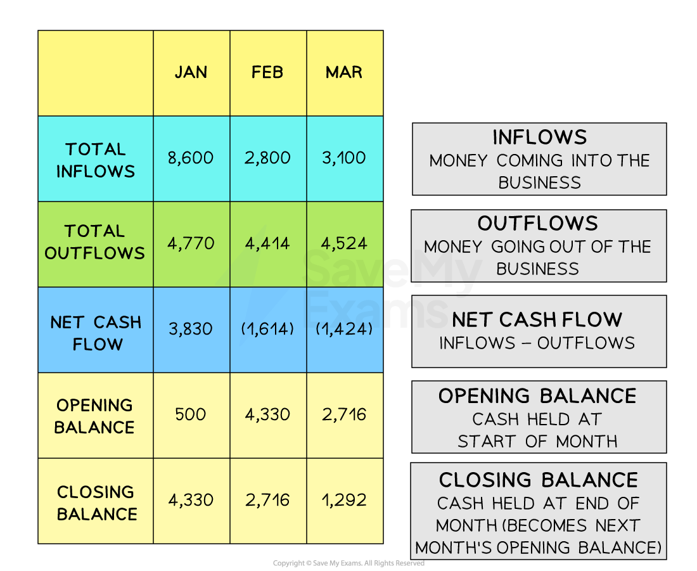

# The Importance of Cash & Cash Flow Forecasts

## Why cash is important

> **Spec point** — `spcpt_868Vb3fSymCf22Yb`

## Why is cash important?

- **Cash is the 'blood' of a business, **as without it, a business cannot survive

  - It is a ***liquid asset***** **in the form of notes, coins and money in the bank

- A new business may have to **pay cash on purchase for all of its supplies** until its suppliers trust them enough to grant *trade credit *

  - A supplier may then give the business 30 or 60 days to pay for items they purchase
  - This means that the business can receive their stock now pay for it later, so the cash outflow is delayed
  - As the business **sells its products**, they receive money generated from the business revenue, which represents **a cash inflow**
  - At the end of the credit period, they pay the supplier **(cash outflow)**, but the firm may still have half of its stock available for sale
- More **established businesses **need to ensure that they manage cash effectively to ensure that they **do not run out of money**

  - Cash-flow issues may put the business in a situation where it is :
  
    - **Unable to pay** key stakeholders, such as workers and suppliers
    
      - **Production is likely to cease,** as workers will not work without pay and suppliers will not supply goods if they are not paid
    - Unable to **pay utility bills and rent**
  - As a result, the business could be forced into ***liquidation*** and is, ultimately, likely to fail

> **Exam Hint**
> Many students confuse **cash, revenue and profit**. Remember: cash is money available to pay bills, revenue is income from sales, and profit is what remains after costs. Keeping these distinct is essential in exams

## Introduction to cash flow forecasts

> **Spec point** — `spcpt_ZKyFsh7Xk2Ws3Mmq`

## Introduction to cash flow forecasts

- A **cash-flow forecast** is a prediction of the expected ***cash inflows*** and  ***cash outflows*****,** typically for the next three, six or twelve-month period

  - **Typical outflows **include payments for raw materials, paying staff wages and *salaries*, paying bills such as electricity and  repaying loans
  - **Typical inflows **include receipts from sales, money received from a new bank loan, money from the sale of an asset and money from investors

*The three month cash-flow forecast clearly shows how inflows and outflows of cash into a business are accounted for*

## Features of cash flow forecasts

> **Spec point** — `spcpt_Mvw2bS4YNh9FPKG4` · "main features of a cash flow forecast: cash inflow, cash outflow, net cash flow, opening balance,
closing balance"

## Features of cash flow forecasts

### Cash inflows

- Cash inflows are sums of **money coming into the business**
- This includes items like **sales revenue**, **loans received** or **money from investors**

### Cash outflows

- Cash outflows are sums of **money leaving the business**
- This includes payments for **rent, wages, stock, bills** or **loan repayments**

### Net cash flow

- Net cash flow is the **difference between cash inflows and cash outflows** in a given period

  - If net cash flow is positive, the business has more cash coming in than going out
  - If it's negative, the business is spending more than it receives
- Net cash flow is calculated using the formula

$\mathrm{Net} \mathrm{cash} \mathrm{flow}=\mathrm{Cash} \mathrm{inflows}-\mathrm{Cash} \mathrm{outflows}$

### Opening balance

- The opening balance is the **amount of cash the business has at the start of a period**, e.g., the beginning of the month
- It is usually the same as the **closing balance from the previous period**

### Closing balance

- The closing balance is the **amount of cash the business has at the end of the period**

  - This figure shows whether the business will have enough money at the end of the month to cover its needs
- The closing balance is calculated using the formula

$\mathrm{Closing} \mathrm{balance}=\mathrm{Opening} \mathrm{balance}+\mathrm{Net} \mathrm{cash} \mathrm{flow}$
