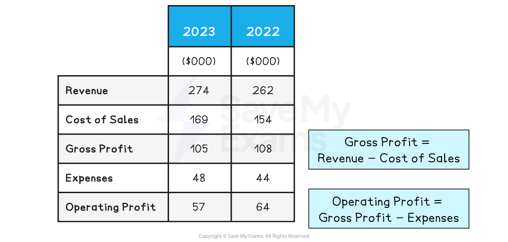

# Statement of Profit or Loss

## Introduction to the statement of profit or loss

> **Spec point** — `spcpt_r84W4JDgZwjXBghp`

## Introduction to the statement of profit or loss

- **A statement of profit or loss records the income and costs of a business incurred over a period of time (usually one year)**

  - The statement is also known as an** income statement**
- Theprofit or loss statement identifies

  - Revenue
  - Cost of sales
  - Gross profit
  - Expenses
  - Operating profit (often known, simply, as profit)
- The extract from the statement for ***Toys and Trikes PLC ***shows figures for both 2022 and 2023, which enables year-on-year comparisons to be made

#### Profit or loss statement for Toys and Trikes Ltd

*The statement of comprehensive income details revenue, costs and expenses over a trading year*

## Features of the statement of profit or loss

> **Spec point** — `spcpt_5ZrtNnt4XjQR8gBK` · "revenue, cost of sales, gross profit, expenses, profit
Note: candidates will not be assessed on constructing statements of profit or loss."

## Features of the statement of profit or loss

### Sales revenue

- **This is money generated through selling goods and services**

  - Calculated by **Price x Quantity**

> **Worked Example**
> In 2023, Toys and Trikes Ltd earned sales revenue of \$274,000, up from \$262,000 in 2022
> 
> Revenue increased by \$8,000 between 2022 and 2023
> 
> This may be due to **increased sales** volume,** higher prices** or a **combination** of the two

### Cost of sales

- **The cost of producing or buying in the goods sold by the business during a time period**

  - They include the costs of raw materials, components, labour and packaging used to produce goods

> **Worked Example**
> In 2023, Toys and Trikes Ltd's cost of sales was \$169,000, which included materials and labour. In 2022, its cost of sales was \$154,000
> 
> Cost of sales increased by \$15,000 between 2022 and 2023
> 
> This may be due to **suppliers increasing prices**, buying **better quality supplies** or increased **wastage**

### Gross profit

- **Gross profit is made when revenue is greater than the cost of sales**

  - Calculated by **Sales revenue - Cost of sales**

> **Worked Example**
> Gross profit for Toys and Trikes Ltd in 2023 was therefore
> 
> `equals space $ 274 comma 000 space minus space $ 169 comma 000 space
> 
> equals space $ 105 comma 000`
> 
> This is a decrease of \$3,000 since 2022, when gross profit was \$108,000

### Expenses

- **Expenses are all of the other costs incurred by a business that are not directly related to each unit of output**

  - Examples include rent, salaries and utilities

> **Worked Example**
> In 2023, Toys and Trikes Ltd's expenses were \$48,000, compared to \$44,000 in 2022
> 
> Expenses increased by \$4,000 between 2022 and 2023
> 
> This may be as a result of **increased salaries**, **higher utilities costs** or **rent increases**

### Operating profit

- **This is profit made by a business after all costs have been deducted from revenue**

  - Calculated by **Gross profit - Expenses**

> **Worked Example**
> Operating profit for Toys and Trikes Ltd in 2023 was therefore
> 
> `equals space $ 105 comma 000 space minus space $ 48 comma 000 space
> 
> equals space $ 57 comma 000`
> 
> This is a decrease of \$7,000 since 2022, when operating profit was \$64,000

## Decisions based on the statement of profit or loss

> **Spec point** — `spcpt_KnWpCrFSwGvSmRq2`

## Decisions based on the statement of profit or loss

- **Profit or loss statements **inform managers whether the business is making a profit or loss

  - They allow the comparison of performance to previous years, **aid with future forecasts **and can be used to make comparisons with competitors
- Finance managers are able to** interrogate the data **in order to make beneficial changes or set new strategic objectives

> **Case Study**
> **Chillie's Cafe**
> 
> Chillie's cafe sells cold drinks during the summer season in central Berlin.Its two best-selling products are bubble tea and smoothies
> 
> 
> 
> - Although Chillie's sells bubble tea drinks at a higher price, **smoothies are more profitable** for the business
> 
>   - Fewer bubble tea drinks than smoothies are sold, so **revenue is lower**
>   - The **cost of sales** of bubble tea are higher than those for smoothies

### If the business is making a profit

- **Is the profit higher or lower than last year?**

  - **If higher, what has the business done that could have led to this?**
  
    - For example, finding a cheaper supplier of raw materials or increasing sales due to a new promotional campaign
  - **If lower, why is profit falling? **
  
    - Have costs increased, such as higher energy bills for the premises, or have sales fallen due to a new competitor entering the market?
  - **Is the profit higher or lower than that of competitors?**
  
    - If lower, what can be done to become as profitable as other businesses?
    - For example, does the business need to improve the quality of the products or increase the ***product portfolio***?

### If the business is making a loss

- **Is this a short-term or long-term problem?**

  - Lower profits may be a result of an external shock affecting all businesses, such as the 2020 Covid pandemic, in which many businesses had to close or reduce working hours
  - **Some losses may be more long-term**
  
    - For example, ecommerce growth has led to many high-street stores closing down as the number of customers has dwindled
  - **Are competitors making losses?**
  
    - If they are, the business needs to consider whether the industry is changing to the point that it may become extinct
    - Alternatively, it needs to ask tough questions about what can be done to evolve with changing market conditions

> **Exam Hint**
> When interpreting a profit and loss statement, go beyond the figures – explain what they reveal about the business’s performance, such as rising expenses reducing profitability
